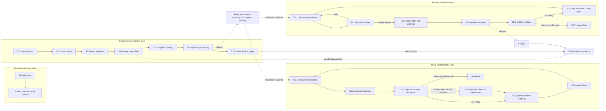
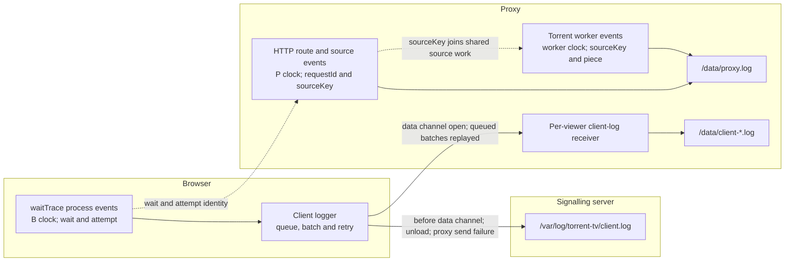
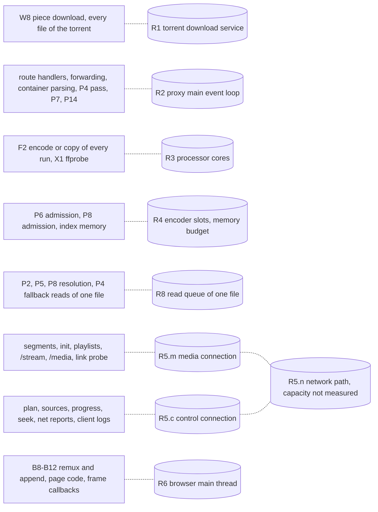
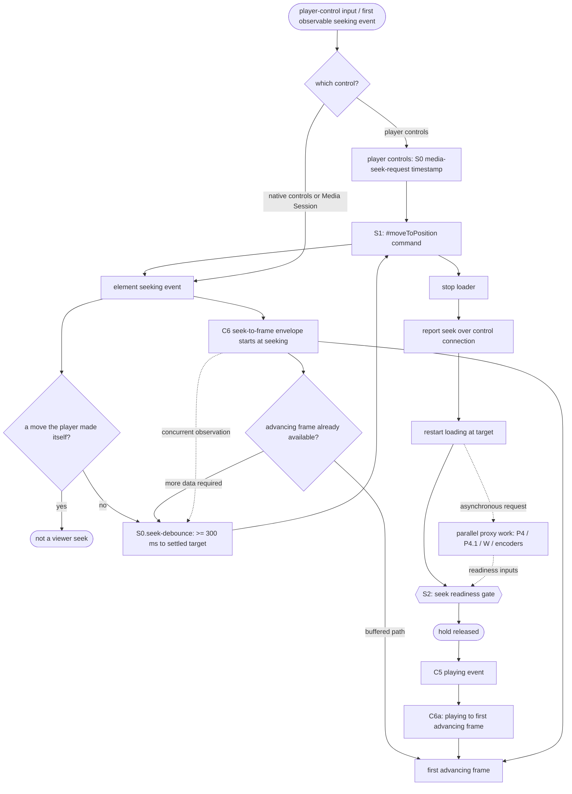

# First-frame wait: process model

This document describes the wait between a viewer's action and the first
presented frame as a set of atomic processes taken from the current code, with
their dependencies, alternatives, parallelism and shared resources
(torrent-tv/meta#185, plan step 3.3.4). It describes what the code does. Timing examples are observations, not estimates; this document changes no formula. Read from server `2645345`
(0.50.32), proxy `2ac8c25` (2.101.43), and the libraries they install:
hls.js 1.7.3 (server `package-lock.json`) and WebTorrent 2.8.5 (proxy
`package.json`).

This revision applies the review in torrent-tv/meta#185 (comment
6285126911); section 11 lists what changed against proxy `7b646fe`.
Section 13 describes the additional opt-in observations introduced for actual
startup validation; the historical observability table in section 8 refers to
the source revisions above.

A measured stage has one owner (host and thread or child process), one start
event, one end event and one kind of work. A stage that runs once per output,
per media stream or per request is written with a suffix: `.v` for the picture
output and main HLS stream, `.a` for a soundtrack served as its own output and
stream. A code path that contains several stages is a parent envelope, not an
atomic stage. Child stages are listed only where the code exposes their own
boundaries; work with no observable boundary is named as an unresolved
measurement gap instead of being presented as an atomic duration.

## 1. Events, clocks and outcomes

1. `t0` — the original action, on the browser's monotonic clock.
   1. Single-file `.torrent`, or a file named by the address: the open action.
      `#processPlayback` takes `payload.startedAt` and dispatches `FILE_CHOSEN`
      with `originalOpen: true`.
   2. Multi-file torrent: the file choice. The time spent choosing is not part
      of the wait.
   3. Seek: player controls are timestamped at `media-seek-request`;
      `#onMediaSeekRequest` starts trace `S0` and calls `#moveToPosition`.
      Native controls and Media Session expose no physical-input timestamp:
      `S0` starts at the first element `seeking` event, then measures the
      debounce until `#moveToPosition`. `S1` measures the seek command;
      `S2` measures the readiness hold through its release. All three use
      the browser monotonic clock and share one wait and attempt identity.
      The time from a native physical input to its first `seeking` event is
      unavailable (section 9).
   4. Soundtrack or quality change: the moment the page takes its hold
      (`#holdForAudio`, `#cushionHeld`); its distance from the viewer's click
      is not traced here.
   `waiting.js` logs every start as `[wait-start] wait=<n> startedAt=<ms>`.
2. `t1`–`t4` — the browser's coarse marks in `#playVideoFile` and
   `#waitForPrebuffer`, logged as `[evt] cold-start total= transport= plan=
   prepare= prebuffer=`. Section 6 states what each interval contains, and
   when `t0` of these marks differs from the wait's `t0`.
3. `tFrame` — the first `requestVideoFrameCallback` with `presentedFrames > 0`
   after the element's `playing` event (`player.js`
   `#watchFirstPresentedFrame`, logged `[first-frame]`). Observation stops at
   this one callback.
4. `audioReady` — computed once, at `tFrame`, from the audio buffered ranges at
   that media time (`loading.js` `#onFirstPresentedFrame`, logged
   `[first-frame-observation] … audioReady=`). When it is `false` nothing
   continues to observe until the sound is ready.
5. `tPlay` as torrent-tv/meta#185 defines it — the first presented *moving*
   frame with the required audio — is **not** produced by the code: no event
   confirms that `mediaTime` advanced between frames, and a frame without its
   required audio ends the observation. `tFrame` with `audioReady=true` is the
   nearest logged event; it is not proof of `tPlay`.
6. Outcomes of a wait, each distinct:
   1. frame observed with `audioReady=true`;
   2. frame observed with `audioReady=false`;
   3. paused: the viewer had stopped, the state goes to `PAUSED` and `play()`
      is not called;
   4. waiting for the viewer: the local-network permission click (A2.4) or a
      refused autoplay (C5);
   5. cancelled: a newer action, the viewer's stop or the page closing ends
      every browser process of the attempt (`#throwIfCancelled`, epoch check);
   6. error: a refusal, `media-continuity-unavailable`, a failed output
      (`state: "failed"`), or a transport loss that is not recovered.
7. Browser times use `performance.now()` from `t0`. Proxy durations use the
   proxy's clock. A browser time and a proxy time are never subtracted from
   each other; they are joined by identifiers (section 8).

## 2. Notation

1. **Completion order** (`X --> Y` in the diagram): Y cannot complete before X
   completes.
2. **Conditional edge** (`X -- condition --> Y`): the same, present only while
   the condition holds. Edges leaving one branch point carry mutually
   exclusive conditions.
3. A process completes after every edge that is present into it; alternatives
   exist only through conditions. The processes of a branch that is not taken
   do not exist, and neither do their edges. Work already done costs nothing
   and appears as the branch that skips it.
4. **Start without waiting** (`X -.-> Y`): X starts Y or states a demand to it
   and continues.
5. **Polled gate input** (`X ==> Y`): X is read by the browser's polling of
   gate Y, so Y sees it at the next poll.
6. **Shared resource**: processes that take service from one capacity at the
   same time (section 4). Their service is not additive.
7. **Atomic stage**: one operation or one wait with one owner, one clock, and
   directly recorded start and end events. A parent envelope that contains
   child stages is for end-to-end comparison only; it is not another stage and
   is never added to its children.

## 3. Processes

### 3.1 Browser: action, connection, plan

| ID | Process | Starts after | Ends when | Edge to caller |
|---|---|---|---|---|
| A0 | Original action (`t0`) | viewer | action accepted | — |
| A0.0 | Address containing base64 torrent bytes: decode the address and construct the File (`Torrent.#loadFromUrl`). Local file input skips this step | A0 | File exists | blocking for A0.1 |
| A0.1 | Read the selected `.torrent` (`Torrent.#processIncomingFiles`, `File.arrayBuffer`) | A0 | bytes available in the page | blocking for A0.2 |
| A0.2 | Decode bencode and derive the info hash (`parseTorrentBytes`); the SHA-1 call is asynchronous (`crypto.subtle.digest`) | A0.1 | parsed metadata and hash available; `FILE_DETAILS_READY` dispatched | blocking for A1 |
| A1 | Store the already parsed source details (`openParsedTorrentDetails`, synchronous), and dispatch `FILE_CHOSEN` when the file is already determined | A0.2 | source details stored | blocking |
| A2 | Connect (`#acquireTransport` → `ProxySelector.chooseBestProxy`), made of A2.1–A2.3. Joins the connect `#connectEarly` started at page load and costs nothing when that has finished. Limits: 12 s public-only, 5 s on the same network, 30 s overall | A1 | A2.3 ends | blocking |
| A2.1 | Ask the server which proxy (`POST /api/proxy-clients/choose`) | A2 | answer | blocking |
| A2.2 | Media connection signalling: WebSocket `/ws/browser-signal`, session, SDP offer, answer relayed by the server, answer applied (`setRemoteDescription`, buffered candidates added) | A2.1 | answer applied | blocking |
| A2.2m | Media connection transport: ICE, DTLS, SCTP, media data channel open | A2.2 | media channel open | parallel with A2.2c |
| A2.2c | Control connection. With `separateControl: 2` in the answer (proxy `webrtc-manager.js`) it is started while the answer is processed (`#openSeparateControl`) and has its own WebSocket signalling, offer/answer, ICE, DTLS and SCTP (`ControlConnection`). Without it, a control channel is opened on the media connection (`#openLegacyControl`) | A2.2 | control channel open | parallel with A2.2m |
| A2.J | Both ready: `#settleConnected` requires the answer applied, the media channel open and, with a separate control connection, its channel open | A2.2m, A2.2c | `connect()` resolves | blocking |
| A2.3 | Liveness ping (`proxy.ping()`): waits for the control link, then sends on the control channel (`#controlChannelFor`) | A2.J | pong | blocking |
| A2.4 | Branch: the public-only attempt fails in A2.2m, A2.2c, A2.J or A2.3 → local-network permission (one viewer click) → A2.1–A2.3 again with private candidates | the failure | second connection ready | blocking; outcome 4 while waiting |
| A2.5 | Link probe (`measureLink`) over the media connection, after the connection is adopted | A2.3 | probe answered | start without waiting |
| A3 | Ask for the proxy that holds this film (`#useProxyThatHoldsTheFilm`, `POST /choose` with the info hash) | A2 | answer | blocking |
| A3r | Branch: move → close, connect to the named proxy (A2 steps) | A3 | connected | blocking |
| A4 | Register the source (`POST /api/sources`; cached per transport; the proxy only records it) | A3 or A3r | `sourceKey` | blocking |
| A5 | Early estimate (`GET /api/sources/:key/stats`, 1 s limit; single file only) | A4 | answer or abort | start without waiting |
| A6 | File list (`GET /api/sources/:key/files`, again every 2 s while the answer is pending); its answer waits for P1 | A4 | statement of the files | blocking |
| A7 | Branch: several videos and none named → playlist; the choice is a new `t0` | A6 | choice | — |
| A8 | Warm-up registration (`#warmSourceInBackground`) | A6; again before A12 | registered | start without waiting |
| A9 | Filename capacity hint (`#preferProxyFromFilename`, `POST /api/proxy-clients/can-serve`; the server asks every proxy over its tunnel) | A6 or A7 | answer | blocking |
| A9r | Branch: other proxies report capacity → the pool is restricted and the connection closed; the connect at A10 is made within that pool | A9 | connected | blocking |
| A10 | Acquire the current transport, record `t1`, then `registerSourceOnProxy` (cached unless the proxy changed) | A9 or A9r | source registered; registration after `t1` belongs to the coarse plan interval | blocking |
| A11 | Source statistics poll, every 2 s while A12 runs | A10 | A12 ends | start without waiting |
| A12 | Playback plan (`POST /api/playback-plan`, `waitForReady: true`); answered after P3 | A10 | plan received (`t2`) | blocking |
| A13 | Fingerprint, container metadata, sidecar soundtrack metadata requests | A12 | answers | start without waiting |
| A14 | Report the opening subtitle track (`#startSubtitlesForVideo`) | A12 | report sent | start without waiting; read by C3 |
| A15 | Codec support (`#predictCodecSupport`, MediaCapabilities) | A12 | verdict | blocking |
| A16 | Branch: `cannotServe` → `POST /can-serve` → `#playVideoFile` again from A9 on the proxies that answered; plan and output start from nothing there | A15 | — | blocking |
| A17 | Branch: HTTP transport → direct-play probe (`#tryPlayDirectUrl`); success leaves this model. The WebRTC transport skips it | A15 | probe result | blocking |

### 3.2 Browser: output and HLS loading

| ID | Process | Starts after | Ends when | Edge to caller |
|---|---|---|---|---|
| B1 | Open the picture output (`POST /api/transcode-sessions`): answered after P6.v; the route itself waits and opens again on the next storage change when the open reports missing bytes (`MEDIA_BYTES_UNAVAILABLE`, `waitForPlan`). Repeated after a "warming up" 500 with `min(3000, 500 + 250·n)` ms; 409 `no-capacity` → the A16 path | A15 | session answer | blocking |
| B2 | Net reporter (every 1.5 s, at once on `reportNow`) and session keep-alive started | B1 | session released | start without waiting |
| B3 | Media playlist wait (`waitForHlsPlaylist`); a synthetic VOD playlist answers at once, otherwise retry with `min(3000, 500 + 250·n)` ms | B1 | playlist with `#EXTINF` | blocking |
| B4 | Restate a position changed during allocation (`reportSeek` loop) | B3 | position acknowledged | blocking (normally no iteration) |
| B5 | hls.js: request and read the master or direct media playlist, parse it, then select the level and start loading. The request, parse, and optional selected-level playlist now have separate measured spans | B4 | `startLoad` called | blocking |
| B5.level | When B5 loads a master playlist, request and process the selected media playlist | B5 | `LEVEL_LOADED` | blocking only for a master playlist; a direct media playlist skips this request |
| B6.v | Main stream init request (fMP4 only: `#EXT-X-MAP`); held by the proxy until P13.v, then P12.v. An MPEG-TS output has no init file (`mpegtsFormat.initFileName` is null, no `#EXT-X-MAP`), so this request does not exist | B5 | init bytes received | per stream |
| B6.a.p | Separate soundtrack: playlist request. Answered from the base output (`resolveAudioRenditionFile` returns `base.id` for a playlist); it creates no output | B5 | playlist received | per stream |
| B6.a.i | Separate soundtrack: init request (fMP4 only). The first init or segment request of the soundtrack is what opens P6.a; held until P13.a | B6.a.p | init bytes received | per stream |
| B7.v / B7.a | First fragment request of the stream, held until its piece is published (P11) or answered at once when it already is. For an MPEG-TS soundtrack this is the request that opens P6.a | B6 of the stream (fMP4) or its playlist (MPEG-TS) | fragment bytes received | per stream |
| B8.v / B8.a | Parse/remux a loaded fragment. fMP4: `MP4Demuxer` + `PassThroughRemuxer`, whose `remux` returns the init only together with a fragment that has samples. MPEG-TS: `TSDemuxer` + `MP4Remuxer`, which builds the track description and init from the first fragment's samples (`generateIS` inside `remux`). The measured span is `FRAG_LOADED` → matching `FRAG_PARSED`; `BUFFER_CODECS` is a separate point event | B6 (fMP4) and B7 of the stream | event raised | per stream |
| B9 | Create required SourceBuffers; this can overlap B8 parsing, and `BUFFER_CREATED` can precede a later per-track `BUFFER_CODECS` event | first codec declaration for a created track | buffers exist | blocking |
| B10.v / B10.a | Init append to the stream's SourceBuffer | B9 | matching hls.js `BUFFER_APPENDED` acknowledgement (emitted after the append completes) | per buffer |
| B11 | `t3`: `readyState >= HAVE_METADATA` (`#ensureVideoReady`, no decoded frame required). Under Media Source this follows the init of every SourceBuffer. A progress poll runs every 1 s meanwhile | every present B10 | `loadedmetadata` | blocking |
| B12.v / B12.a | First fragment append | B10 of the stream | matching hls.js `BUFFER_APPENDED` acknowledgement (emitted after the append completes) | per buffer |

Because hls.js produces a stream's buffer description only from its first
fragment, in fMP4 and in MPEG-TS, `t3` follows the production and delivery of
the first fragment of every required stream, whichever way the proxy makes the
init (P13).

The segment format belongs to the base output and to its soundtrack outputs.
It is fMP4 by default (`DEFAULT_SEGMENT_FORMAT_ID`, `--segment-format`). The
page asks for MPEG-TS when a soundtrack it copies cannot be appended from fMP4
but can from MPEG-TS (`#requiredSegmentFormat`, `canAppendCopiedAudio`; copied
MP3 is the case its comment names); the proxy also uses MPEG-TS when started
with `--segment-format mpegts`.

### 3.3 Browser: readiness gate and presentation

| ID | Process | Starts after | Ends when | Edge to caller |
|---|---|---|---|---|
| C1 | Prebuffer-gate envelope (`#waitForPrebuffer`); group duration only, not an atomic stage. Its repeated actions are C1.1–C1.6 below | B11 | release | contains parallel waits and repeated actions |
| C2 | Net report delivered over the control connection: buffered ranges per track, position, link samples | B2, `reportNow` | proxy records the reading | gate input to P14 |
| C3 | Subtitle hold (`subtitleStartHold`): a ready answer requested before the proxy knew the opening subtitle track is not taken; a separate span starts at the first pending gate check and ends when a later answer releases it | A14 | proxy states the track read | part of C1; separate C3 span is nested in the C1 gate |
| C4 | Application state on `PLAYBACK_READY`: `ADVANCING`, or `PAUSED` when the viewer had stopped (outcome 3) | C1 | state published | blocking |
| C5 | `video.play()` → `playing`. Branch: autoplay refused → waits for a viewer gesture (outcome 4) | C4 (`ADVANCING`) | `playing` | blocking |
| C6 | Presentation envelope from the first `seeking` event (seek) or `playing` event (initial open) until the first advancing frame (`tFrame`); group duration only, not an atomic stage | S0 seek event / C5 | callback | contains frame observation and may finish before seek debounce or load control |
| C6a | On a seek where `playing` precedes `tFrame`, `playing` → first advancing frame. Nested inside C6; absent when the frame advances before `playing` | C5 | `C6.frame-presentation-tail` span | blocking for the first frame; separately exposes the final presentation delay |
| C7 | `audioReady` at `tFrame`'s media time (outcome 1 or 2) | C6 | logged | observation |

### 3.7 Browser: atomic seek actions and gate waits

`S1` and `S2` remain parent envelopes for comparison with the action-to-frame
timeline. They are not atomic stages and must not be added to their child
durations. Each row below is one browser operation or one explicit wait between
observable events. `C1` uses the same rule: its loop is an envelope; only its
measured child actions are stages.

| ID | Atomic action | Starts | Ends | Relation |
|---|---|---|---|---|
| S1.1 | Record the requested seek target in loading state | `#moveToPosition` after input validation | target fields recorded | synchronous browser work |
| S1.2 | Write the requested position to browser history | after S1.1 | `#writeHistory()` returns | synchronous browser work |
| S1.3 | Reset the browser readiness model for the new position | after S1.2 | `#waitingModel.reset()` returns | synchronous browser work |
| S1.4 | Acquire the seek hold while playback is live | before changing the HLS position | `#holds.beginSeek()` returns; absent if playback is not live | gate ownership |
| S1.5 | Stop HLS loading | `SeekPosition.move` calls `stopLoad` | `#hlsPlayer.stopLoad()` returns | precedes B4 and S1.6 |
| B4 | Send the target position to the proxy | after S1.5 | seek request response or error | separately timed HTTP operation |
| S1.6 | Restart HLS loading at the target | successful B4 response | `#hlsPlayer.seekTo()` returns | only for the current seek revision |
| S2.1 | Read proxy readiness | each `#holdSeekUntilReady` poll begins | progress response, error or cancellation | repeated request; overlaps proxy work |
| S2.2 | Evaluate whether that response can release this seek | after S2.1 | `seekHoldAnswer()` returns | immediate decision; a stale answer starts another poll |
| S2.3 | Read the current browser buffer and calculate the displayed wait estimate | after a usable S2.1 response | buffer and estimate values are available | synchronous browser work |
| S2.4 | Update the browser readiness model | after S2.3 | `#waitingModel.update()` returns | synchronous browser work |
| S2.5 | Publish current transcode readings to the page | after S2.4 | `#publishTranscodeMeasurements()` returns | synchronous browser work |
| S2.6 | Wait for media arrival or the next readiness poll | after an unread or not-ready response | `seeked`, `canplay`, timeout or cancellation | repeated event/timer wait |
| S2.7 | Release the seek hold | readiness loop ends | `#holds.releaseSeek()` returns | terminal action for S2 |
| C1.1 | Read proxy readiness during initial prebuffer | each due progress poll | progress response or error | repeats every 1.5 s, or after buffer growth |
| C1.2 | Evaluate readiness from the latest proxy response, subtitle state and browser buffer | after C1.1 or on a gate iteration using cached data | readiness input is formed | synchronous browser decision |
| C1.3 | Update the browser readiness model | after C1.2 | `#waitingModel.update()` returns | synchronous browser work |
| C1.4 | Resume HLS loading at the buffered end after a four-second stall | stall threshold reached | `resumeLoadAt()` returns | conditional action |
| C1.5 | Publish the current download, transcode and readiness measurements to the page | after C1.3 | `PROXY_EVENTS.MEASURED` dispatch returns | synchronous browser work |
| C1.6 | Wait for the next prebuffer-gate check | after an unsuccessful gate iteration | 250 ms timer fires or wait is cancelled | repeated timer wait |

### 3.4 Proxy main thread

One Node.js event loop runs every route handler, the data-channel forwarding
(`transport/data-channel-handler.js`, through loopback HTTP), container
parsing, the download map pass, the readiness forecast and encoder
orchestration. The torrent runs in one worker thread
(`torrent/worker/client.js`); FFmpeg and ffprobe run as child processes.

| ID | Process | Starts after | Ends when | Edge |
|---|---|---|---|---|
| P1 | Torrent ready (`torrentPool.getTorrent`): the main-thread side of W1–W6 | A6 or A12, whichever asks first | `ready` | blocking for A6, A12 |
| P2 | Container declarations (`readDeclarations`, `declaredTracksOf` → `ContainerOrchestrator.inspect`, statements `tracks`, `media-info`). Each read waits in the file's read queue (R8). The container is chosen by sniffing 16 bytes (`ContainerFactory.create`): Matroska, MP4, AVI, MPEG-TS, ASF and MPEG-PS are parsed on this thread; anything else is read by X1. Strict reads: missing bytes return `needs-ranges`, which is stated to the download map; missing index memory returns `needs-memory`. The plan route reads again on every storage change (`getReadyPlan` → `waitForPlan`) | P1 | codecs and duration known | blocking for A12 |
| P3 | Plan completion: sidecar soundtrack headers (`buildInventory`), subtitle defaults, cache; the offer (`offeredHeights`, `cannotServe`) on the way out | P2 | plan answered | blocking for A12 |
| P4 | Download map pass (`DownloadMaps.resolvePlayback`, proxy `server.js`): on each change of demand, the source byte ranges of every unresolved segment of every watched output (`directSegmentInput` / `PacketIndex.inputFor`, or reads through R8), recorded in `SegmentInputTable`, the priority map published to the worker; yields between zones | any demand change | pass ends | repeated; feeds W7 and P14 |
| P4.1 | Resolve one demanded segment's source ranges: select its required track IDs and source interval, use the direct source index or the container/packet-index read path, and register the ranges for the forecast. Repeated for unresolved segments inside P4; its interval is included in P4 | unresolved zone after the pass yields | ranges registered, input unavailable, or resolution fails | sequential substep of P4; R8 reads overlap its measured duration |
| P5 | Keyframe index (`KeyframeTables`; warmed during P2 by `warmKeyframeIndex`, read through R8 by `getKeyframeIndex`). A missing range is stated to the map like any read (`onReadResult` → `downloadMaps.metadata`); the table is read again when pieces arrive (`readAgainIfUnanswered`). Required only when the video is copied | P2 (warm), B1 | table answered | blocking for P6.v (copy) |
| P6.v | Picture output open (`OutputOpening.open`): media info from the plan, file length, P5 for a copy, cut grid and timeline, capacity admission (`admitsWatching`), viewer placed; answered before any segment exists | B1 | output returned | blocking for B1 |
| P6.a | Soundtrack output open (`#resolveAudioRenditionSession`): on the soundtrack's first init request (fMP4) or first segment request (MPEG-TS) through `resolveAudioRenditionFile`; earlier when the `…/a/:track/warm` route (`prepareAudioTrack`) asks for it, which the page uses for a soundtrack change and to restate its soundtrack after a reconnect. A playlist request does not open it | B6.a.i, B7.a or the warm route, whichever comes first | output returned | blocking for that request |
| P7.v / P7.a | Encoder plan (`planEncodersSoon` → microtask → `planEncodersNow` → `encodeOrchestrator.reconcile`), run again after each output opens and after each seek; it reads each output's priority map, built from where its viewers stand (`PriorityOrchestrator.mapForOutput`, not the P4 pass), and the host's capacity | P6 of the output, a seek | that output's runs decided | blocking for P8 of the output |
| P8.v / P8.a | Run input (`EncodeInputs`): input ranges of the run's first segments (reads through R8), wait until those bytes are held (W9), memory admission, copy of the held bytes. A copy may continue while the run opens (`deferredBytes`) | P7 of the output | input admitted | blocking for F1 |
| P11.v / P11.a | Piece closure: FFmpeg names the closed piece on its fourth descriptor, completeness judged (`encode/piece-completeness.js`), published in `SegmentStore` | F2 of the output | published | blocking for P12 |
| P13.v / P13.a | Init readable; fMP4 only. Alternatives: written by FFmpeg at the run's start; or, for an output cut at given times (`cutsAtGivenTimes`), lifted from the first produced piece (`#initFromFirstSegment`); or already kept by `SegmentStore` / readable from a published piece when the output was made before | F1 or P11 of the output, or nothing (exactly one) | init readable | blocking for B6 |
| P12.v / P12.a | Held request answered (`SegmentServing`) and streamed through the data-channel handler | P11 or P13 of the output, or the piece already published | response sent | blocking for B6 (fMP4), B7 |
| P14 | Readiness forecast on each progress request (`getSessionProgress` → `#playbackReadinessFor` → `predictPlaybackReadiness`): worker statistics (W10), segment inputs from `SegmentInputTable`, rates, client ranges (C2) | progress request | answer | gate input to C1 |
| P15 | Early estimate (`waitEstimateForFile` / `waitEstimateForSource` → `LocalObservations.firstFrameSeconds`) | A5, A6, A11, P14 | value or null | observer |

### 3.5 Child processes

| ID | Process | Starts after | Ends when | Edge |
|---|---|---|---|---|
| X1 | ffprobe (`probe-packets.js`) for a container the sniff does not recognise (`FfprobeContainer`): reads the file over loopback `/media`, which serves held bytes only; a missing byte aborts the probe as `needs-ranges` | P2 | streams or packets listed | blocking for P2 |
| F1.v / F1.a | Deliver the run's first input bytes to FFmpeg, by loopback HTTP (`/encode-input/:token/:fileIndex` or `/stream`) or admitted input on `stdin` | P8 of the output | first input bytes successfully handed to FFmpeg by the proxy | blocking for F2 |
| F2.v / F2.a | Encode or copy the first piece up to its cut | F1 of the output | first output piece closed | blocking for P11 |

### 3.6 Torrent worker thread and swarm (WebTorrent 2.8.5)

| ID | Process | Starts after | Ends when | Edge |
|---|---|---|---|---|
| W1 | Add source and wait until the torrent is ready (`pool.getTorrent`) | ADD_SOURCE begins | ready torrent or error | parent wait for P1; overlaps W2–W6 |
| W2 | Peer discovery started (`_startDiscovery`: trackers, DHT). Magnet: at listening, before the metadata. `.torrent`: inside `_onStore`, immediately before `ready` | W1 (magnet) or W6 (`.torrent`) | discovery running | blocking for W3 |
| W3 | Peer connections and handshakes | W2 | a peer serving | blocking for W4, W8 |
| W4 | Metadata from peers (`ut_metadata`); magnet only | W3 | `metadata` | blocking for W5 |
| W5 | Verification of stored pieces; no work when every file is whole (`skipVerify`) | W1 (`.torrent`) or W4 (magnet) | verified | blocking for W6 |
| W6 | Store ready (`_onStore`) → `ready` | W5 | `ready` | blocking for P1 |
| W7 | Piece selection from the published priority map (`SwarmSelection`) | P4 | selection applied | blocking for W8 |
| W8 | Piece download, one service per torrent | W3, W7 | piece received | shared resource R1 |
| W9 | Piece verification and storage (shared memory, spill to disk); the main thread is told the held bytes changed | W8 | piece readable | blocking for P2, P5, P8, X1 |
| W10 | File statistics and per-piece arrival forecast (`getFileStats`, `downloadForecast`) | a statistics request, P14 | answer | blocking for P14 |

## 4. Shared resources

| ID | Resource | Who takes service from it | What is established | What is not established |
|---|---|---|---|---|
| R1 | Download service of one torrent | W8 for every file and output of that torrent | Bytes are fetched once; the priority map orders them | — |
| R2 | Proxy main event loop | all route handlers, P2–P8, P11–P15, data-channel forwarding | A long synchronous step delays every response; field23: an `onSend`→`finish` gap of 33.875 s overlapped a 33.862 s map pass (research `wait-estimate-2026-10-19-ttv185.md`) | queueing per response, except the loop delay in `[net-debug] sent` |
| R3 | Processor cores | F2 of every run, X1, R2, the worker | Measured per-piece speeds include the sharing at the time they were taken | the split between runs at a future moment |
| R4 | Encoder slots and the memory budget (`MachineBudget`, `EncodeInputs`) | P6 admission, P8 admission, P2/P5 index memory (`needs-memory`) | A wait for memory delays the read or the run | — |
| R5.m | Media connection (one `RTCPeerConnection`) | segments, init, playlists, `/stream`, `/media`, link probe, subtitles, covers (`isBulkPath`) | The proxy forwards each request on its own (`forwardRequest` per `requestId`) and sends chunks with backpressure; responses can be in flight together | that transfers are serial; the forecast's single link queue (`transferFinish` in `predictPlaybackReadiness`) is an assumption of the calculation |
| R5.c | Control connection (a second `RTCPeerConnection` when `separateControl: 2`) | plan, sources, progress, seek, net reports, client logs | It does not carry segments | its effect on R5.m's rate; whether the two directions limit each other |
| R5.n | The network path between viewer and proxy | R5.m and R5.c | — | its capacity; the link probe measures only R5.m |
| R6 | Browser main thread | hls.js remux and append, page code, frame callbacks | browser `PerformanceObserver` long-task entry | point event with task start and duration; shorter work is not measured |
| R7 | Proxy disk | piece spill, segment files, original-input copies | — | not measured as a service |
| R8 | Read queue of one file (`ContainerOrchestrator.inspect`, `#reads`) | P2, P4 (fallback reads), P5, P8 resolution | Reads of one file run one after another; a statement answerable from what was already read is answered beside the queue | P2/P5/X1 source events and P8 input records carry queue and read durations |

## 5. Branch points

1. Magnet or `.torrent` (W2–W5 order, section 3.6).
2. Whole files on disk: W5 does no work; W8 is not needed for their bytes.
3. Connection already made by `#connectEarly`: A2 costs nothing.
4. Public-only attempt fails: A2.4, waiting for the viewer.
5. `separateControl: 2`: A2.2c is a separate connection (R5.c) built in
   parallel with A2.2m; otherwise the control channel is on the media
   connection.
6. A better proxy holds the film (A3r) or the pool is restricted by the
   filename (A9r).
7. Several videos: a new `t0` at the choice (A7).
8. Container recognised by sniffing or read by ffprobe (X1).
9. `needs-ranges` or `needs-memory`: the read is repeated on the storage or
   memory change; it is not a terminal answer.
10. `cannotServe` (A16) or 409 `no-capacity` (B1): `#playVideoFile` runs again
    from A9 on the proxies that answered.
11. HTTP transport: direct play may end the model (A17).
12. Video copied (P5 required) or encoded.
13. Soundtrack muxed into the picture or served separately: the `.a`
    processes exist only in the second case, and only then does the forecast
    require two tracks (`requiredAudio`).
14. Segment format: fMP4 (init request, P13) or MPEG-TS (no init request; the
    soundtrack output opens on its first segment request).
15. Init written by FFmpeg or lifted from the first piece (P13, fMP4 only).
16. First piece at the position already published: P7, P8, F1, F2 and P11 do
    no work for it; P12 answers at once.
17. Opening subtitle track: C3 holds the gate until the proxy states it read.
18. Viewer had stopped: `PAUSED`, no `play()` (outcome 3).
19. Autoplay refused: C5 waits for a gesture (outcome 4).
20. Cancellation and errors: outcomes 5 and 6 can end any browser process.
21. Soundtrack output opened early by the warm route (`prepareAudioTrack`).
22. Seek, soundtrack and quality change: section 9.

## 6. What the coarse intervals contain

| Interval | Single-file open | Multi-file choice |
|---|---|---|
| `transport = t1 − t0` | A0.1, A0.2, A1, A2 (when not finished early), A3/A3r, A4, A6 (waits for P1: W1–W6), A9/A9r, A10 transport acquisition | A9/A9r, A10 transport acquisition |
| `plan = t2 − t1` | A10 source registration after `t1` (no request on a cache hit), then A12: P2 (R8 queue, X1 when not sniffed, `needs-ranges` → P4 → W7–W9 → read again), P3 | same |
| `prepare = t3 − t2` | A13–A15, B1 (P6.v, P5 for a copy), B2–B5, then per required stream: P6.a (soundtrack, opened by its first init or segment request), P7, P8, F1, F2, P11, P13 and the init transfer (fMP4), P12, the first-fragment transfer on R5.m, B8, B9, B10 | same |
| `prebuffer = t4 − t3` | gate C1: the continuity forecast to the end of the film (P14, needing P4 inputs for every remaining segment of an incomplete source), further production and delivery, poll and net-report latency, C3 | same |
| `presentation = tFrame − t4` | C4, C5, C6 | same |

1. The name `transport` covers the file list and the torrent's metadata for a
   single-file open.
2. `prepare` contains the first piece of every required output because of
   B8 (section 3.2).
3. When `#playVideoFile` runs again on another proxy (branch 10), the cold-start
   `t0` (`#coldStart.t0`) is the time of that run, while the overlay and
   `[first-frame] elapsedMs` keep the original `t0`. `presentationMs`, logged as
   `elapsedMs − totalMs`, then also contains the abandoned attempt; the proxy
   records these values for the stage medians (`routes/api/client-logs/post.js`
   → `noteFirstFrameObservation`). Durations from such a wait are not
   comparable until the cold-start `t0` keeps the original action.
4. The intervals end at `tFrame`, not at `tPlay` (section 1, item 5).

## 7. What the current calculations cover

1. `LocalObservations.firstFrameSeconds` sums five medians of the intervals in
   section 6 from earlier waits on the same proxy configuration. Overlap and
   resource sharing inside an interval are whatever they were in those waits.
2. `predictPlaybackReadiness` schedules, per remaining segment in media order:
   source bytes on the torrent's one service (R1; planned piece arrivals from
   W10 first, then the measured rate); the start of a new run and its open
   cost; per-track processing at the track's measured rate, tracks in
   parallel and each serial in itself, a segment starting only when its whole
   input is held; and delivery on one link queue (`transferFinish`), plus
   `appendSeconds` when supplied. `ViewerRequests` supplies no
   `appendSeconds`. The single link queue is the calculation's assumption
   about R5.m, not an established property of it. The delay is the largest
   lateness of a production or delivery against the media already ahead of
   it, over the near window and the tail to the end of the film.
3. It returns a reason instead of a number while an input is missing:
   `separate-audio-not-observed` (until P6.a exists), `timeline-unavailable`,
   `link-rate-unavailable`, `segment-size-unavailable`,
   `source-measurement-unavailable`, `source-input-ranges-unavailable` (P4 has
   not resolved a remaining segment of an incomplete source),
   `encode-rate-unavailable`, `download-rate-unavailable`,
   `service-not-advancing`; `media-continuity-unavailable` ends the wait.
4. `firstRequiredSegmentsSeconds`: for each required track (one, or two with a
   separate soundtrack) it takes the first segment of the near window that
   ends after the viewer's position. If all of that segment's media is
   already in the client's ranges, the track contributes 0, even when the
   next segment is missing. Otherwise it contributes that segment's
   completion: delivery on the link queue plus `appendSeconds` when supplied.
   The value is the largest contribution, or null when any is unknown. It is
   not the completion of the first missing segment in general, and it is not
   the first-frame wait: it excludes the rest of the continuity gate, the
   gate's poll latency, C3, B8–B12 and C4–C7.
5. Not represented as separate terms in either calculation (the medians of
   item 1 contain them only inside whole intervals): A1–A17, B1–B5 and their
   retries, P5, P6, P7, P4 pass time, the R8 queue, X1, R2 queueing,
   processor sharing beyond measured rates, memory admission, P13, B8–B12,
   C4–C7.

## 8. Observability

With `?waitTrace=1`, browser and proxy emit structured process events with a
process id, phase, and monotonic timestamp where the code has a measurable
boundary. Browser intervals carry a wait id and attempt; proxy intervals carry
the source key and inherit the most recent browser wait context. The clocks are
separate: identifiers join events, but timestamps from different processes
cannot be subtracted. Point observations and shared-resource readings are not
durations. A missing end event means the operation was interrupted or its
outcome was not observed.

Clock owners: `B` browser `performance.now()` (wall time in `[evt]` lines),
`P` proxy, `F` FFmpeg run times reported to the proxy. "Direct" is an event
logged at the process boundary; "derived" is computed from other values;
"none" means no event exists.

| Process | Clock | Identifier | Start event | End event | Queue | Work, units | Source |
|---|---|---|---|---|---|---|---|
| A0.0–A0.2 | B | wait sequence and attempt | `A0.0` address decode; `A0.1` file read; `A0.2` bencode parse and info-hash derivation | each operation has its own `end` event | — | bytes | direct spans; parse and hash remain one operation |
| A2.2, A2.2m, A2.2c, A2.J, A2.3 | B | signalling session id | `process` begin events for signalling, media/control channel, and join | corresponding end events; ping end | — | — | direct for these coarse boundaries; ICE subphases remain state events |
| A2.5 | B | wait, attempt, operation | `measureLink` starts | probe loop resolves, fails or is aborted | media data channel | probe bytes and transfer durations | direct operation span; each probe also has its own HTTP transfer record |
| A2.1, A3, A9, A16 | B / P | wait, attempt, operation | structured `http-start` | structured `http-end` | server fanout for capacity checks | one request | direct request spans |
| A6 | B / P | wait, attempt, operation, source key | structured `http-start` | structured `http-end` | includes P1 if it waits | file-list response | direct request span |
| A7 | B | wait, attempt, file count | playlist choice shown | viewer selects a file | viewer input | file index | direct span; its duration remains separate from the selected file's new `t0` |
| A8 | B / P | wait, attempt, source key | warm-up registration request | response or close | source-add work may be shared with P1 | file index | request span; shared source work is not attributed as exclusive A8 time |
| A11 | B / P | wait, attempt, request id, source key | every stats poll | response or close | worker queue and W10 | file statistics and forecast fields | direct request span; polling runs alongside A12 |
| A13 / A14 | B / P | wait, attempt, source key, track | each fingerprint, metadata or subtitle request | response or close | shared source reads | track or metadata result | direct request spans; asynchronous work remains outside blocking startup time |
| A12 / P2–P3 | B / P | wait, attempt, source key and file | structured `http-start`; P2/P5/X1 begin | structured `http-end`; paired P2/P5/X1 ends; `t2` | R8 queued and read times on proxy source events | ranges, bytes | direct for each instrumented read |
| P3 | P | wait operation, source and file | `process=P3 phase=begin` around plan construction | matching `process=P3 phase=end`, including error/cancel outcome; endpoint `http-end` is the wider request envelope | P2 and P4 | plan fields | direct proxy-monotonic process span; endpoint span is separate |
| X1 | P | source key, request id | `process=X1 phase=begin` | `process=X1 phase=end` | R8 | probe request and result | direct, operation elapsed on proxy clock |
| P5 | P | source key, file index, request id | `process=P5 phase=begin` | `process=P5 phase=end` | R8 | index bytes and read result | direct, operation elapsed on proxy clock |
| B1 / P6.v | B / P | wait, attempt, request id | browser output-session request / proxy open | browser response / proxy handler return | R4 | open calls and plan wait | separate clocked request spans; proxy logs inner open durations |
| B2 | B | wait, attempt, request id | each net-report request | response or close | control connection R5.c | buffered ranges, position and link sample | direct request span on browser clock |
| B4 | B | wait, attempt, request id | position-restatement request | response or close | control connection R5.c | position seconds | direct request span on browser clock |
| P6.a | P | base session, track index, consumer | direct `process=P6.a phase=begin` around first alternate-output creation | matching `phase=end` with duration and outcome; endpoint `http-end` is the wider request envelope | memory / encoder admission | output mode and track | direct proxy-monotonic process span; repeated requests for an existing output are not counted as opens |
| P7 | P | source key, output key | `process=P7.v/a phase=begin` | `process=P7.v/a phase=end` | R2 event loop | outputs and active sessions | direct, proxy monotonic clock |
| P8 | P | source key, output key, run range, input request | `process=P8.v/a phase=begin` | paired end at input admitted or terminal; attempt/wait events for retries | R8, W9, R4 detailed in adjacent input/read records | bytes, queue/read/copy times | direct, proxy monotonic clock |
| F1.v / F1.a | P | source key, run token, output, file | monotonic timestamp at run spawn | first input bytes handed off by `/encode-input`, `/stream`, or the successful admitted-input `stdin.write` callback | R3 | bytes | direct proxy-monotonic span; endpoint is byte handoff, not FFmpeg's internal packet parser; never subtract wall-clock `run.startedAt` |
| F2.v / F2.a | P | source key, run token, output, segment | first input bytes delivered | first output piece closed | R3 | segment | direct proxy-monotonic span; P11 separately records publication |
| P11 | P | output key, segment index | `process=P11.v/a phase=begin` immediately before `SegmentStore.publish` | matching `phase=end` with duration/outcome; encoder run-relative named/published times are separate milestones | — | one piece | direct monotonic publication span; first-segment-served is a later event |
| P13 | P | source key, output key, init filename | init request start | init request answer | read/production wait is within request | bytes | direct request span, proxy monotonic clock |
| P12 + transfer | P / B | P/B `requestId` | proxy HTTP route entry (`http-start`, endpoint classified as P12) | proxy `http-end`; `[net-debug] sent … requestId= fetchMs= sendMs= readMs= chanMs= drainMs= loopMax=` decomposes route wait and channel delivery; browser `[dc-load]` records the same `requestId`, `waitMs` and `transferMs` | R2, R5.m | bytes | direct proxy endpoint and transfer spans plus browser span; joined by request ID |
| B3 | B / P | wait, attempt, request id | `waitForHlsPlaylist` request | response or close | R5.m | media playlist readiness | direct request span; separate from hls.js playlist loading |
| B5 manifest request | B | wait, attempt, operation, URL | custom HLS loader `load()` | response body read, HTTP error body read, transport error or abort | R5.m / browser main thread | manifest bytes and status | direct browser-clock span through complete response body |
| B5 manifest parse | B | wait, attempt, operation, HLS instance | hls.js `MANIFEST_LOADED` carrying `stats.parsing.start/end` | hls.js `MANIFEST_PARSED` for the same instance | browser main thread | manifest URL | direct browser-clock span from hls.js parser timing; the event pair can be emitted in the same task and does not itself delimit parse work |
| B5 selected-level playlist | B | wait, attempt, operation, URL | custom HLS loader `load()` for a `level` context | response body read, error or abort | R5.m / browser main thread | selected playlist bytes and status | direct browser-clock span; exists only when a master playlist selected a level |
| B6.v / B6.a.i / B6.a.p requests | B | wait, attempt, operation, stream, segment or URL | custom HLS loader `load()` | response body read, error or abort | R5.m / browser main thread | init bytes or soundtrack playlist | direct per-request browser-clock spans; `.v` and `.a` are parallel streams |
| B7.v / B7.a requests | B | wait, attempt, operation, stream, segment | custom HLS loader `load()` | response body read, error or abort | R5.m / browser main thread | fragment bytes | direct per-request browser-clock spans; picture and soundtrack requests can overlap |
| B8.v / B8.a | B | wait, attempt, HLS instance, stream id and segment | hls.js `FRAG_LOADED` for that fragment | matching `FRAG_PARSED` fragment | R6 | segment and track | direct browser-clock span around hls.js parsing/remux; `BUFFER_CODECS` is a separate point event that may fall inside or after this span |
| B9 | B | wait, attempt, created tracks | first observed `BUFFER_CODECS` declaration for a track included in the created buffers | `BUFFER_CREATED` | R6 | track list | direct span from first known codec declaration to buffer creation; later per-track declarations may occur after `BUFFER_CREATED`; also emits a point event |
| B10.v / B10.a | B | wait, attempt, stream and init segment | hls.js `BUFFER_APPENDING` for init | matching `BUFFER_APPENDED` | R6 | init bytes | direct span to hls.js append acknowledgement; native `SourceBuffer.updateend` is not exposed separately |
| B12.v / B12.a | B | wait, attempt, stream and media segment | hls.js `BUFFER_APPENDING` for media | matching `BUFFER_APPENDED` | R6 | segment bytes | direct span to hls.js append acknowledgement; native `SourceBuffer.updateend` is not exposed separately |
| B11 (`t3`) | B | — | — | `cold-start prepare=` | — | — | direct |
| C1 parent envelope (`t4`) | B | wait, attempt | B11 | prebuffer release or terminal outcome | contains repeated C1.1–C1.4; envelope is not an atomic stage |
| C1.1 | B | wait, attempt, request id | each due progress request begins | response, error or cancellation | R5.c | readiness response | direct browser request span |
| C1.2 | B | wait, attempt | readiness update begins | `#waitingModel.update()` returns | — | readiness and buffered seconds | direct operation span |
| C1.3 | B | wait, attempt | four-second no-growth threshold | `resumeLoadAt(bufferedEnd)` returns | R6 | buffered end seconds | conditional direct operation span |
| C1.4 | B | wait, attempt | unsuccessful gate iteration ends | 250 ms timer fires or cancellation occurs | browser timer queue | wait duration | direct timer-wait span |
| P14 | P | session id, consumer | `process=P14 phase=begin` for readiness calculation | matching `phase=end` with duration; `readiness parts … in all <ms>` remains the breakdown and `http-end` the wider request envelope | R2 | — | direct proxy-monotonic process span |
| P15 | P | source key, wait id, consumer, revision | estimate selected for a revision | `process=P15 phase=event` with remaining and total seconds and estimate basis | R2 | seconds | direct point observation; estimate calculation is synchronous |
| C3–C5 | B / P | wait, attempt, consumer and selected track | C3 `subtitle-hold` begin; C5 `play` | C3 release/error/cancel; C4 playback-ready; C5 `playing` | C1 gate | track and state | direct C3 span when held; point or state observations for C4/C5 |
| S0 seek input | B | wait, attempt, target, input source | player controls: `media-seek-request`; native/system controls: first `seeking` event | `seek-input`; native path also `S0.seek-debounce` end at settled target | — | target seconds, source | direct monotonic trace; native physical input to `seeking` remains unobservable |
| S1 parent envelope | B | wait, attempt, target | entry to `#moveToPosition` | command completion | contains S1.1–S1.6 and B4; envelope is not an atomic stage |
| S1.1 | B | wait, attempt, target | target-state update begins | target fields recorded | — | target seconds | direct operation span |
| S1.2 | B | wait, attempt, target | history update begins | `#writeHistory()` returns | — | target seconds | direct operation span |
| S1.3 | B | wait, attempt, target | readiness reset begins | `#waitingModel.reset()` returns | — | — | direct operation span |
| S1.4 | B | wait, attempt, target | seek-hold acquisition begins | `#holds.beginSeek()` returns | — | target seconds | direct operation span; absent if playback is not live |
| S1.5 | B | wait, attempt, target | HLS stop-load begins | `#hlsPlayer.stopLoad()` returns | — | target seconds | direct operation span |
| B4 | B / P | wait, attempt, request id, target | seek HTTP request | browser response or error; proxy logs its handler separately | R5.c and proxy event loop | target seconds | direct browser request span; clocks remain separate |
| S1.6 | B | wait, attempt, target | HLS restart begins after successful B4 | `#hlsPlayer.seekTo()` returns | — | target seconds | direct operation span; superseded seek revision skips it |
| S2 parent envelope | B | wait, attempt, target | `#holdSeekUntilReady` entry | seek hold release | contains repeated S2.1–S2.6 and terminal S2.7; envelope is not an atomic stage |
| S2.1 | B | wait, attempt, request id | each progress request begins | response, error or cancellation | R5.c | readiness response | direct browser request span |
| S2.2 | B | wait, attempt, target | readiness answer evaluation begins | `seekHoldAnswer()` returns | — | ready/stale/not-ready outcome | direct operation span |
| S2.3 | B | wait, attempt | browser buffer and wait estimate read begins | values are available | — | buffered seconds and estimate | direct operation span |
| S2.4 | B | wait, attempt | browser readiness update begins | `#waitingModel.update()` returns | — | readiness and buffered seconds | direct operation span |
| S2.5 | B | wait, attempt | transcode readings publication begins | `#publishTranscodeMeasurements()` returns | — | current progress fields | direct operation span |
| S2.6 | B | wait, attempt, target | timer/event wait begins | media event, timer or cancellation | media element event queue | wait reason | direct event/timer wait span |
| S2.7 | B | wait, attempt, target | terminal release begins | `#holds.releaseSeek()` returns | — | released/cancelled | direct operation span |
| C6, C7 | B | wait, attempt, media time | `requestVideoFrameCallback` observations; C6 begins on `seeking` for a seek and on `playing` for initial open | advancing frame and audio-ready point events | R6 | media time, audio state | direct observations with wait identity; stale callbacks before the start event are ignored |
| P4 | P | source key, file, map revision | `process=P4 phase=begin` at range-resolution pass | `process=P4 phase=end`, with resolved zone count and outcome | R2, R8 | zones | direct resolver span; separate from the aggregate map-pass timing |
| P4.1 | P | source key, wait/attempt, file, output key, map pass and segment | one unresolved demanded segment after the pass yields | `process=P4.1 phase=begin/end`; end records track IDs, source interval, resolution method/outcome, joined range count/bytes and monotonic duration | R2, R8 | track IDs, bytes | per-segment local span included in P4; overlaps R8 reads and must not be added to P4 or R8 durations |
| W1 | torrent worker | source key | first traced `ADD_SOURCE` starts `pool.getTorrent` | its promise resolves with a ready torrent or fails | worker command scheduling precedes W1; W2–W6 overlap inside it | files, outcome | direct worker-monotonic parent span with `durationMs`; overlaps nested stages and is not additive to them |
| W2, W5–W6 | torrent worker | source key | internal `_startDiscovery`, `_verifyPieces`, `_onStore` begin events | corresponding end events; skipped verification is a point event | — | files, outcome | direct worker-monotonic spans with `durationMs`; errors close the span; WebTorrent internal method boundaries pinned to installed 2.8.5 |
| W3 | torrent worker | source key | end of W2 discovery | first `wire` (peer connection/handshake) | swarm | outcome, peer | direct monotonic wait span; `.torrent` and magnet paths are separate; two records per span |
| W4 | torrent worker | source key | first peer for a magnet | `metadata` from peers | swarm | outcome, file count | direct monotonic wait span; `.torrent` with metadata already present emits a point event; two records per span |
| W7 | torrent worker | source key, file | priority-map command begins | applied, source-not-ready, or error result | worker command queue and source lookup | windows | direct worker-monotonic span with `durationMs`; every outcome closes the span |
| W8 | torrent worker | source key and piece | first accepted block request for the piece | piece verified after hashing and store callback; existing per-piece diagnostics retain request-to-arrival timing and retry counts | R1 | bytes | direct per-piece span; includes the nested W9 storage write, so W8 and W9 durations are not additive; two records per span |
| W9 | torrent worker | source key, piece and affected file ranges | verified bytes passed to `store.put` | store callback completes; a separate point event records when readable bytes are announced to the main thread | R7 | bytes and ranges | direct per-piece storage span plus availability event; W9 is contained in W8; two records per span |
| W10 | torrent worker | source key, file | statistics command begins | statistics/forecast response, pending/whole-file result, or error | forecast walk | forecast requested | direct worker-monotonic span with `durationMs`; response retains arrival forecast |

The opt-in trace now emits process ids for A0.0–A0.2, P4, and W1–W10 in
addition to the previously listed browser and proxy operations. Worker events
use the torrent worker's monotonic clock and are joined to browser events by
`sourceKey`; clock values from separate processes cannot be subtracted. Remaining
limits are specific: A2.2 ICE candidate substeps are state events rather than
separate spans; B9 starts at the first observed codec declaration among the
tracks later listed by `BUFFER_CREATED`, because field logs show that buffer
creation can precede another track's `BUFFER_CODECS`; C7 is a point observation;
B8 spans hls.js fragment parsing from `FRAG_LOADED` to the matching `FRAG_PARSED`
event without splitting internal remux work;
B10/B12 end
at `BUFFER_APPENDED`, not native `SourceBuffer.updateend`; F1 ends at the
proxy's first input-byte handoff and does not expose FFmpeg's internal packet
parser boundary. R2/R3/R5/R6/R7 are shared resources, and
their load is not fully apportioned to one wait. Keep these boundaries explicit
when comparing traced intervals with the browser's first advancing frame.

### 8.1 Atomic action inventory with real session examples

This table lists every process id in sections 3–5, including conditional and
per-output actions. Detailed implementation boundaries are in those sections.
Examples come from the saved Home Assistant field sessions on 2026-10-20:
field 04, wait `6a2e02ac-13ff-4f7b-b386-c0dbc7222297`; field 05, wait
`f1e0068f-7804-4fb3-983e-4d2dfb84bb3c`; and the post-release Alien Romulus
captures on 2026-10-23, including c7 wait `ab68b107-d8bd-426e-9a29-c28d8f9037b4`
and c8 cold-start wait `7d5ad538-fbb3-4e3a-ade0-8974853674b6` plus seek wait
`b5441b78-f32d-4485-b5ef-43e25afef268`; and the traced Haunted Hotel session
on 2026-10-23, cold-start wait `281b2380-f52f-4756-8af9-d62cb9832e6a` and
seek waits `6f7fd9db-57b8-4f48-a0e0-0824a3053de2`,
`880f8577-1b34-42e8-8306-444a899b7f6d`,
`2e21f423-95e6-48fe-8cc1-311926a549b9`, and
`45721373-4726-4d35-9baf-98eb070cb507`. Browser durations use the browser clock;
proxy and worker durations use their own clocks. These are observed spans, not
additive estimates. `not observed` means the branch or independent boundary
did not occur in those captured attempts; it never means zero duration.

| Parallel lane | ID | Atomic action | Example from a saved session |
|---|---|---|---|
| Browser: input | A0 | Accept viewer action; set `t0` | Field 05: `t0=13306.9 ms` |
| Browser: input | A0.0 | Decode torrent bytes from address | Not observed: local `.torrent` input |
| Browser: input | A0.1 | Read selected torrent file | Field 05, attempt 0: 3.0 ms |
| Browser: input | A0.2 | Parse bencode and derive info hash | Field 05, attempt 0: 0.7 ms |
| Browser: input | A1 | Store parsed source details | Field 05, attempt 0: 1.6 ms |
| Browser: connection | A2 | Acquire transport, including any unfinished early connection | Field 05, attempt 0: 0.3 ms; early connection was already ready |
| Browser: connection | A2.1 | Ask server to choose a proxy | Not separately timed in this attempt |
| Browser: connection | A2.2 | Signal media connection and apply answer | Not separately timed in this attempt |
| Browser: parallel connection lanes | A2.2m | Open media data channel | Not separately timed in this attempt |
| Browser: parallel connection lanes | A2.2c | Open separate control channel | Not separately timed in this attempt |
| Browser: connection join | A2.J | Join media and control readiness | Not separately timed in this attempt |
| Browser: connection | A2.3 | Ping control connection | Included in coarse A2; no separate span |
| Browser: retry branch | A2.4 | Ask permission and reconnect with local candidates | Branch not taken |
| Browser background lane | A2.5 | Probe media-link rate | No completed span retained in this attempt |
| Browser: source selection | A3 | Choose proxy holding the source | Field 05, attempt 0: 78.7 ms |
| Browser: retry branch | A3r | Close and connect to named proxy | Branch not taken |
| Browser: source setup | A4 | Register source on proxy | Field 05, attempt 0: 67.7 ms browser request; proxy handler 18.0 ms |
| Browser background lane | A5 | Request early source estimate | Field 05, attempt 0: 55.9 ms |
| Browser: source setup | A6 | Request file list; wait for torrent readiness if needed | Field 05, attempt 0: 58.8 ms |
| Browser: viewer input | A7 | Choose a file from multi-file playlist | Branch not taken: one selected file |
| Browser background lane | A8 | Register warm-up source request | Field 05: 7.6 ms in attempt 0; 1.8 ms in attempt 1 |
| Browser: source setup | A9 | Ask server for filename capacity | Field 05, attempt 1: 1.1 ms |
| Browser: retry branch | A9r | Reconnect within restricted proxy pool | Branch not taken |
| Browser: source setup | A10 | Acquire transport and register source | Field 05, attempt 1: connect 1.8 ms; register 0.2 ms |
| Browser background lane | A11 | Poll source statistics while plan runs | Field 05, attempt 1: 67.5 ms; proxy handler 6.6 ms |
| Browser: plan lane | A12 | Request playback plan | Field 05, attempt 1: 70.6 ms; proxy handler 21.9 ms |
| Browser parallel setup lane | A13 | Request fingerprint and container/track metadata | Field 05, attempt 1: fingerprint 2.3 ms; container metadata 2.1 ms |
| Browser parallel setup lane | A14 | Report opening subtitle track | Field 05, attempt 1: 1.7 ms |
| Browser parallel setup lane | A15 | Query codec support | Field 05, attempt 1: 1.1 ms |
| Browser: retry branch | A16 | Re-run on a proxy after `cannotServe` | Branch not taken |
| Browser: direct-play branch | A17 | Probe direct HTTP playback | Branch not taken: WebRTC path |
| Browser: output setup | B1 | Open picture output and wait for session | Field 05, attempt 1: 483.5 ms through manifest setup; output request 145.6 ms |
| Browser background lane | B2 | Send progress report and keep-alive requests | Field 05, attempt 1: 60.4–424.5 ms per observed report |
| Browser: playlist lane | B3 | Wait for media playlist | Field 05, attempt 1: 81.1–164.7 ms per observed request |
| Browser: playlist lane | B4 | Restate position changed during allocation | No iteration in captured path |
| Browser: manifest lane | B5 | Request and parse manifest, then load selected level playlist | c8 cold start: manifest request 46.7 ms; parser span 5.1 ms; selected-level playlist request 37.6 ms |
| Browser: picture stream lane | B6.v | Request picture init segment (fMP4 only) | Alien Romulus, segment `initSegment`: 387.9 ms |
| Browser: soundtrack stream lane | B6.a.p | Request soundtrack playlist | Alien Romulus: 140.6 ms |
| Browser: soundtrack stream lane | B6.a.i | Request soundtrack init segment (fMP4 only) | Alien Romulus, segment `initSegment`: 902.2 ms |
| Browser parallel stream lanes | B7.v | Request first picture fragment | Alien Romulus, segment 0: 2,856.4 ms |
| Browser parallel stream lanes | B7.a | Request first soundtrack fragment | Alien Romulus, segment 0: 2,028.3 ms |
| Browser parallel stream lanes | B8.v | Parse/remux picture fragment | c8 cold start, fragment 0: 11.8 ms (`FRAG_LOADED` → matching `FRAG_PARSED`) |
| Browser parallel stream lanes | B8.a | Parse/remux soundtrack fragment | c8 cold start, fragment 0: 847.5 ms (`FRAG_LOADED` → matching `FRAG_PARSED`); later audio fragment: 3.7 ms |
| Browser: track join | B9 | Create all expected SourceBuffers | c8 cold start: 19.7 ms from first video `BUFFER_CODECS` at 10,040.2 ms to `BUFFER_CREATED` at 10,059.9 ms; audio `BUFFER_CODECS` followed at 10,061.0 ms |
| Browser parallel append lanes | B10.v | Append picture init segment | Field 05, attempt 1: 35.9 ms |
| Browser parallel append lanes | B10.a | Append soundtrack init segment | Field 05, attempt 1: 1.7 ms |
| Browser: metadata gate | B11 | Reach `HAVE_METADATA` | Field 05, attempt 1: 415.2 ms |
| Browser parallel append lanes | B12.v | Append first picture fragment | Alien Romulus, segment 0 append acknowledgement: 35.4 ms |
| Browser parallel append lanes | B12.a | Append first soundtrack fragment | Alien Romulus, segment 0 append acknowledgement: 13.0 ms |
| Browser: readiness envelope | C1 | Wait for continuous-playback readiness | Field 05, attempt 1: 500.7 ms; envelope, not an atomic stage |
| Browser: prebuffer request | C1.1 | Read proxy readiness for the initial-start gate | Haunted Hotel cold start: 251.8 ms and 152.6 ms (2 polls) |
| Browser: prebuffer decision | C1.2 | Evaluate readiness from the proxy response, subtitle state and browser buffer | Haunted Hotel cold start: 0.3 ms and 0.2 ms |
| Browser: prebuffer state | C1.3 | Update the browser readiness model | Haunted Hotel cold start: 0 ms in both observed iterations |
| Browser: prebuffer recovery | C1.4 | Resume HLS loading at the buffered end after a four-second stall | Conditional; not taken in Haunted Hotel cold start |
| Browser: prebuffer reporting | C1.5 | Publish current download, transcode and readiness measurements | Haunted Hotel cold start: 0.5 ms (1 publication) |
| Browser: prebuffer timer | C1.6 | Wait for the next gate check | Haunted Hotel cold start: 253.3 ms (1 timer wait) |
| Browser background lane | C2 | Send buffered ranges, position and link samples | Timed through B2 request spans; no separate C2 work duration |
| Browser: readiness gate | C3 | Hold readiness until opening subtitle track is known | No hold branch taken in the captured path; the trace now emits a separate span when it occurs |
| Browser: seek command | S1.1 | Record the requested position in loading state | Haunted Hotel, 8 recorded actions: 0–0.1 ms each |
| Browser: seek command | S1.2 | Write the requested position to browser history | Haunted Hotel, 8 actions: median 1.0 ms, range 0.5–1.2 ms |
| Browser: seek command | S1.3 | Reset the browser readiness model | Haunted Hotel, 8 actions: 0–0.1 ms each |
| Browser: seek command | S1.4 | Acquire the seek hold during live playback | Haunted Hotel, 8 actions: median 1.5 ms, range 1.0–3.8 ms |
| Browser: seek command | S1.5 | Stop HLS loading | Haunted Hotel, 8 actions: median 1.2 ms, range 0.6–2.7 ms |
| Browser: seek command | B4 | Send the seek target to the proxy | Haunted Hotel: 8 position-restatement spans, median 1,196.6 ms, maximum 2,871.1 ms |
| Browser: seek command | S1.6 | Restart HLS loading at the target | Haunted Hotel, 8 actions: median 3.1 ms, range 2.7–5.1 ms |
| Browser: seek readiness request | S2.1 | Read proxy readiness | Haunted Hotel: 23 polls, median 819.4 ms, range 116.4–2,757.7 ms |
| Browser: seek readiness decision | S2.2 | Decide whether the response is stale, ready or still waiting | Haunted Hotel: 19 decisions, median 0 ms, maximum 0.4 ms |
| Browser: seek readiness state | S2.3 | Read browser buffer and calculate the wait estimate | Haunted Hotel: 19 readings, median 0.1 ms, maximum 0.2 ms |
| Browser: seek readiness state | S2.4 | Update the browser readiness model | Haunted Hotel: 19 updates, median 0.1 ms, maximum 0.1 ms |
| Browser: seek readiness reporting | S2.5 | Publish transcode readings to the page | Haunted Hotel: 19 publications, median 0.9 ms, range 0.2–1.4 ms |
| Browser: seek readiness timer | S2.6 | Wait for media arrival or the next readiness poll | Haunted Hotel: 15 waits, median 1,503.2 ms, range 283.4–1,515.8 ms |
| Browser: seek readiness | S2.7 | Release the seek hold | Haunted Hotel: 8 releases, median 1.6 ms, maximum 3.8 ms |
| Browser: playback state | C4 | Publish `PLAYBACK_READY` / `ADVANCING` | Point event; no duration |
| Browser: playback | C5 | Call `play()` and receive `playing` | Field 05, attempt 1: 39.6 ms |
| Browser: presentation | C6 | Wait for first presented frame callback | c8 cold start: 248.9 ms from `t4` to first advancing frame; a seek begins at its `seeking` event, even when the first frame precedes `playing` |
| Browser: audio observation | C7 | Check audio at the first advancing frame's media time | Point event at the first advancing frame; field 05 total action-to-frame 1857.5 ms |
| Browser: main-thread observation | R6 | Record browser long tasks when supported | Field 05, attempt 1: 128 ms and 65 ms long tasks |
| Proxy main lane | P1 | Resolve torrent and wait for ready state | Field 05, attempt 1: 8.7 ms median over 138 cached lookups |
| Proxy main lane | P2 | Read container declarations through per-file queue | Field 05, attempt 1: 0.1 ms median over 1,524 reads |
| Proxy main lane | P3 | Build plan and select offered outputs | Alien Romulus, opt-in wait trace: direct span 46.5 ms; enclosing HTTP request 109.5 ms |
| Proxy main lane, repeated pass | P4 | Resolve demanded source ranges and publish priority map | Field 05, attempt 1: 132.7 ms median over 134 passes |
| Proxy main lane | P5 | Read keyframe index for copied video | Alien Romulus, opt-in wait trace: cache miss; 1.4 ms total (0.03 ms queue, 1.38 ms read) |
| Proxy output lane | P6.v | Open picture output | Field 05, attempt 1: 55.2 ms median over 3 opens |
| Proxy output lane | P6.a | Open separate soundtrack output | Alien: Romulus, proxy 2.107.1, cold start: two overlapping direct spans for the same base session, track 0, consumer and wait: 106.5 ms and 211.3 ms, both `outcome=opened`. The init and first-segment requests raced; these durations overlap and must not be added. The first-frame observation was 26,356.1 ms after the wait began; P6.a is inside `prepare`, not an extra end-to-end interval. |
| Proxy parallel output lanes | P7.v | Plan picture encoder runs | Field 05: one picture run plan took 254.8 ms |
| Proxy parallel output lanes | P7.a | Plan soundtrack encoder runs | Same interval as P7.v: 254.8 ms, on proxy clock |
| Proxy parallel output lanes | P8.v | Admit and copy picture run input | Field 05, attempt 1: 331.6 ms median over 2 completed spans |
| Proxy parallel output lanes | P8.a | Admit and copy soundtrack run input | Field 05, attempt 1: 354.6 ms median over 250 completed spans |
| Proxy parallel output lanes | P11.v | Publish closed picture piece | Alien Romulus, opt-in wait trace: 14 direct spans, 1.4–119.5 ms |
| Proxy parallel output lanes | P11.a | Publish closed soundtrack piece | Alien Romulus, opt-in wait trace: 15 direct spans, 1.3–10.1 ms |
| Proxy parallel output lanes | P13.v | Make picture init segment readable (fMP4) | Alien Romulus, opt-in wait trace: 4.9 ms until readable |
| Proxy parallel output lanes | P13.a | Make soundtrack init segment readable (fMP4) | Alien Romulus, opt-in wait trace: 1.9 ms until readable |
| Proxy parallel output lanes | P12.v | Serve and transfer picture bytes | Alien Romulus, first picture segment request: 2,435.2 ms total; endpoint and transfer records join by request ID |
| Proxy parallel output lanes | P12.a | Serve and transfer soundtrack bytes | Alien Romulus, first soundtrack segment request: 1,761.3 ms total; endpoint and transfer records join by request ID |
| Proxy main lane, repeated poll | P14 | Compute playback readiness forecast | Alien Romulus, opt-in wait trace: 45 direct spans, 14.7–344.2 ms; enclosing HTTP request is a separate wider interval |
| Proxy main lane, observer | P15 | Emit early-estimate revision | Point observations; no duration |
| Proxy main lane, conditional | X1 | Run ffprobe for unrecognised container | Not taken: container was recognised |
| Encoder lane | F1.v | Hand first picture input bytes to FFmpeg | Post-release 2026-10-23 trace: positive spans of 209.2–1,081.3 ms for run tokens 32–41 |
| Encoder lane | F1.a | Hand first soundtrack input bytes to FFmpeg | Post-release 2026-10-23 Alien Romulus cold start: 112.5 ms (run token 1), 27.9 ms (run token 3); seek: 29.5 ms (token 37), 36.7 ms (token 39); every admitted-`stdin` span has both events |
| Encoder parallel output lanes | F2.v | Produce first picture segment | Field 05, attempt 1: 5,401.1 ms |
| Encoder parallel output lanes | F2.a | Produce first soundtrack segment | No valid isolated completion span in these logs |
| Torrent worker: add-to-ready parent | W1 | Add source through ready torrent | Historical Field 04: worker add point only; new traces record the full interval, including nested worker steps |
| Torrent worker: startup | W2 | Start peer discovery | No matched startup span in fields 04/05 |
| Torrent worker: peer lane | W3 | Connect to peers and complete handshakes after discovery | Historical Field 04: peer-arrival points only; new traces record begin/end duration |
| Torrent worker: metadata lane | W4 | Receive magnet metadata from peers | Historical selected `.torrent` did not take this branch; new magnet traces record begin/end duration |
| Torrent worker: startup | W5 | Verify stored pieces | No matched verification span in fields 04/05 |
| Torrent worker: startup | W6 | Publish store-ready state | No matched startup span in fields 04/05 |
| Torrent worker: selection | W7 | Apply priority-map piece selection | Field 04: 1.5 ms median over 8 commands |
| Torrent worker: download lane | W8 | Request, receive and verify pieces | Field 04: 2,038.8 ms median over 288 completed piece spans |
| Torrent worker: storage lane | W9 | Write verified bytes and report readable ranges | Field 04: 288 availability points only; the new trace records each `store.put` duration |
| Torrent worker: stats lane | W10 | Return file statistics and arrival forecast | Field 04: 3.4 ms median over 137 commands |

### 8.2 Parallel actions in the field traces

Each column is a separate execution lane. Side-by-side entries show concurrent
work; measured overlap is stated only where the intervals use the same
monotonic clock. Durations are not to be added.

| Concurrent phase | Browser lane | Proxy main-thread lane | Torrent worker / encoder lane | Picture stream lane | Soundtrack stream lane | Measured overlap |
|---|---|---|---|---|---|---|
| Source setup, field 05 attempt 0 | A5 early estimate: 55.9 ms; A6 file-list request: 58.8 ms | A6 handler: 21.4 ms (nested in its request; proxy clock) | — | — | — | Browser A5/A6 intervals overlapped by 55.7 ms |
| Plan, field 05 attempt 1 | A11 statistics poll: 67.5 ms; A12 plan request: 70.6 ms | P2 reads: 0.1 ms median per read, within plan processing | W10 is sampled on the worker clock; no cross-clock overlap value | — | — | Browser A11/A12 overlapped by 66.4 ms |
| Plan completion, field 05 attempt 1 | A13 metadata/fingerprint: 2.1–2.3 ms; A14 subtitles: 1.7 ms; A15 codecs: 1.1 ms | P2 repeated reads and P4 map passes | W7/W8/W9 have separate worker-clock records; exact cross-clock overlap is not calculated | — | — | A13, A14 and A15 intervals overlap on the browser clock |
| First media and readiness, field 05 attempt 1 | B2 progress report: 424.5 ms; C1 gate: 500.7 ms | P4 repeated map passes | W8 piece requests continue | B7 fragment response: 512.1 ms; B10.v init append: 35.9 ms | B10.a init append: 1.7 ms | B2 overlapped B7 by 422.3 ms; C1 overlapped B2 by 414.7 ms; B10.v/a overlapped by 1.7 ms |
| Per-output encoder planning, field 05 attempt 1 | — | P7.v picture plan: 254.8 ms | P7.a soundtrack plan: same 254.8 ms interval | — | — | Full 254.8 ms overlap on proxy clock |
| First-frame endpoint, field 05 attempt 1 | C5 `play()`: 39.6 ms; C6 frame callback: 91.9 ms; C7 audio-ready point | P14 readiness observations continue on progress requests | — | Picture frame advanced | Required audio was ready at that media time | First advancing frame: 1,857.5 ms after original action; this elapsed value is not the sum of concurrent rows |

The worker and proxy main-thread columns are shown as parallel lanes because
they are separate threads. Their clocks are not aligned, so the table does not
claim measured wall-time overlap between them. The session files and analysis
are linked in [the field-check note](https://github.com/torrent-tv/meta/blob/main/research/first-frame-wait-trace-field-check-2026-10-20.md).

### 8.3 Reconcile the field 05 wait with its first-frame time

For wait `f1e0068f-7804-4fb3-983e-4d2dfb84bb3c`, the original browser action
was at 13,306.9 ms and the first advancing frame with decoded audio was at
15,164.4 ms on the same browser monotonic clock. The observed wait was
**1,857.5 ms**. Attempt 1 followed attempt 0; both retain the original action
time.

The measured browser blocking path accounts for that elapsed time:

| Elapsed part of the path | Time (ms) |
|---|---:|
| Original action to B1 output/manifest start; includes earlier setup, plan, retry and concurrent work | 322.5 |
| B1–B5 output and manifest interval | 483.5 |
| Gap from B1–B5 end to B11 start | 0.4 |
| B11 metadata interval | 415.2 |
| Gap from B11 end to C1 start | 0.1 |
| C1 prebuffer gate | 500.7 |
| Gap from C1 release to C5 start | 5.7 |
| C5 play-to-playing interval | 39.6 |
| C6 interval after its 2.1 ms overlap with C5 | 89.8 |
| **Total to first advancing frame** | **1,857.5** |

The arithmetic matches the action-to-frame elapsed time exactly for this trace.
The action-to-B1 envelope is not a sum of the earlier rows: A5/A6, A11/A12
and A13–A15 contain parallel work. B1–B5 is an inclusive interval; its B5
manifest span is already inside it. The prebuffer gate also overlaps progress
and fragment requests. Adding these child and background spans again would
double count elapsed time.

As a coverage cross-check, the union of the 112 directly timed browser spans
before the first frame covers 1,836.3 ms; 21.2 ms lies between recorded spans.
Those gaps are visible in the total above and are not assigned to a code
operation. This is an event-path reconciliation for one successful wait, not
an ETA accuracy result or proof for unobserved branches.

The inventory in 8.1 mixes browser spans, proxy/worker-local durations,
repeated-operation medians and conditional actions. It is not a list of
durations to add for one viewer wait. For example, the 5,401.1 ms F2.v encoder
span is a proxy-clock duration for output work; the table does not establish
that this whole span lies after this browser action or is a first-frame
prerequisite. Field 04's W8 median is from a different wait. Proxy and worker
durations cannot be placed on the browser timeline by subtracting host
timestamps. The trace details and limits are in the
[reconciliation note](https://github.com/torrent-tv/meta/blob/main/research/first-frame-event-time-reconciliation-2026-10-20-ttv185.md).

### 8.4 Current-release field reconciliation

The following three real-torrent runs used the deployed server `0.59.0`, proxy
`2.104.2` and addon `0.97.2` on 2026-10-21. An independent browser observer
recorded the file-selection action and the first advancing frame with decoded
audio. The client journal contains the per-action trace. Durations in the
parallel lanes overlap and must not be added to one another.

| Parallel lane | Alien Romulus, 1080p | Frankenstein, 1080p | Below the Surface S01E01, 1080p |
|---|---:|---:|---:|
| Independent action → first advancing frame | 3,703.0 ms | 21,568.0 ms | 17,597.9 ms |
| Client `first-frame-observation` elapsed | 3,703.6 ms | 21,577.3 ms | 17,599.3 ms |
| A0–A10 transport and source setup | transport 341.7 ms | transport 1,293.4 ms | transport 749.1 ms |
| A12 plan | 51.1 ms | 5,694.2 ms | 3,682.1 ms |
| A13–A15 preparation | prepare 1,435.6 ms | 13,433.0 ms | 9,007.4 ms |
| B/C buffering before first presentation | prebuffer 549.2 ms | 1,053.6 ms | 4,059.5 ms |
| C6 first-frame presentation | presentation 1,326.0 ms | 103.1 ms | 101.2 ms |
| Sum of client phase fields | **3,703.6 ms** | **21,577.3 ms** | **17,599.3 ms** |
| Direct action-span union plus R6 long-task intervals | 3,671.7 ms covered; 31.3 ms between spans | 21,529.7 ms covered; 38.3 ms between spans | 17,571.0 ms covered; 26.9 ms between spans |
| R6 long tasks during the wait | 5 tasks: 54, 52, 157, 191 and 50 ms | 1 task: 51 ms | None observed |
| Trace emission time (`emitMs`) | 34.1 ms through confirmation | 32.2 ms through confirmation | 16.9 ms through confirmation |

For all three runs, transport + plan + prepare + prebuffer equals
`coldStartTotalMs`; adding presentation equals `elapsedMs` exactly at the
logged 0.1 ms precision. The independent action-to-frame observation differs
from that total by 0.6 ms for Alien Romulus, 9.3 ms for Frankenstein, and
1.4 ms for Below the Surface. The union of the individually timed operations
and R6 intervals leaves 31.3 ms, 38.3 ms, and 26.9 ms between recorded
intervals. All are below the 43.6 ms event-boundary tolerance used for this
trace. The trace reports 16.9–34.1 ms spent emitting trace events; this is
measurement overhead, not a playback stage. These checks found no missing
named cold-start process in the three successful runs.

The timed action rows remain parallel as shown in 8.1–8.2 and in the Mermaid
map: for example, plan requests, metadata/subtitle setup and the HLS stream
requests can overlap. Their durations are not summed into the end-to-end
result. The full logs, independent observer captures, failed field attempts
and calculation are linked in the
[2026-10-21 current-release reconciliation note](https://github.com/torrent-tv/meta/blob/main/research/first-frame-current-release-reconciliation-2026-10-21-ttv185.md).

The same Alien Romulus session also sought from 38.374 s to 20 s while the
browser reported a buffered range of 10.417–156.235 s. `seeking` arrived
12.2 ms after the seek request, `seeked` at 543.8 ms, and the first advancing
frame at 834.7 ms; two advancing frames were observed by 1,850.9 ms. The
client's generation-1 first-frame line reports 570.4 ms from its wait start.
The independent input timestamp precedes that wait by 264.3 ms, consistent
with the seek path's separately documented input-to-hold interval in section
9. This seek resumed playback.

The Frankenstein seek to 30 s reached `seeked` at 511.3 ms and produced a
frame at 520.5 ms, but that frame was paused and no advancing frame followed.
It is not counted as a successful seek-to-playback reconciliation. Two
Nightmare on Elm Street attempts also did not reach playback: the 1080p source
was refused at a measured 4.77 Mbit/s against 7.2 Mbit/s required, and the
720p source had one connected peer and a 26-minute readiness estimate before
the check was stopped. These failed attempts are excluded from the cold-start
coverage comparison.

### 8.5 Per-stage measurement and calculation audit

The `playback readiness` log now records `firstRequiredStages` for each required
track. Its stage values are predicted event offsets in seconds from that
forecast's `measuredAt` time, on one shared clock: source arrival, run
admission, run opening, production start and completion, delivery completion,
append allowance, and segment completion. These are event times, not durations
to add; different tracks can overlap. A `null` means the model has no predicted
event time for that point. The details are removed before returning the
readiness response to the browser. The current 8.4 and field28 observations
predate this diagnostic and therefore have no saved per-stage prediction
snapshot.

This table separates measured stage time from a stage prediction. The three
cold-start rows in 8.4 verify the sum of the browser's coarse intervals against
the independent action-to-frame endpoint. They do not provide an independent
mathematical prediction for each interval: `LocalObservations.firstFrameSeconds`
uses historical medians of those same whole intervals, and the saved
`early wait forecast` record does not include the selected median or a per-stage
prediction snapshot. A matching sum of measured intervals is evidence of
measurement coverage for these runs, not evidence that each stage formula is
accurate.

| Stage | Description | Current formula and coverage | Real measurement | Model prediction in the same run | Decision |
|---|---|---|---|---|---|
| `transport` (`t1−t0`) | Browser input, proxy selection/connection, source registration and file-list wait | Historical median of the whole browser interval; no causal per-action ETA | Alien Romulus 341.7 ms; Frankenstein 1,293.4 ms; Below the Surface 749.1 ms | Not logged per stage | Stage time is measured in the three runs; stage accuracy is unverified. Replace the whole-interval fallback with measured action work and waits. |
| `plan` (`t2−t1`) | Source registration after `t1`, container reads, plan construction and torrent-piece waits | Historical median of the whole interval; `predictPlaybackReadiness` does not forecast this plan phase | 51.1 ms; 5,694.2 ms; 3,682.1 ms | Not logged per stage | Stage time is measured; no stage forecast exists to compare. Add causal inputs/forecast output before claiming accuracy. |
| `prepare` (`t3−t2`) | Output open, HLS requests, per-track run/input/production/publication and first-piece delivery | Historical median of the whole interval. The segment scheduler separately predicts source, per-track production, link delivery and optional append for selected segments; it does not produce a prediction for the whole `prepare` interval | 1,435.6 ms; 13,433.0 ms; 9,007.4 ms | No `prepare` prediction logged. Field28's first-required segment forecast: 3.675 s remaining at +0.911 s; actual remaining to audio segment arrival was 7.248 s, absolute error 3.573 s, relative error 49.3% | The first-required segment estimate is materially early in field28. Per-track output scheduling and shared proxy load need measurement and model correction. |
| `prebuffer` (`t4−t3`) | Continuity gate, additional production/delivery, polling, net reports and subtitle gate | Historical median of the whole interval. The segment scheduler computes a continuity constraint, but its `delaySeconds` is not a first-frame ETA | 549.2 ms; 1,053.6 ms; 4,059.5 ms | No `prebuffer` prediction logged | Actual stage varies by 3.51 s across these runs; there is no same-run stage prediction. Do not mark stable. |
| `presentation` (`tFrame−t4`) | Readiness release through first presented frame callback | Historical median of the whole interval; no browser decode/presentation work formula | 1,326.0 ms; 103.1 ms; 101.2 ms | Not logged per stage | The first run differs from the other two by over 1.2 s. No stage formula or repeated matched forecast establishes stability. |
| `first moving frame with audio` | Acceptance endpoint: advancing frame with required audio available | No current end-to-end causal formula; current segment value ends at first required segment completion and omits remaining browser/readiness work | Independent elapsed: 3,703.0 ms; 21,568.0 ms; 17,597.9 ms. Client phase sum differs by 0.6, 9.3 and 1.4 ms respectively | No complete same-run forecast snapshot available in 8.4 | Measurement boundary reconciles within the recorded 43.6 ms trace tolerance for these three runs. End-to-end forecast accuracy remains unproved. |
| Source-piece service | Missing source ranges needed by a segment | `rate.finish(bytes, availableAt)` on one modeled source service, using explicit piece arrivals before a measured rate | Field28: GET for audio segment 115 waited 7,598 ms; send took 21 ms | The forecast's relevant segment arrival was included in the 3.675 s first-required value, but no per-piece completion snapshot was logged | The observable end-to-end source/output wait is measured; source piece arrival and input readiness are not separately joined to this segment. |
| Encoder admission and production | Start the actual required run, hand it input, produce and publish the segment | Per-track run-start queue and rate curve; no allocation of CPU/encoder capacity across concurrent outputs/sessions | Field28: audio run 115 requested at +5.577 s and started at +5.691 s; audio segment response completed at +8.159 s from seek | The model treated the required segment as completing at +4.586 s from seek | The model omits shared proxy encoder contention and does not expose a same-segment admission/input/publication prediction chain. Correct this before rating the stage stable. |
| Client-link delivery | Transfer required output bytes to the browser | One `link.finish(sizeBits, time)` queue shared by all modeled jobs | Field28 audio transfer: 21 ms; video segment: 2,217 ms send after 1,730 ms fetch | Link contribution is embedded in `firstRequiredSegmentsSeconds`; not logged separately in the per-stage forecast | Observed spans exist, but per-track forecast contribution is not saved. Link queue assumption and concurrent channel use remain unvalidated. |
| Browser append, readiness, playback and presentation | Remux, append, metadata, readiness polling/release, `play()`, decoded audio and moving-frame confirmation | `appendSeconds` is optional and not supplied by `ViewerRequests`; B8–C7 are not represented in the numeric segment estimate | Field28: readiness `ready=true` at +10.760 s; `playing` at +11.006 s; advancing `timeupdate` at +11.220 s | No complete predicted completion for these actions | These actions are measured in browser/proxy traces but omitted from the end-to-end formula. Add them as causal dependencies; do not infer their time from segment delivery. |

The atomic inventory in 8.1 remains the row-level description and actual-session
example for every process ID. It includes branches that were not taken in the
three current-release runs. P5 has a direct Alien Romulus measurement, but A2
connection substeps, retries, P6.a, most HLS request/append boundaries, torrent
startup W2–W6, and per-response main-thread queueing still lack a matched
duration in those runs. Those rows are “no matched measurement,” not stable
zero-cost stages. The current data therefore supports complete coarse-interval
coverage for three successful initial opens, while atomic coverage and
per-stage mathematical accuracy are incomplete.

## 9. Seek, soundtrack and quality change

1. Player controls provide `media-seek-request`, which starts `S0` at the
   browser monotonic input timestamp. Native controls and Media Session expose
   no physical-input event; their first observable boundary is the element's
   `seeking` event. `S0.seek-debounce` ends when the target settles after at
   least 300 ms (`SEEK_REPORT_DEBOUNCE_MS`; a timer may fire later).
2. The `S1` parent interval is an envelope, not a stage. Its individually
   logged actions are S1.1 target update, S1.2 history update, S1.3 readiness
   reset, S1.4 hold acquisition, S1.5 stop HLS loading, B4 target report, and
   S1.6 restart HLS loading at the target. The B4 request has its own browser duration; its
   proxy work begins on a separate clock and overlaps the readiness and
   download work.
3. The `S2` parent interval is also an envelope, not a stage. Each readiness
   cycle logs S2.1 proxy-readiness request, S2.2 answer decision, S2.3 browser
   buffer and wait-estimate read, S2.4 readiness-model update, S2.5 publish of
   transcode readings, and S2.6 wait for media or the next poll. S2.7 releases
   the hold. A prepared seek can produce a frame before S1.1 or S2 begins; the
   later seek-command and readiness actions then do not delay that frame.
4. The proxy repeats P4, P7, P8, F1, F2, P11, P12 for the segments at the new
   position unless they are published (branch 16). B7–B12 repeat for the new
   fragments; B8–B10 do not repeat the init.
5. `#holdSeekUntilReady` asks for progress every 1.5 s, sooner when the
   forecast names a shorter delay or the element reports `seeked`/`canplay`,
   and releases on the same readiness answer as C1.
6. A soundtrack or quality change opens another output (`prepareAudioTrack`,
   `prepareQualityVariant`, the `…/warm` routes) through P6–P13 and is held by
   the page (`#holdForAudio`, `#cushionHeld`). These holds are not traced
   further here.

## 10. Diagrams

### 10.1 Process flow with every branch

Edge meanings are those of section 2. A node completes after all edges that
are present into it; conditional edges carry their condition as a label. A
branch to A9 runs `#playVideoFile` again on another proxy. A loop through W9
is the event-driven read again when new bytes are held.

```mermaid
flowchart TB
  subgraph BROWSER["Browser main thread"]
    T0(["A0 t0"])
    A1["A1 store parsed source details"]
    A21["A2.1 ask the server which proxy"]
    A22["A2.2 media signalling, answer applied"]
    A22m["A2.2m media ICE, DTLS, SCTP, channel"]
    A22c["A2.2c separate control connection"]
    A2J["A2.J both channels open"]
    A23["A2.3 ping on the control channel"]
    QA2{"public-only attempt failed?"}
    A24["A2.4 viewer permits local network, A2.1-A2.3 again"]
    A25["A2.5 link probe"]
    A3["A3 ask for the proxy holding the film"]
    QA3{"move?"}
    A3r["A3r connect to the named proxy"]
    A4["A4 register source"]
    A5["A5 early estimate request"]
    A6["A6 file list request"]
    QA6{"one video or a named file?"}
    A7["A7 viewer chooses: new t0"]
    A8["A8 warm-up registration"]
    A9["A9 filename capacity hint"]
    QA9{"pool restricted?"}
    A9r["A9r connect within the pool"]
    T1(["A10 t1"])
    A11["A11 stats poll every 2 s"]
    A12["A12 playback plan request"]
    T2(["t2 plan received"])
    A13["A13 fingerprint, metadata, sidecar audio"]
    A14["A14 report opening subtitle"]
    A15["A15 codec support"]
    QA16{"cannotServe?"}
    QA17{"HTTP transport and direct play works?"}
    DIRECT(["A17 direct play: outside this model"])
    B1["B1 open picture output request"]
    QB1{"409 no-capacity?"}
    B2["B2 net reporter"]
    B3["B3 media playlist wait"]
    B4["B4 restate a moved position"]
    B5req["B5 manifest request, body complete"]
    B5parse["B5 manifest parser stats"]
    B5["B5 startLoad"]
    QSEP{"soundtrack served separately?"}
    QFMT{"segment format of the output"}
    B6v["B6.v main init request"]
    B7v["B7.v first main fragment request"]
    B8v["B8.v FRAG_LOADED → FRAG_PARSED"]
    B6ap["B6.a.p soundtrack playlist, answered from the base output"]
    B6ai["B6.a.i soundtrack init request"]
    B7a["B7.a first soundtrack fragment request"]
    B8a["B8.a FRAG_LOADED → FRAG_PARSED"]
    BW["soundtrack warm request: change or reconnect"]
    B9["B9 first BUFFER_CODECS → BUFFER_CREATED"]
    B10v["B10.v main init append"]
    B10a["B10.a soundtrack init append"]
    T3(["B11 t3 HAVE_METADATA"])
    B12v["B12.v main fragment append"]
    B12a["B12.a soundtrack fragment append"]
    C2["C2 net report"]
    C3["C3 subtitle hold"]
    C1{{"C1 prebuffer envelope; atomic actions in 10.2"}}
    T4(["t4 release"])
    C4{"C4 viewer had stopped?"}
    C5["C5 play to playing"]
    QC5{"autoplay refused?"}
    C5G["C5 wait for a viewer gesture"]
    C6(["C6 tFrame: first presented frame"])
    C7{"C7 audio buffered at that media time?"}
  end

  subgraph OUTCOMES["Outcomes"]
    O1(["outcome 1: frame, audioReady=true"])
    O2(["outcome 2: frame, audioReady=false"])
    O3(["outcome 3: paused"])
    O6(["outcome 6: error"])
  end

  subgraph SERVER["Signalling server"]
    S1["choose a proxy, can-serve over tunnels"]
    S2["relay SDP and ICE"]
  end

  subgraph PROXY["Proxy main thread: one event loop"]
    P1["P1 torrent ready"]
    QCF{"container recognised by sniffing?"}
    P2["P2 container declarations through the read queue"]
    P3["P3 sidecar headers, subtitles, offer"]
    P4["P4 download map pass"]
    P41["P4.1 resolve each demanded segment's source ranges"]
    QP5{"video copied?"}
    P5["P5 keyframe index through the read queue"]
    P6v["P6.v picture output open"]
    P6a["P6.a soundtrack output open"]
    P7v["P7.v encoder plan for the picture output"]
    P7a["P7.a encoder plan for the soundtrack output"]
    QRv{"first picture piece already published?"}
    QRa{"first soundtrack piece already published?"}
    P8v["P8.v run input"]
    P8a["P8.a run input"]
    P11v["P11.v piece published"]
    P11a["P11.a piece published"]
    P13v["P13.v init readable, fMP4"]
    P13a["P13.a init readable, fMP4"]
    P12v6["P12.v init answered"]
    P12v7["P12.v fragment answered"]
    P12a6["P12.a init answered"]
    P12a7["P12.a fragment answered"]
    P14["P14 readiness forecast"]
    P15["P15 early estimate"]
  end

  subgraph CHILD["Child processes"]
    X1["X1 ffprobe over /media"]
    F1v["F1.v first picture input bytes"]
    F2v["F2.v first picture piece"]
    F1a["F1.a first soundtrack input bytes"]
    F2a["F2.a first soundtrack piece"]
  end

  subgraph WORKER["Torrent worker thread and swarm"]
    W1["W1 add through torrent ready"]
    QMAG{"magnet?"}
    W2m["W2 discovery before metadata"]
    W3m["W3 peer wait span"]
    W4["W4 magnet metadata wait span"]
    W5["W5 verify stored pieces, none when whole"]
    W6["W6 store ready, discovery started for .torrent"]
    W3t["W3 peer wait span"]
    W7["W7 piece selection"]
    W8["W8 piece download"]
    W9["W9 verify, store, notify"]
    W10["W10 stats, arrival forecast"]
  end

  subgraph OBSERVER["Estimate display: blocks nothing"]
    E1["WaitingModel deadline, overlay render"]
  end

  T0 --> QURL{"base64 torrent in the address?"}
  QURL -- yes --> A00["A0.0 decode address"] --> A01["A0.1 read torrent file"]
  QURL -- local file --> A01
  A01 --> A02["A0.2 bencode and async SHA-1"] --> A1 --> A21 --> A22
  A21 -.- S1
  A22 -.- S2
  A22 --> A22m --> A2J
  A22 -- separateControl 2 --> A22c --> A2J
  A22c -.- S2
  A2J --> A23 --> QA2
  QA2 -- yes --> A24 --> A3
  QA2 -- no --> A3
  A23 -.-> A25
  A3 -.- S1
  A3 --> QA3
  QA3 -- yes --> A3r --> A4
  QA3 -- no --> A4
  A4 -.-> A5
  A4 --> A6
  A6 -.-> P1
  P1 --> QA6
  A6 --> QA6
  A6 -.-> A8
  QA6 -- no --> A7 --> A9
  QA6 -- yes --> A9
  A9 -.- S1
  A9 --> QA9
  QA9 -- yes --> A9r --> T1
  QA9 -- no --> T1
  T1 -.-> A11
  T1 --> A12
  A12 -.-> QCF

  P1 -.-> W1
  W1 --> QMAG
  QMAG -- magnet --> W2m --> W3m --> W4 --> W5
  QMAG -- .torrent --> W5
  W5 --> W6 --> P1
  W6 -- .torrent --> W3t
  W3m --> W8
  W3t --> W8
  P4 --> P41 --> W7 --> W8 --> W9

  P1 --> QCF
  QCF -- yes --> P2
  QCF -- no --> X1 --> P2
  P2 -. needs-ranges .-> P4
  W9 -- held bytes changed --> P2
  P2 --> P3 --> T2
  A12 --> T2
  T2 -.-> A13
  T2 -.-> A14
  T2 --> A15 --> QA16
  QA16 -- yes: open again on another proxy --> A9
  QA16 -- no --> QA17
  QA17 -- yes --> DIRECT
  QA17 -- no --> B1
  B1 -.-> QP5
  P2 -. warm .-> P5
  QP5 -- yes --> P5 --> P6v
  QP5 -- no --> P6v
  P5 -. needs-ranges .-> P4
  W9 -- held bytes changed --> P5
  P6v --> QB1
  QB1 -- yes: open again on another proxy --> A9
  QB1 -- no --> B3
  QB1 -. no .-> B2
  B3 --> B4 --> B5req --> B5parse --> B5 --> QSEP
  P6v -. viewer placed .-> P4
  P6v --> P7v

  B5 --> QFMT
  QFMT -- fMP4 --> B6v --> B7v
  QFMT -- MPEG-TS: no init --> B7v
  P7v --> QRv
  QRv -- no --> P8v
  W9 --> P8v
  P8v --> F1v --> F2v --> P11v
  F1v -- FFmpeg writes the init --> P13v
  P11v -- cut at given times: init lifted --> P13v
  QRv -- yes: init kept or in the published piece --> P13v
  P13v --> P12v6 --> B6v
  QRv -- yes --> P12v7
  P11v --> P12v7
  P12v7 --> B7v
  B6v --> B8v
  B7v --> B8v

  QSEP -- yes --> B6ap
  B6ap -- fMP4 --> B6ai
  B6ap -- MPEG-TS: no init --> B7a
  B6ai -. first request opens .-> P6a
  B7a -. MPEG-TS: first request opens .-> P6a
  BW -. opens early .-> P6a
  P6a --> P7a
  P6a -.-> P4
  P7a --> QRa
  QRa -- no --> P8a
  W9 --> P8a
  P8a --> F1a --> F2a --> P11a
  F1a -- FFmpeg writes the init --> P13a
  P11a -- cut at given times: init lifted --> P13a
  QRa -- yes: init kept or in the published piece --> P13a
  P13a --> P12a6 --> B6ai
  QRa -- yes --> P12a7
  P11a --> P12a7
  P12a7 --> B7a
  B6ai --> B7a
  B6ai --> B8a
  B7a --> B8a

  B8v -. emits codec declaration .-> B9
  B8a -. may emit codec declaration .-> B9
  B9 --> B10v
  B9 -- soundtrack separate --> B10a
  B10v --> T3
  B10a -- soundtrack separate --> T3
  B10v --> B12v
  B10a --> B12a

  T3 --> C1
  B2 -.-> C2
  B12v ==> C2
  B12a ==> C2
  C2 ==> P14
  P4 ==> P14
  W10 ==> P14
  P11v ==> P14
  P11a ==> P14
  P14 ==> C1
  A14 ==> C3
  C3 ==> C1
  C1 -- media-continuity-unavailable or output failed --> O6
  C1 -- ready --> T4 --> C4
  C4 -- yes --> O3
  C4 -- no --> C5 --> QC5
  QC5 -- yes --> C5G --> C6
  QC5 -- no --> C6
  C6 --> C7
  C7 -- yes --> O1
  C7 -- no --> O2

  A5 -.-> P15
  A6 -.-> P15
  A11 -.-> P15
  P14 -.-> P15
  P15 -.-> E1
```

The three edges into P13.v (and into P13.a) carry mutually exclusive
conditions: exactly one is present for an fMP4 output, and P13 does not exist
for an MPEG-TS output. P6.a is opened by whichever of its three requests comes
first; the others then find it open.

### 10.2 Measured atomic actions and parallel dependencies

Every ID in the timing inventory above appears as its own node. Columns are
execution lanes; branches in the same row or joined at a later node represent
parallel work. This map describes observed action boundaries and dependencies,
not additive durations.

```mermaid
flowchart LR
  subgraph BROWSER1["Browser: input, connection and source setup"]
    A0(["A0 viewer action, t0"]) --> A00["A0.0 address decode"] --> A01["A0.1 file read"] --> A02["A0.2 parse and hash"] --> A1["A1 store source"]
    A0 --> A01
    A1 --> A2["A2 acquire transport"] --> A21["A2.1 choose proxy"] --> A22["A2.2 signal media"]
    A22 --> A22m["A2.2m media channel"] --> A2J["A2.J connection join"]
    A22 --> A22c["A2.2c control channel"] --> A2J
    A2J --> A23["A2.3 ping"] --> A3["A3 choose holder"]
    A23 -.-> A25["A2.5 link probe"]
    A22 -. connection failure .-> A24["A2.4 local-network retry"] --> A21
    A3 --> A3r["A3r proxy move"] --> A4["A4 register source"]
    A3 --> A4
    A4 --> A5["A5 early estimate"]
    A4 --> A6["A6 file list"] --> A7["A7 viewer file choice"] --> A9["A9 capacity check"]
    A6 --> A9
    A6 -.-> A8["A8 warm registration"]
    A9 --> A9r["A9r restricted-pool reconnect"] --> A10["A10 acquire and register"]
    A9 --> A10
    A10 --> A11["A11 statistics poll"]
    A10 --> A12["A12 playback plan"]
    A12 --> A13["A13 metadata and fingerprint"]
    A12 --> A14["A14 subtitle report"]
    A12 --> A15["A15 codec support"]
    A15 --> A16["A16 cannotServe retry"]
    A15 --> A17["A17 direct-play probe"]
  end

  subgraph PROXY["Proxy main thread"]
    P1["P1 torrent ready"] --> P2["P2 container declarations"] --> P3["P3 plan completion"]
    P2 -.-> X1["X1 ffprobe when needed"]
    P2 -.-> P4["P4 range map pass"]
    P2 -.-> P5["P5 keyframe index"]
    P4 --> W7["W7 priority selection"]
    P5 --> P6v["P6.v picture output"]
    A6 -.-> P1
    A12 -.-> P1
    A16 -. cannotServe .-> A9
    A5 -.-> P15["P15 early estimate"]
    A6 -.-> P15
    A11 -.-> P14["P14 readiness forecast"]
    P14 -.-> P15
    P6v --> P7v["P7.v picture run plan"]
    P6a["P6.a soundtrack output"] --> P7a["P7.a soundtrack run plan"]
    P7v --> P8v["P8.v picture input admission"]
    P7a --> P8a["P8.a soundtrack input admission"]
    P11v["P11.v publish picture piece"]
    P11a["P11.a publish soundtrack piece"]
    P13v["P13.v picture init readable"]
    P13a["P13.a soundtrack init readable"]
    P11v --> P12v["P12.v serve picture bytes"]
    P13v --> P12v
    P11a --> P12a["P12.a serve soundtrack bytes"]
    P13a --> P12a
    P4 --> P14
  end

  subgraph WORKER["Torrent worker thread"]
    W1["W1 add, parse, listen"] --> W2["W2 discovery"] --> W3["W3 peer wait span"]
    W3 --> W4["W4 magnet metadata wait span"] --> W5["W5 stored-piece verification"]
    W1 --> W5
    W5 --> W6["W6 store ready"] --> P1
    W3 --> W8["W8 piece download"]
    W7 --> W8 --> W9["W9 piece stored and readable"]
    W10["W10 statistics and arrival forecast"]
    W9 -. new bytes .-> P2
    W9 -. new bytes .-> P4
    W9 -. new bytes .-> P8v
    W9 -. new bytes .-> P8a
    W10 -.-> P14
  end

  subgraph OUTPUT["Encoder and browser media lanes"]
    P8v --> F1v["F1.v first picture bytes to FFmpeg"] --> F2v["F2.v first picture piece"] --> P11v
    P8a --> F1a["F1.a first soundtrack bytes to FFmpeg"] --> F2a["F2.a first soundtrack piece"] --> P11a
    B1["B1 open output"] --> B2["B2 progress and keep-alive"]
    B1 --> B3["B3 playlist wait"] --> B4["B4 position restatement"] --> B5req["B5 manifest request through body completion"]
    B5req --> B5parse["B5 parser stats"] --> B5["B5 startLoad"]
    B5 --> B5l["B5 selected level playlist request through body completion"]
    B5 --> B6v["B6.v picture init request, direct media playlist"]
    B5l --> B6v
    B6v --> B7v["B7.v picture fragment request"] --> B8v["B8.v FRAG_LOADED → FRAG_PARSED"]
    B5 --> B6ap["B6.a.p soundtrack playlist"]
    B5l --> B6ap
    B6ap --> B6ai["B6.a.i soundtrack init request"] --> B7a["B7.a soundtrack fragment request"] --> B8a["B8.a FRAG_LOADED → FRAG_PARSED"]
    B5 --> B7a
    B5l --> B7a
    B6ai -. first request opens .-> P6a
    B7a -. first request opens .-> P6a
    B8v -. codec declaration .-> B9["B9 first BUFFER_CODECS → BUFFER_CREATED"]
    B8a -. codec declaration .-> B9
    B9 --> B10v["B10.v picture init append"]
    B9 --> B10a["B10.a soundtrack init append"]
    B10v --> B11["B11 HAVE_METADATA"]
    B10a --> B11
    B10v --> B12v["B12.v picture fragment append"]
    B10a --> B12a["B12.a soundtrack fragment append"]
    B11 --> C1["C1 continuous-playback gate"]
    P4 -.-> P14
    W10 -.-> P14
    P11v -.-> P14
    P11a -.-> P14
    B2 --> C2["C2 buffered ranges and link report"] --> P14
    A14 --> C3["C3 subtitle hold"] --> C1
    P14 --> C1 --> C4["C4 PLAYBACK_READY"] --> C5["C5 play and playing"] --> C6["C6 first presented frame"] --> C7["C7 audio-ready observation"]
    R6["R6 browser long-task observation"]
  end
```

### 10.2 Atomic seek timeline

This diagram separates browser actions on the seek path. The S1/S2 parent
envelopes are omitted as stages; the child actions below are the timed stages.
The proxy work triggered by B4 runs concurrently with the browser gate and
segment loading. A prepared seek can present a frame before S1.1–S2 starts.

The dot-dashed arrows mark background starts or repeated input, as in section
2. Audio and picture lanes stay separate through output planning, run input,
piece publication, transfer and append; B9/C1 are their explicit joins.

### 10.3 Trace events and log destinations

This diagram shows where the opt-in observations are recorded. It is separate
from the process-flow graph: log-routing arrows do not add process dependencies
or waiting time. Browser, proxy and worker monotonic clocks remain independent.

The server file is the browser-log fallback before the data channel opens, on
page unload, or when a proxy send fails. During playback, browser batches are
sent to the proxy and stored in the per-viewer file when `--log-file` is set.
The proxy's own route/source events and worker events go to `/data/proxy.log`.
Use wait, attempt, operation, request and source identifiers to correlate these
files; do not subtract timestamps from different clocks. See [logs.md](logs.md)
for log retention and collection details.

### 10.4 Shared resources

Each line pairs the processes with the resource they take service from
(`-.-`, section 2). The main event loop itself runs on one of the processor
cores (R3); that sharing is in the table of section 4.

### 10.5 Start of a seek wait

Player-control waits start at the `media-seek-request` timestamp. Native/system
control waits start at the first `seeking` event because the physical input
time is not exposed; `[wait-start]` is a separate state record. C6 observation
starts on that same `seeking` event, before the debounced seek report. If the
target is already buffered, the first advancing frame can precede the 300 ms
debounce, the S1 command, the S2 gate, and `playing`; C6a is then absent. When
`playing` precedes the first advancing frame, C6a measures that final
presentation delay inside the C6 envelope. Those control spans are concurrent
and must not be added as if they were serial prerequisites for the frame.

## 11. Changes against earlier revisions

Against proxy `7b646fe` (review 6285126911):

1. Processes are split per output and per stream (`.v`, `.a`); P13 has two
   conditional predecessors instead of two required ones; a published piece
   bypasses production (branch 16); B10 is split into SourceBuffer creation,
   init append and fragment append.
2. `t3` follows the first fragment of every required stream (hls.js 1.7.3
   remux), and the soundtrack output opens only on its first file request
   (P6.a after B5).
3. WebTorrent order corrected: magnet discovery and peers precede the
   metadata; for a `.torrent` discovery starts at `_onStore`, just before
   `ready`.
4. `tFrame` and `audioReady` are separated from the issue's `tPlay`; outcomes
   are listed.
5. The per-file read queue (R8) and the ffprobe child process (X1) are added.
6. `opened in` is marked derived; `first-segment ready` is marked as a serving
   event; P8's breakdown line and the proxy's `[net-debug] sent` line are
   added.
7. R5 is split into the media and control connections; the single link queue
   is stated as the calculation's assumption.
8. `firstRequiredSegmentsSeconds` is defined as the code computes it.
9. The keyframe index states its missing bytes through
   `onReadResult` → `downloadMaps.metadata`; the earlier open question is
   closed.

Against proxy `aa67015` (the second review in torrent-tv/meta#185):

1. The soundtrack output is opened by the soundtrack's first init request
   (fMP4) or first segment request (MPEG-TS), or earlier by the warm route;
   its playlist request is answered from the base output and opens nothing.
2. The MPEG-TS path is added: no init request and no P13; hls.js uses
   `TSDemuxer` + `MP4Remuxer`, which still builds the buffer description from
   the first fragment.
3. The two connections are drawn as parallel work after the media answer,
   joined by `#settleConnected`, and followed by the ping on the control
   channel.
4. A seek's `t0` is the viewer's input; the `seeking` event and the hold are
   named as later observations of it.
5. `[evt] … playing` is listed as an existing line; what it lacks is a wait
   identifier and monotonic time.

## 12. Limits of this model

1. The table records observed stage durations from named field sessions; these
   samples describe the process and are not predictions for a future session.
2. Section 8 lists the remaining boundary and shared-resource limits; a field
   run must mark those as unobserved instead of assigning their time to another
   process.
3. hls.js behaviour is read from its 1.7.3 source, not measured in this player.
4. Soundtrack and quality change holds (section 9, item 5), the magnet open
   path in the page (`#processMagnetPlayback`), the direct-play path (A17) and
   web seeds are described at process level only.
5. Native controls and Media Session do not expose physical-input time. For
   those paths, measured `S0` begins at the first `seeking` event; the delay
   from physical input to that event remains outside the browser's observable
   boundaries. Player-control requests have a direct `S0` input timestamp.
6. P2, P4, P5 and P8 repeat on new bytes, memory or demand; the tables name
   the pass that matters for the first frame.

## 13. Actual execution observations

Add `?waitTrace=1` to the page address before an initial open. This enables
`[wait-trace]` JSON records without changing the forecast, admission or playback
permission rules. Before the data channel opens, on page unload, or when a
proxy send fails, browser logs go to the server's `/var/log/torrent-tv/client.log`.
During playback the logger sends batches to the proxy; earlier queued events
are replayed into that viewer's `/data/client-*.log` file when the proxy sink
opens. The proxy's own route, source and worker records are in `/data/proxy.log`.
The default page does not emit these trace records.

1. Browser `action` records preserve the original input timestamp. Each selected
   file has a wait identity; retries of that file get increasing attempt
   numbers without replacing its original timestamp. A multi-file choice
   starts another wait and excludes time spent choosing.
2. Browser `begin`/`end` records contain operation identities and direct
   monotonic boundaries for file read, parse/hash, connection, holder choice,
   registration, file list, filename capacity, plan, track/page setup, codec
   support, output/manifest preparation, metadata readiness, prebuffer,
   `play()` and frame presentation. Grouped intervals remain inclusive: their
   children must not be added to them again.
3. Each proxy response carries the browser wait, attempt and operation in
   diagnostic headers. The proxy records request arrival, handler entry,
   serialization, send and finish/close on its own monotonic clock. On
   WebRTC a browser response completes after its body; an HTTP response
   record explicitly ends at headers (`bodyComplete=false`).
4. Source observations report torrent-ready/cache/join boundaries, changed
   held bytes, container queue/read boundaries and missing-range answers, and
   the first published piece of a run. Shared source work has no claimed
   request-operation parent: its `operation` is null. Source subscriptions
   expire after 30 minutes and are bounded to 64 sources. Short source reads
   are included; map events still do not enumerate every cached segment range.
   Worker pieces and encoder input use their owning process's monotonic clock.
5. hls.js events identify manifest/track loading, codec declarations, buffer
   creation, appends and buffered fragments. Their dispatch timestamps do not
   establish exclusive CPU time or the native decoder's internal queue. Long
   browser main-thread tasks are separately logged as R6 events when supported.
6. The diagnostic observer confirms increasing `mediaTime` and frame count
   across two callbacks while unpaused. When audio is required it also checks
   the selected audio ranges and nonzero decoded audio bytes. It reports the
   first advancing frame separately from the later confirmation and records
   unsupported audio observation explicitly. A C3 span now records a period
   when a stale ready forecast is held until the opening subtitle report is
   included. The `outcome` record includes
   `firstAdvancingFrameAt` and `firstAdvancingFrameElapsedMs`, measured from
   the original action to that frame; `elapsed` ends at the later confirming
   callback. This establishes browser media progress with decoded audio, not
   acoustic output at the physical speaker.
7. A seek uses the same wait-trace stream with its own wait and attempt:
   `S0` input (or first observable `seeking` event), `S0.seek-debounce` for
   native controls, `S1.seek-command`, and `S2.seek-readiness-gate`. Proxy
   work triggered by `S1` keeps its own process and source spans; it overlaps
   `S2` and must not be added to that browser duration.
8. Browser and proxy timestamps are never directly subtracted. Match request
   identities and use local durations; bound the proxy interval by the browser
   request interval. Expand retries, cache alternatives and repeated readers
   into separate operation instances before calculating a completion path.
   Dashed start edges in section 10 are not completion prerequisites.
9. Validation compares an independent browser observer with the union of
   recorded blocking intervals. Uncovered intervals remain explicit; coverage
   of a whole request is not proof of its internal decomposition. Independently
   calculated serial, parallel, cache and retry examples check the scheduling
   and overlap accounting. Case coverage, timing uncertainty and limitations
   are recorded in the meta research note linked from issue #185.

The 2026-10-20 field check reached the first advancing frame and decoded-audio
observation on the Home Assistant proxy (server 0.52.5, proxy 2.102.4). For
wait `f1e0068f-7804-4fb3-983e-4d2dfb84bb3c`, the browser recorded 163 trace
records; attempt 1 followed attempt 0. The first advancing frame occurred
1857.5 ms after the original browser action (15164.4 ms minus 13306.9 ms).
The proxy log contained 7,239 records for that wait. This verifies trace
delivery and the observed path through the first frame; it does not show that
the logged intervals sum to elapsed wait or establish a forecast. Full logs
and limits are recorded in the [field-check note](https://github.com/torrent-tv/meta/blob/main/research/first-frame-wait-trace-field-check-2026-10-20.md).

The 2026-10-21 Frankenstein 720p MP4 field trace adds an atomic startup and
seek timing example. On cold startup, the measured intervals sum exactly:
transport 2361.1 ms + plan 111.8 ms + prepare 12255.0 ms + prebuffer 1251.9 ms +
presentation 149.8 ms = 16129.6 ms to the first advancing frame with decoded
audio. On a seek to 1200 s, the first observable `seeking` event to the first
advancing frame was 4659.1 ms. The timeline was 313.0 ms from S0 to S1 entry,
S1 310.8 ms, S2 3974.9 ms, C5 play 62.8 ms, and C6 presentation 5.9 ms.
Those intervals overlap: S1/S2 by 1.8 ms, S2/C5 by 3.7 ms, and C5/C6 by
2.8 ms. Their union is 4659.1 ms. The older `first-frame-observation` line
reported 4413.5 ms for that seek, 245.6 ms short because its wait-state clock
began after the input. The server now uses the trace's original action time for
that aggregate when tracing is enabled. The full downloaded logs and per-event
arithmetic are recorded in the [2026-10-21 field note](https://github.com/torrent-tv/meta/blob/main/research/first-frame-seek-atomic-field-check-2026-10-21.md).

### 13.1 Latest atomic startup and seek capture

The 2026-10-21 Frankenstein 720p MP4 run on server 0.62.3 was captured after
the action-time correction. The startup phase fields still sum to the logged
first-frame observation. They are coarse envelopes; the atomic inventory in
8.1 and 8.2 identifies the child actions and parallel lanes within them.

| Startup envelope | Duration (ms) |
|---|---:|
| Transport | 1,383.4 |
| Plan | 79.3 |
| Prepare | 11,532.8 |
| Prebuffer | 956.7 |
| Presentation to first-frame observation | 495.3 |
| **Logged first-frame observation** | **14,447.5** |

For the seek to 1,500 s, the measured endpoint is the first C6 frame that is
confirmed by the next callback to have advanced with decoded required audio.
The native-control physical input timestamp is not exposed, so the timed path
starts at the first `seeking` event. Browser spans below share one monotonic
clock. They are parallel where their intervals overlap and must not be summed
without subtracting the overlap.

| Parallel lane | Atomic action | Start (browser ms) | End (browser ms) | Duration (ms) | Overlap |
|---|---|---:|---:|---:|---|
| Browser input | S0 first observable `seeking` event | 33,359.8 | 33,359.8 | point | — |
| Browser seek intent | S0 debounce to settled target | 33,359.8 | 33,663.0 | 303.2 | — |
| Browser command | S1 `#moveToPosition` | 33,663.9 | 33,961.1 | 297.2 | S2 by 1.3 ms |
| Browser readiness hold | S2 seek readiness gate | 33,959.8 | 39,309.0 | 5,349.2 | S1 by 1.3 ms; C5 by 1.3 ms |
| Proxy and torrent worker | P4/P4.1, source reads, torrent work and encoder work | separate proxy/worker clocks | separate proxy/worker clocks | recorded locally | Concurrent with S2; cross-clock overlap is not calculated |
| Browser playback | C5 `play()` through `playing` | 39,307.7 | 39,352.5 | 44.8 | S2 by 1.3 ms; C6 by 3.4 ms |
| Browser presentation | C6 through first advancing frame | 39,349.1 | 39,366.0 | 16.9 | C5 by 3.4 ms |
| **First observable seek event → advancing frame** | **Union of blocking browser spans** | **33,359.8** | **39,366.0** | **6,006.2** | **Union arithmetic: 6,006.3 ms at displayed precision** |
| Original action → advancing frame | A0 action at 33,359.4 to C6 at 39,366.0 | 33,359.4 | 39,366.0 | 6,006.6 | S0 first `seeking` arrives 0.4 ms after A0 |
| Delayed aggregate log | `first-frame-observation`, elapsed from A0 | — | — | 6,021.1 | 14.5 ms later than C6's first advancing-frame timestamp |

The direct stage union accounts for the first observable seek event through
the advancing frame within 0.1 ms at the precision printed in the log. The
aggregate `first-frame-observation` record is emitted later by a separate
callback; it is not the endpoint for seek reconciliation. Its 14.5 ms delay is
an observation/logging delay, not an unlabelled playback stage. The C6 event
and the confirmation event in `wait-trace` provide the exact frame timestamp.
For this saved run, the new `firstAdvancingFrameElapsedMs` field would be
6,006.6 ms (`39,366.0 − 33,359.4`); that value is derived from the 0.62.3 trace,
not observed from a field run of the new 0.63.0 logger.

This evidence establishes event-time coverage only for the captured successful
cold open and native seek path. It does not establish complete coverage of all
branches. The inventory still marks missing matched spans for connection
substeps, retries, copied-video keyframe lookup, alternate soundtrack and
quality changes, magnet and direct-play paths, and detailed per-request main
thread queueing. Native physical input before `seeking` remains unobservable.
Intervals between measured operations remain an explicit residual until a
browser performance capture identifies their cause; they are not assigned to
the nearest named action. Thus the process map is not yet proven complete for
all startup and seek paths.

### 13.2 Monotonic-clock validation, 2026-10-23

The Frankenstein 1080p MKV check used server 0.64.0 and the HA proxy. Its
reopened, already-warm source is not a cold-start sample. The selected file
opened with subtitles off, so C3 did not run. The complete proxy, server and
client logs are saved under
`research/session-logs-20261023-ttv185-c3/` in the task workspace.

The trace exposed an invalid F1.v interval: its begin record carried
`startedAt=1792734760240` (wall-clock milliseconds), while its end used proxy
`performance.now()` (`endedAt=3369210.550809`), producing a duration of
`-1792731391029.4492 ms`. The run's encoder `startedAt` is for wall-clock
accounting and cannot be subtracted from a proxy-monotonic event. The actual
monotonic F1.v begin was `3368477.341839`, making the observed span to first
input bytes 733.2 ms. The proxy now records a separate monotonic start for F1.
The post-release 2026-10-23 Alien Romulus trace confirms positive F1.v
durations of 209.2 to 1,081.3 ms. The same trace exposed the admitted-stdin
F1.a path, whose begin events had no matching end. Section 13.4 records the
post-release fix and field verification. Exclude the mixed-clock duration from
stage reconciliation.

### 13.3 Alien Romulus cold open and seek, 2026-10-23

The Alien Romulus 1080p LostFilm torrent was opened on the HA proxy after
proxy 2.105.9 was installed. For this cold open, the browser action began at
6,181.3 ms on the page clock and the first advancing frame with decoded audio
was observed at 29,439.0 ms. The client phase values and independent frame
event reconcile as follows:

| Atomic envelope | Duration (ms) | Measurement |
|---|---:|---|
| Transport | 1,280.2 | `t1−t0` |
| Plan | 9,316.2 | `t2−t1` |
| Prepare | 11,894.3 | `t3−t2` |
| Prebuffer | 634.8 | `t4−t3` |
| **Cold-start phase sum through `t4`** | **23,125.5** | Sum of four phases |
| Presentation | 135.9 | `tFrame−t4` |
| **Phase sum through first advancing frame** | **23,261.4** | Cold-start sum + presentation |
| Independent first advancing frame | 23,257.7 | `29,439.0−6,181.3`; 3.7 ms before aggregate |
| Client `first-frame-observation` | 23,261.4 | `elapsedSource=action-trace`; 3.7 ms after frame event |

The four startup phases sum exactly to `coldStartTotalMs` (23,125.5 ms), and
adding presentation gives the client aggregate (23,261.4 ms). The independent
advancing-frame event differs from that aggregate by 3.7 ms. Child work inside
`prepare` and `prebuffer` runs in parallel and is not added to these enclosing
phase durations.

The same source session then sought to 300 s by assigning `video.currentTime`
in the browser. This exercises the native media-element `seeking` path; the
timestamp is a programmatic request and does not represent a physical control
input. Browser trace records and the media-event observer share the page's
monotonic clock. Durations below are offsets from the request at 59,129.9 ms:

| Parallel lane | Atomic action | Start from request (ms) | End from request (ms) | Duration (ms) | Measurement |
|---|---|---:|---:|---:|---|
| Browser input | S0 programmatic request | 0.0 | 0.0 | point | `video.currentTime = 300` |
| Browser media state | First `seeking` event / S0 start | 5.9 | 5.9 | point | Trace `at=59,135.8` |
| Browser seek intent | S0 debounce to settled target | 5.9 | 312.2 | 306.3 | `59,135.8–59,442.1` |
| Browser command | S1 `#moveToPosition` | 312.4 | 1,003.9 | 691.6 | `59,442.3–60,133.9` |
| Browser readiness gate | S2 seek readiness gate | 1,003.1 | 14,581.2 | 13,578.1 | `60,133.0–73,711.1`; overlaps S1 and C5 by about 0.9 ms each |
| Browser media state | `seeked` event | 12,431.5 | 12,431.5 | point | `readyState=4`, paused; about 1,152 ms before S2 release |
| Browser playback | C5 `play()` through `playing` | 14,580.3 | 14,592.2 | 11.9 | `73,710.2–73,722.1`; overlaps S2 and C6 by about 0.9–1.0 ms |
| Browser presentation | C6 first advancing frame | 14,591.2 | 14,607.3 | 16.1 | Frame at `73,737.2`; confirmation at `73,770.4` |
| **First `seeking` event → first advancing frame** | **Union of S0, S1, S2, C5 and C6** | **5.9** | **14,607.3** | **14,601.4** | Trace reports 14,601.6 ms from A0 at 59,135.6; timestamp-rounding difference |
| **Programmatic request → first advancing frame** | **Independent browser observer** | **0.0** | **14,607.3** | **14,607.3** | Request 59,129.9; frame 73,737.2 |
| Client `first-frame-observation` | Aggregate from original seek action | — | — | 14,603.2 | 1.6 ms after the advancing-frame event |

The S2 hold includes the 1,152 ms between `seeked` and `play()`: reaching the
media element's target does not release the readiness gate. S2 also spans
concurrent proxy, torrent-worker, encoder and segment-delivery work. The proxy
forecast predicted about 23.9 s to the first required segment. In the browser
trace, the required video segment 28 response completed about 12.0 s after the
request, and S2 released after 14.6 s. The forecast exceeded the measured
segment response by about 11.9 s in this run. That forecast is not the
measured S2 duration, and its nested work must not be added to S2. Proxy and
worker clocks remain separate from the browser clock; compare event identity
and within-process durations rather than subtracting their timestamps. The
same pre-fix trace contains F1.a begin events for admitted stdin input but no
matching ends. Section 13.4 verifies the corrected boundary after release.

The browser action spans reconcile with the advancing-frame timestamp to
within rounding. The installed monotonic F1 logger reports a positive
first-frame interval. This run does not close the other branch gaps listed in
12 and 13.1: it does not exercise player-control debounce, proxy retry,
soundtrack/quality changes, magnet or direct-play startup, or all worker
branches. The latest sample verifies coverage for this cold-open and native
seek path only. The complete downloaded client and proxy logs are in
`research/session-logs-20261023-ttv185-c3/`.

### 13.4 Post-release F1.a verification and cold open, 2026-10-23

The first post-upgrade attempt overlapped the HA add-on restart. Its browser
trace ended at the proxy-selection step with `No video source is available
right now`; the local copy of the complete proxy log records `SIGTERM` and the
tunnel closing at that time. There is no client session log for that attempt,
so it is excluded. After HA reported add-on 0.98.11 and proxy 2.105.10, the
Alien Romulus LostFilm torrent was opened again. Browser wait
`bfc733e7-33c6-4d5a-b1fd-c011ab0d6111`, attempt 1, reached its first advancing
frame with decoded audio.

| Atomic envelope | Duration (ms) | Measurement |
|---|---:|---|
| Transport | 3,143.3 | `t1−t0` |
| Plan | 7,682.5 | `t2−t1` |
| Prepare | 11,087.0 | `t3−t2` |
| Prebuffer | 3,931.6 | `t4−t3` |
| **Cold-start phase sum through `t4`** | **25,844.4** | Sum of four phases; equals `coldStartTotalMs` |
| Presentation | 83.8 | `tFrame−t4` |
| **Phase sum through first advancing frame** | **25,928.2** | Cold-start sum + presentation; client observation |
| Independent first advancing frame | 25,925.2 | `firstAdvancingFrameElapsedMs`; 3.0 ms before phase sum |
| Client wait outcome | 25,977.1 | Includes confirmation of a second advancing frame and log emission; not the frame time |

F1.a now records both boundaries for the admitted `stdin` input path before
the first frame: run token 1 lasted 112.5 ms and run token 3 lasted 27.9 ms.
This verifies that this previously unmatched action is measurable on the
released proxy. The phase sum and frame event differ by 3.0 ms, within trace
timestamp precision and asynchronous observation ordering. The independent
frame observer was attached after playback had started and is not used as an
independent action-to-frame total for this run; the action-to-frame value comes
from the wait trace's `firstAdvancingFrameElapsedMs`.

The same playback was then sought to 300 s. The browser observer started at
35,047.6 ms; the application's seek action was registered at 35,053.7 ms.
The independent observer saw the first advancing frame at 58,089.9 ms. The
internal seek spans reconcile to that frame:

| Parallel lane | Atomic action | Start from app seek action (ms) | End from app seek action (ms) | Duration (ms) |
|---|---|---:|---:|---:|
| Browser seek intent | S0 debounce | 0.2 | 303.5 | 303.3 |
| Browser seek command | S1 command | 304.1 | 983.2 | 679.1 |
| Browser readiness gate | S2 hold | 982.9 | 22,965.0 | 21,982.1 |
| Browser playback | C5 `play()` through `playing` | 22,964.1 | 22,981.2 | 17.1 |
| Browser presentation | C6 to first advancing frame | 22,980.2 | 23,036.2 | 56.0 |
| **Phase-span sum** | **S0 + S1 + S2 + C5 + C6** | — | — | **23,037.6** |
| **First advancing frame from app seek action** | **Wait trace** | **0.0** | **23,036.2** | **23,036.2** |
| **First advancing frame from external request** | **Independent browser observer** | **0.0** | **23,042.3** | **23,042.3** |

The 1.4 ms difference between summed spans and the frame timestamp comes from
overlapping boundaries and sub-millisecond trace rounding. `seeked` arrived
15,113.9 ms after the application's seek action; S2 continued for another
7,849.3 ms before release. The external request preceded the application's
seek action by 6.1 ms, outside the application's S0–C6 total. The proxy log
records paired F1.a events on this seek: 29.5 ms for run token 37 and 36.7 ms
for run token 39. These occur on the concurrent encoder lane and are not added
to S2.

The failed attempt during restart is not a process-model gap. For this
successful cold-open path, the browser phase envelope reaches the first
advancing frame within 3.0 ms, and F1.a has matched begin/end records. The full
proxy and client logs are saved in
`research/session-logs-20261023-ttv185-c4/`.

### 13.5 Alien Romulus follow-up, 2026-10-23

The follow-up capture is saved in
`research/session-logs-20261023-ttv185-c5/`. Its cold-open wait is
`46131cc9-75dd-47ee-8ba6-36b4703661b7`; the seek wait is
`ac1ce9a5-c173-473f-bff4-83bdc83c1a0b`. The cold-start phase envelope and the
first advancing-frame event differ by 1.9 ms:

| Atomic envelope | Duration (ms) | Measurement |
|---|---:|---|
| Transport | 822.3 | `t1−t0` |
| Plan | 84.5 | `t2−t1` |
| Prepare | 1,522.7 | `t3−t2` |
| Prebuffer | 17,850.8 | `t4−t3` |
| **Cold-start phase sum through `t4`** | **20,280.3** | `coldStartTotalMs` |
| Presentation | 85.1 | `tFrame−t4` |
| **Phase sum through first advancing frame** | **20,365.4** | Envelope sum |
| First advancing frame from action | 20,363.5 | `firstAdvancingFrameElapsedMs` |
| Wait outcome | 20,415.1 | Confirms a later advancing frame; not the first-frame endpoint |

The seek target was 300 s. The application's action begins at 105,181.5 ms;
the independent observer began at 105,176.3 ms, 5.2 ms earlier. The first
advancing frame was at 112,364.4 ms, giving 7,182.9 ms from the application
action and 7,188.1 ms from the independent observer's start.

| Parallel lane | Atomic action | Start from app action (ms) | End from app action (ms) | Duration (ms) |
|---|---|---:|---:|---:|
| Browser seek intent | S0 debounce | 0.3 | 301.9 | 301.6 |
| Browser seek command | S1 command | 302.2 | 894.2 | 592.0 |
| Browser readiness gate | S2 hold | 893.8 | 7,121.2 | 6,227.4 |
| Browser playback | C5 `play()` through `playing` | 7,120.5 | 7,141.4 | 20.9 |
| Browser presentation | C6 to first advancing frame | 7,140.1 | 7,182.9 | 42.8 |
| **Sum of measured spans** | **S0 + S1 + S2 + C5 + C6** | — | — | **7,184.7** |
| **Application action to first advancing frame** | **Wait trace** | **0.0** | **7,182.9** | **7,182.9** |
| **Independent observer start to first advancing frame** | **External browser observer** | **0.0** | **7,188.1** | **7,188.1** |

The measured seek spans overlap at S1/S2, S2/C5 and C5/C6; their arithmetic
sum is 1.8 ms longer than the app action-to-frame interval. This is an
overlap-boundary effect, not an extra process. The proxy log has paired F1.a
spans for run tokens 37 and 39: 29.5 ms and 36.7 ms. Those run on the encoder
lane concurrently with S2 and are not added to the browser total.

This c5 capture exposed invalid B8 and B5 boundaries. The fixes were released
in server 0.64.4 and verified in c7/c8; the corrected field values are recorded
in section 13.6.

### 13.6 Alien Romulus post-fix confirmation, 2026-10-23

The c8 capture used the deployed server 0.64.5 and the HA proxy. Its cold-start
wait is `7d5ad538-fbb3-4e3a-ade0-8974853674b6`; its seek to 600 s is
`b5441b78-f32d-4485-b5ef-43e25afef268`. Full proxy, browser, client and server
logs are saved in `research/session-logs-20261023-ttv185-c8/`. The browser
observer and internal trace saw the same first advancing frame on the seek.

| Cold-start action or envelope | Duration (ms) | Observation |
|---|---:|---|
| Transport | 968.4 | `t1−t0` |
| Plan | 63.9 | `t2−t1` |
| Prepare | 3,771.6 | `t3−t2` |
| Prebuffer | 12,853.9 | `t4−t3` |
| **Cold-start total through `t4`** | **17,657.8** | `coldStartTotalMs` |
| Presentation to first-frame observation | 248.9 | `presentationMs` |
| **Sum through first-frame observation** | **17,906.7** | `coldStartTotalMs + presentationMs` |
| First advancing frame | 17,901.8 | internal wait trace; 4.9 ms before the phase-sum observation |
| Wait outcome | 18,921.3 | Later confirmation, 1,019.5 ms after the first-frame trace point |

The c8 browser log records the corrected media boundaries. B5 manifest request
took 46.7 ms, parser timing 5.1 ms and selected-level playlist request 37.6 ms.
The first picture B8 span was 11.8 ms; the first soundtrack B8 span was
847.5 ms. B9 lasted 19.7 ms from the first video `BUFFER_CODECS` declaration
to the `BUFFER_CREATED` event. Audio `BUFFER_CODECS` arrived 0.9 ms after
`BUFFER_CREATED`, confirming that B9 begins on the first observed declaration
and overlaps the B8 stream work instead of waiting for all per-track codec
events.

| Parallel lane | Action | Start (browser ms) | End (browser ms) | Duration (ms) |
|---|---|---:|---:|---:|
| Soundtrack parser/remux | B8.a fragment 0 | 9,214.9 | 10,062.4 | 847.5 |
| Picture parser/remux | B8.v fragment 0 | 10,031.8 | 10,043.6 | 11.8 |
| SourceBuffer creation | B9 first codec declaration to `BUFFER_CREATED` | 10,040.2 | 10,059.9 | 19.7 |

During this interval B9 overlaps B8.v by 3.4 ms and B8.a by 19.7 ms. These are
separate browser-clock lanes and their durations are not added together.

| Parallel lane | Seek action to first advancing frame | Start from trace action (ms) | End from trace action (ms) | Duration (ms) |
|---|---|---:|---:|---:|
| Browser seek intent | S0 debounce to settled target | 0.3 | 304.6 | 304.3 |
| Browser seek command | S1 command | 305.1 | 589.4 | 284.3 |
| Browser readiness gate | S2 hold | 588.5 | 16,855.2 | 16,266.7 |
| Browser playback | C5 `play()` through `playing` | 16,854.4 | 16,870.8 | 16.4 |
| Browser presentation | C6 through first advancing frame | 16,869.4 | 17,911.6 | 1,042.2 |
| **Sum of measured spans** | **S0 + S1 + S2 + C5 + C6** | — | — | **17,913.9** |
| **Trace action to first advancing frame** | **Wait trace** | **0.0** | **17,911.6** | **17,911.6** |
| Independent browser action to same frame | `requestVideoFrameCallback`, mediaTime 601 s | **0.0** | **17,920.4** | **17,920.4** |

The independent observer began 8.8 ms before the wait trace action. Both clocks
identify the same callback timestamp, 91,978.3 ms. The stage sum is 2.3 ms
longer than the internal action-to-frame interval; adjacent spans overlap by
sub-millisecond amounts and their logged endpoints are rounded. The first
callback at mediaTime 600 s occurred while the video was still paused; the
measured endpoint is the later advancing callback at 601 s. A later B12.a
append remained active 334 ms beyond that frame, on the parallel segment-load
lane; it is not part of the blocking action-to-frame interval.

This c8 cold-start phase sum is within 4.9 ms of the internal first-frame
event, and its unprepared seek-stage sum is within 2.3 ms. The separate c9
capture below checks prepared and unprepared seek paths on the same proxy.
Conditional paths not taken (proxy retry, multi-file selection, subtitle hold,
copied-video index wait and direct play) remain represented in the inventory
but need their own field samples before path-specific coverage can be confirmed.

### 13.7 Alien Romulus seek-path comparison, 2026-10-23

The c9 capture used server 0.64.5, the same HA proxy, and the same torrent as
c8. It contains one cold start, prepared forward and backward seeks, and
unprepared forward and backward seeks. Complete logs were saved in
`research/session-logs-20261023-ttv185-c9/` before analysis. The independent
browser observer saw advancing frames in every completed case.

| Case | Target / buffer before seek | Event-to-first-advancing-frame | Logged stage evidence |
|---|---|---:|---|
| Cold start | initial open | 21,576.2 ms | transport 649.6 + plan 81.8 + prepare 3,890.9 + prebuffer 16,874.0 + presentation 82.5 = 21,578.8 ms; difference 2.6 ms |
| Forward, prepared | 35 s; buffered [0, 41.654] s | 86.6 ms from trace action; independent observer 92.7 ms | First advancing frame preceded the 304.1 ms S0 debounce end and `playing`; C6 was incorrectly opened at `playing`, producing −9.7 ms |
| Backward, prepared | 24 s; buffered [11.654, 62.494] s | 57.6 ms from trace action; independent observer 63.2 ms | S0 debounce ended at 305.3 ms; S1 and S2 did not occur before the frame |
| Forward, prepared | 40 s; buffered [11.654, 62.494] s | 1,245.7 ms from trace action | S0 307.4 + S1 572.9 + S2 303.6 + C5 19.2 + C6 49.4 = 1,252.5 ms; sum exceeds endpoint by 6.8 ms |
| Backward, unprepared | 20 s; buffered [20.833, 62.494] s | 10,982.4 ms from trace action; independent observer 10,989.1 ms | S0 302.7 + S1 382.3 + S2 10,225.4 + C5 27.0 + C6 50.4 = 10,987.8 ms; sum exceeds endpoint by 5.4 ms |
| Forward, unprepared | 100 s; buffered [20.833, 83.328] s | 10,387.5 ms from trace action; independent observer 10,391.4 ms | S0 301.1 + S1 399.7 + S2 9,613.0 + C5 21.1 + C6 55.7 = 10,390.6 ms; sum exceeds endpoint by 3.1 ms |

The independent observer's action timestamp can precede the trace action by a
few milliseconds, so compare each elapsed value to its own origin. The
unprepared-path sums exceed the internal action-to-frame result by 3.1–5.4 ms;
the rows overlap at phase boundaries and the logger rounds endpoints. These
cases are consistent within that measured boundary error. The prepared seeks
show why a single serial S0→S1→S2→C5→C6 chain is wrong: for targets 35 s and
24 s, the picture advanced before the debounced report and without S1/S2.

| Concurrent lane, seek to 35 s | Relative time from trace action (ms) | Relation |
|---|---:|---|
| First advancing frame | 0–86.6 | Picture resumed from the existing buffer |
| S0 seek debounce | completed at 304.1 | Continued after the first advancing frame |
| S1 seek command | not observed before frame | Not a prerequisite on this buffered path |
| S2 readiness gate | not observed before frame | Not a prerequisite on this buffered path |

| Concurrent lane, seek backward to 24 s | Relative time from trace action (ms) | Relation |
|---|---:|---|
| First advancing frame | 0–57.6 | Picture resumed from the existing buffer |
| S0 seek debounce | completed at 305.3 | Continued after the first advancing frame |
| S1 seek command | not observed before frame | Not a prerequisite on this buffered path |
| S2 readiness gate | not observed before frame | Not a prerequisite on this buffered path |

The 35 s case exposed an actual logging defect: C6 began at `playing` although
the first advancing callback had already occurred, yielding a negative span.
The correction registers the seek-intent handler before the frame observer,
starts C6 on the same `seeking` event after its wait context exists, and ignores
callback timestamps earlier than that event. Server PR #7 contains the
start-boundary correction; server PR #8 corrects the seek endpoint to the first
advancing frame rather than a paused target frame. The c11 post-release check
below verifies both boundaries. The invalid c9 prepared-seek C6 durations
remain excluded.

### 13.8 Post-fix Alien Romulus verification, 2026-10-23

The c11 capture used server 0.64.7, the same HA proxy and Alien Romulus torrent.
It includes a cold open, prepared seeks backward to 24 s and forward to 35 s,
and unprepared seeks forward to 100 s and backward to 50 s. Full proxy,
client, and droplet logs were copied to
`research/session-logs-20261023-ttv185-c11/` before analysis. The independent
browser observer and the wait trace both identify the first advancing frame;
the page was closed after the capture.

| Case | Trace action → first advancing frame | Independent observer | Stage evidence |
|---|---:|---:|---|
| Cold open | 11,956.2 ms | Same page-clock frame; outcome emitted at 11,991.1 ms after action | C6 presentation 71.2 ms; its start is after `playing`; the later outcome emission is not part of the viewer wait |
| Backward, prepared | 116.2 ms | 124.3 ms from the observer's earlier action timestamp | C6 115.9 ms; S0 continues to 306.7 ms; no S1 or S2 before the frame |
| Forward, prepared | 133.7 ms | 138.6 ms | C6 133.6 ms; S0 continues to 308.1 ms; no S1 or S2 before the frame |
| Forward, unprepared | 17,880.9 ms | 17,885.9 ms | S0 300.7 ms; S1 324.1 ms; S2 17,226.2 ms; C5 26.2 ms; C6 spans action to frame, 17,880.6 ms |
| Backward, unprepared | 14,774.8 ms | 14,782.1 ms | S0 301.5 ms; S1 1,325.6 ms; S2 13,119.5 ms; C5 12.3 ms; C6 spans action to frame, 14,774.6 ms |

The observer's action timestamp precedes the trace action by 5.0–8.1 ms in
these cases. Compare the two elapsed values from their own origins. For the
unprepared seeks, the C6 interval is the full seek-to-frame envelope and runs
in parallel with S0, S1, S2, and C5; adding all five durations would double
count the same wait. The endpoint agreement is 0.3 ms for the forward seek and
0.2 ms for the backward seek between the C6 event and the frame callback. The
independent observer is 5.0 ms and 7.3 ms later than the trace action result,
respectively, consistent with its earlier start timestamp.

| Concurrent lane, prepared backward seek to 24 s | Start from trace action (ms) | End from trace action (ms) | Duration (ms) |
|---|---:|---:|---:|
| C6 presentation begins at `seeking` | 0.3 | 116.2 | 115.9 |
| First advancing frame | — | 116.2 | — |
| S0 seek debounce | 0.2 | 306.9 | 306.7 |
| S1 / S2 | — | — | Not started before the frame |

| Concurrent lane, prepared forward seek to 35 s | Start from trace action (ms) | End from trace action (ms) | Duration (ms) |
|---|---:|---:|---:|
| C6 presentation begins at `seeking` | 0.1 | 133.7 | 133.6 |
| First advancing frame | — | 133.7 | — |
| S0 seek debounce | 0.1 | 308.2 | 308.1 |
| S1 / S2 | — | — | Not started before the frame |

| Concurrent lane, unprepared forward seek to 100 s | Start from trace action (ms) | End from trace action (ms) | Duration (ms) |
|---|---:|---:|---:|
| C6 presentation envelope | 0.3 | 17,880.9 | 17,880.6 |
| S0 seek debounce | 0.2 | 300.9 | 300.7 |
| S1 seek command (contains B4 position restatement) | 301.0 | 625.1 | 324.1 |
| S2 readiness gate | 624.9 | 17,851.1 | 17,226.2 |
| C5 play through `playing` | 17,849.0 | 17,875.2 | 26.2 |
| First advancing frame | — | 17,880.9 | — |

| Concurrent lane, unprepared backward seek to 50 s | Start from trace action (ms) | End from trace action (ms) | Duration (ms) |
|---|---:|---:|---:|
| C6 presentation envelope | 0.2 | 14,774.8 | 14,774.6 |
| S0 seek debounce | 0.1 | 301.6 | 301.5 |
| S1 seek command (contains B4 position restatement) | 301.7 | 1,627.3 | 1,325.6 |
| S2 readiness gate | 1,626.9 | 14,746.4 | 13,119.5 |
| C5 play through `playing` | 14,745.8 | 14,758.1 | 12.3 |
| First advancing frame | — | 14,774.8 | — |

The c11 timelines show that C6 covers each seek-to-frame envelope. A prepared
seek reaches the first advancing frame while the debounce continues; it does
not enter S1 or S2. An unprepared seek has an explicit S0→S1→S2 readiness path,
with C5 near the end. C11 predates the separate C6a event; deriving the interval
from the logged `playing` event and first-frame timestamp gives 5.7 ms after
`playing` for the forward seek and 16.7 ms for the backward seek. These short
intervals were covered only by the enclosing C6 span. The c12 post-release run
below verifies the new C6a span on both prepared and unprepared seeks. On the
c11 cold open, action-to-frame elapsed is 11,956.2 ms, while C6 itself measures
the 71.2 ms presentation tail after `playing`. The corrected C6 interval does
not include an earlier retry or stop at a paused target frame.

### 13.9 Post-release C6a field verification, 2026-10-23

The c12 capture used server 0.65.0 and the same HA proxy and torrent. Full
proxy, client, and droplet logs were copied to
`research/session-logs-20261023-ttv185-c12/` before analysis. The first seek
target was already prepared; the second needed new data. The independent browser
observer measured from the script's action timestamp, while the wait trace
starts at its own action record, which followed 4.2–6.4 ms later.

| Seek case | Trace action → first advancing frame | C6 envelope | C6a: `playing` → first advancing frame | Independent observer: action → frame |
|---|---:|---:|---:|---:|
| Forward to 100 s, prepared | 287.1 ms | 286.9 ms | 10.8 ms | 291.3 ms total; 10.6 ms from `playing` |
| Forward to 1,500 s, unprepared | 4,777.1 ms | 4,777.0 ms | 63.8 ms | 4,783.5 ms total; 63.8 ms from `playing` |

| Concurrent lane, prepared seek to 100 s | Start from trace action (ms) | End from trace action (ms) | Duration (ms) |
|---|---:|---:|---:|
| C6 seek-to-frame envelope | 0.2 | 287.1 | 286.9 |
| `media-playing` event | — | 276.3 | Point event |
| C6a frame-presentation tail | 276.3 | 287.1 | 10.8 |
| First advancing frame | — | 287.1 | — |
| S0 seek debounce | 0.1 | 300.6 | 300.5 |
| S1 / S2 | — | — | Not started before the frame |

| Concurrent lane, unprepared seek to 1,500 s | Start from trace action (ms) | End from trace action (ms) | Duration (ms) |
|---|---:|---:|---:|
| C6 seek-to-frame envelope | 0.1 | 4,777.1 | 4,777.0 |
| S0 seek debounce | 0.0 | 312.2 | 312.2 |
| S1 seek command | 312.2 | 402.9 | 90.7 |
| S2 readiness gate | 402.7 | 4,702.1 | 4,299.4 |
| C5 `play()` call → `media-playing` event | 4,701.6 | 4,713.3 | 11.7 |
| C5 `play()` promise settlement span | 4,701.6 | 4,716.4 | 14.8 |
| C6a frame-presentation tail | 4,713.3 | 4,777.1 | 63.8 |
| First advancing frame | — | 4,777.1 | — |

For the prepared seek, C6a is nested inside C6, and S0 continues after the
frame. For the unprepared seek, S2 ends 75.0 ms before the first advancing
frame; the C6a span starts at the `media-playing` event and measures the
remaining presentation wait. Its 63.8 ms duration matches the independent
observer's 63.8 ms `playing`-to-frame interval. The C5 `play()` promise settles
3.1 ms after the logged `media-playing` event; the event is the C5 process
endpoint, and the later promise settlement is not an additional loading stage.
The full action-to-frame time is represented by the C6 envelope, while C6a
names and measures the final seek substage. These spans overlap and must not be
added together.

The c12 logs predate the atomic C1.1–C1.6 and S1.1–S1.6/S2.1–S2.7 spans. The
Haunted Hotel c13 capture below supplies those measurements for the paths it
exercised. C1.4 remains unobserved because its four-second-stall branch did not
occur; this is a conditional branch, not a missing log event in that run.

### 13.10 Haunted Hotel atomic-stage field run, 2026-10-23

The c13 field run used the Home Assistant proxy with
`Haunted.Hotel.S02E01.1080p.rus.LostFilm.TV.mkv`. It recorded the initial cold
start and four seeks: an unprepared seek near 30 s, unprepared forward to 300 s,
unprepared backward to 150 s, and a seek to 160 s inside the range prepared by
the preceding seek. The complete local copies are in
`research/session-logs-2026-10-23-ttv185-haunted-hotel/`.

The cold-start total to prebuffer release was 27,400 ms. Its enclosing
intervals were transport 2,390 ms, plan 5,104 ms, prepare 19,245 ms and
prebuffer 660 ms (sum 27,400 ms; values are rounded). The first advancing frame
arrived at 27,472.5 ms from the original action, 72.8 ms after that total
endpoint. The atomic prebuffer rows in section 8.1 were emitted in this same
wait. They are child actions inside C1; their durations are not added to the
enclosing interval a second time.

The action-to-frame envelope for the four seeks measured 15,367 ms, 19,568 ms,
15,038 ms and 1,540 ms respectively. The seek to 160 s was the prepared-range
case. The other three required new data at the target. For each seek, S1 and S2
are command/readiness envelopes containing the child rows in section 8.1;
S2.1 and S2.6 repeat, and their durations overlap proxy work and the end-to-end
C6 frame envelope. Do not sum these poll spans to estimate the seek duration.
The final C6 frame-presentation tails were 21.1 ms, 26.1 ms, 66.8 ms and
51.4 ms. This run establishes that every observed C1 and S1/S2 atomic action
has a measured span. It does not measure the conditional C1.4 recovery branch,
the subtitle hold C3, or path-specific branches not taken by this title and
these seeks.

### 13.11 Alien Romulus direct proxy spans, 2026-10-23

The opt-in trace used the Home Assistant proxy and
`Alien.Romulus.2024.1080p.WEB-DL.DDP5.1.H.264-RU.mkv`. The torrent had already
been read during the earlier Alien Romulus field run, so this is not an empty
torrent-cache cold start. It does directly measure playback-plan construction,
readiness assembly and segment publication in a fresh playback session. The
complete local log copies are in
`research/session-logs-2026-10-23-ttv185-post-099-alien-romulus-waittrace/`.

For the first-frame wait, P3's direct plan-construction span was 46.5 ms; its
enclosing `/api/playback-plan` request was 109.5 ms. The difference is work
outside P3's measured body and must not be assigned to plan construction. P14
was measured repeatedly on the proxy main lane: 14.7–344.2 ms across 45 spans
in the cold-start and seek trace. The matching progress-request HTTP spans are
separate envelopes and include request handling around readiness assembly.

The copied-video keyframe index missed cache: P5 took 1.4 ms total, comprising
0.03 ms in the per-file queue and 1.38 ms reading the index. P13 init readiness
took 4.9 ms for picture and 1.9 ms for soundtrack. These direct process
records were present in the same saved trace; the earlier pending table entries
were stale.

P12's first picture segment request took 2,435.2 ms from proxy route entry to
response completion; the first soundtrack segment request took 1,761.3 ms.
Those endpoint spans include waiting for the requested piece and channel
delivery. They are not transfer-only durations; the matching `[net-debug]`
records and browser request spans separate those parts by request ID.

P11 publication was measured separately for both output streams. Picture
publication had 14 spans from 1.4 to 119.5 ms; soundtrack publication had 15
spans from 1.3 to 10.1 ms. These are independent output actions and are kept
as parallel lanes in the process table and Mermaid map. Their values are not
summed into one serial interval. The picture and soundtrack encoding, source
reads and transfers also proceed on their own output lanes; the proxy main
event loop can delay their callbacks, as described by R2.

The same session exercised a cold playback view and a forward seek to 500 s
that needed unprepared data. The seek readiness gate lasted 22,037.8 ms; the
first advancing frame arrived 22,598.2 ms after that seek began. Its final
frame-presentation tail was 61.8 ms. These are enclosing browser-clock spans;
they are not the sum of proxy spans, which use a separate monotonic clock.
Together with the Haunted Hotel run, this supplies real examples from two
titles for cold-start and seek paths. Prepared-range seeks were separately
observed on Haunted Hotel. It does not establish coverage of every conditional
branch, especially subtitle hold and four-second stall recovery.
