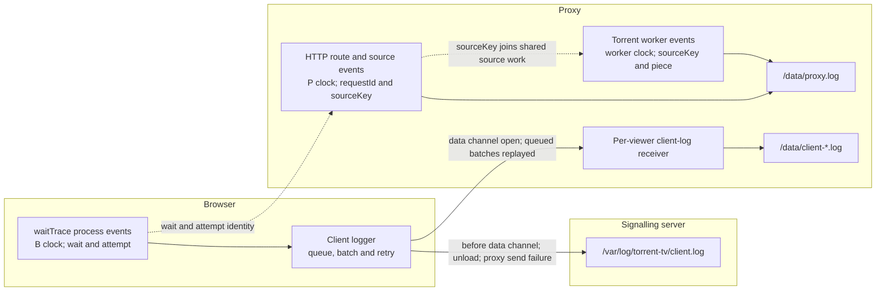
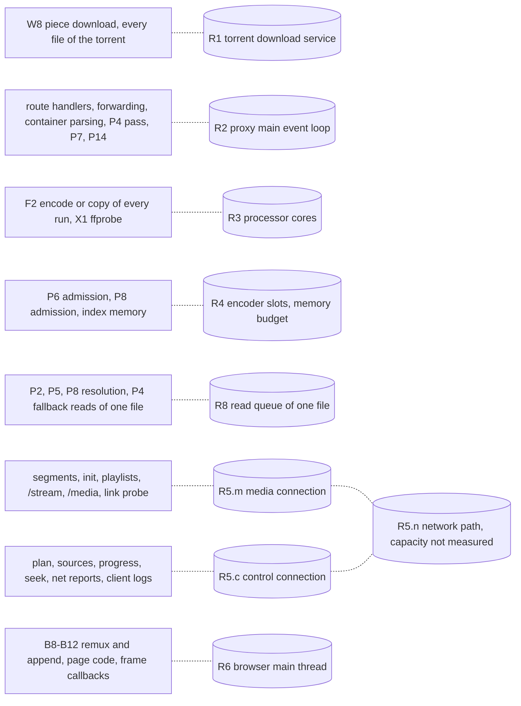
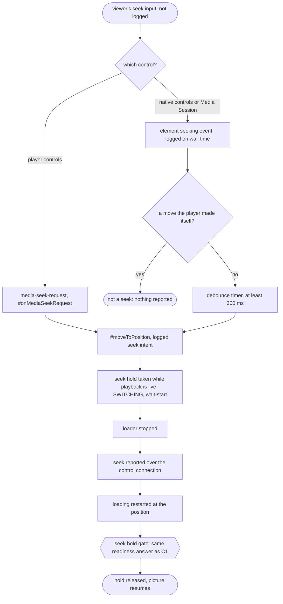

# First-frame wait: process model

This document describes the wait between a viewer's action and the first
presented frame as a set of atomic processes taken from the current code, with
their dependencies, alternatives, parallelism and shared resources
(torrent-tv/meta#185, plan step 3.3.4). It describes what the code does; it
contains no durations and changes no formula. Read from server `2645345`
(0.50.32), proxy `2ac8c25` (2.101.43), and the libraries they install:
hls.js 1.7.3 (server `package-lock.json`) and WebTorrent 2.8.5 (proxy
`package.json`).

This revision applies the review in torrent-tv/meta#185 (comment
6285126911); section 11 lists what changed against proxy `7b646fe`.
Section 13 describes the additional opt-in observations introduced for actual
startup validation; the historical observability table in section 8 refers to
the source revisions above.

A process has one owner (host and thread or child process), one start event,
one end event and one kind of work. A process that runs once per output, per
media stream or per request is written with a suffix: `.v` for the picture
output and the main HLS stream, `.a` for a soundtrack served as its own output
and stream. Where the code combines several kinds of work in one call, the call
is one process and its parts are named; they are not split into invented
durations.

## 1. Events, clocks and outcomes

1. `t0` — the original action, on the browser's monotonic clock.
   1. Single-file `.torrent`, or a file named by the address: the open action.
      `#processPlayback` takes `payload.startedAt` and dispatches `FILE_CHOSEN`
      with `originalOpen: true`.
   2. Multi-file torrent: the file choice. The time spent choosing is not part
      of the wait.
   3. Seek: the viewer's seek input. The code does not log the input itself;
      it observes it later. The player's controls raise `media-seek-request`,
      handled by `#onMediaSeekRequest`, which calls `#moveToPosition` at
      once. Native controls and Media Session are seen first as the
      element's `seeking` event (logged `[evt] <wall time> seeking`) and then
      through a debounce timer of `SEEK_REPORT_DEBOUNCE_MS` = 300 ms, which
      fires no earlier and may fire later. `#moveToPosition` logs
      `[evt] seek intent → <s>` and takes the seek hold, which moves the
      application to `SWITCHING` and makes `waiting.js` record
      `[wait-start]`. That record is a late observation of `t0`: the time from
      the input to the hold is part of the wait and is not measured
      (section 9).
   4. Soundtrack or quality change: the moment the page takes its hold
      (`#holdForAudio`, `#cushionHeld`); its distance from the viewer's click
      is not traced here.
   `waiting.js` logs every start as `[wait-start] wait=<n> startedAt=<ms>`.
2. `t1`–`t4` — the browser's coarse marks in `#playVideoFile` and
   `#waitForPrebuffer`, logged as `[evt] cold-start total= transport= plan=
   prepare= prebuffer=`. Section 6 states what each interval contains, and
   when `t0` of these marks differs from the wait's `t0`.
3. `tFrame` — the first `requestVideoFrameCallback` with `presentedFrames > 0`
   after the element's `playing` event (`player.js`
   `#watchFirstPresentedFrame`, logged `[first-frame]`). Observation stops at
   this one callback.
4. `audioReady` — computed once, at `tFrame`, from the audio buffered ranges at
   that media time (`loading.js` `#onFirstPresentedFrame`, logged
   `[first-frame-observation] … audioReady=`). When it is `false` nothing
   continues to observe until the sound is ready.
5. `tPlay` as torrent-tv/meta#185 defines it — the first presented *moving*
   frame with the required audio — is **not** produced by the code: no event
   confirms that `mediaTime` advanced between frames, and a frame without its
   required audio ends the observation. `tFrame` with `audioReady=true` is the
   nearest logged event; it is not proof of `tPlay`.
6. Outcomes of a wait, each distinct:
   1. frame observed with `audioReady=true`;
   2. frame observed with `audioReady=false`;
   3. paused: the viewer had stopped, the state goes to `PAUSED` and `play()`
      is not called;
   4. waiting for the viewer: the local-network permission click (A2.4) or a
      refused autoplay (C5);
   5. cancelled: a newer action, the viewer's stop or the page closing ends
      every browser process of the attempt (`#throwIfCancelled`, epoch check);
   6. error: a refusal, `media-continuity-unavailable`, a failed output
      (`state: "failed"`), or a transport loss that is not recovered.
7. Browser times use `performance.now()` from `t0`. Proxy durations use the
   proxy's clock. A browser time and a proxy time are never subtracted from
   each other; they are joined by identifiers (section 8).

## 2. Notation

1. **Completion order** (`X --> Y` in the diagram): Y cannot complete before X
   completes.
2. **Conditional edge** (`X -- condition --> Y`): the same, present only while
   the condition holds. Edges leaving one branch point carry mutually
   exclusive conditions.
3. A process completes after every edge that is present into it; alternatives
   exist only through conditions. The processes of a branch that is not taken
   do not exist, and neither do their edges. Work already done costs nothing
   and appears as the branch that skips it.
4. **Start without waiting** (`X -.-> Y`): X starts Y or states a demand to it
   and continues.
5. **Polled gate input** (`X ==> Y`): X is read by the browser's polling of
   gate Y, so Y sees it at the next poll.
6. **Shared resource**: processes that take service from one capacity at the
   same time (section 4). Their service is not additive.

## 3. Processes

### 3.1 Browser: action, connection, plan

| ID | Process | Starts after | Ends when | Edge to caller |
|---|---|---|---|---|
| A0 | Original action (`t0`) | viewer | action accepted | — |
| A0.0 | Address containing base64 torrent bytes: decode the address and construct the File (`Torrent.#loadFromUrl`). Local file input skips this step | A0 | File exists | blocking for A0.1 |
| A0.1 | Read the selected `.torrent` (`Torrent.#processIncomingFiles`, `File.arrayBuffer`) | A0 | bytes available in the page | blocking for A0.2 |
| A0.2 | Decode bencode and derive the info hash (`parseTorrentBytes`); the SHA-1 call is asynchronous (`crypto.subtle.digest`) | A0.1 | parsed metadata and hash available; `FILE_DETAILS_READY` dispatched | blocking for A1 |
| A1 | Store the already parsed source details (`openParsedTorrentDetails`, synchronous), and dispatch `FILE_CHOSEN` when the file is already determined | A0.2 | source details stored | blocking |
| A2 | Connect (`#acquireTransport` → `ProxySelector.chooseBestProxy`), made of A2.1–A2.3. Joins the connect `#connectEarly` started at page load and costs nothing when that has finished. Limits: 12 s public-only, 5 s on the same network, 30 s overall | A1 | A2.3 ends | blocking |
| A2.1 | Ask the server which proxy (`POST /api/proxy-clients/choose`) | A2 | answer | blocking |
| A2.2 | Media connection signalling: WebSocket `/ws/browser-signal`, session, SDP offer, answer relayed by the server, answer applied (`setRemoteDescription`, buffered candidates added) | A2.1 | answer applied | blocking |
| A2.2m | Media connection transport: ICE, DTLS, SCTP, media data channel open | A2.2 | media channel open | parallel with A2.2c |
| A2.2c | Control connection. With `separateControl: 2` in the answer (proxy `webrtc-manager.js`) it is started while the answer is processed (`#openSeparateControl`) and has its own WebSocket signalling, offer/answer, ICE, DTLS and SCTP (`ControlConnection`). Without it, a control channel is opened on the media connection (`#openLegacyControl`) | A2.2 | control channel open | parallel with A2.2m |
| A2.J | Both ready: `#settleConnected` requires the answer applied, the media channel open and, with a separate control connection, its channel open | A2.2m, A2.2c | `connect()` resolves | blocking |
| A2.3 | Liveness ping (`proxy.ping()`): waits for the control link, then sends on the control channel (`#controlChannelFor`) | A2.J | pong | blocking |
| A2.4 | Branch: the public-only attempt fails in A2.2m, A2.2c, A2.J or A2.3 → local-network permission (one viewer click) → A2.1–A2.3 again with private candidates | the failure | second connection ready | blocking; outcome 4 while waiting |
| A2.5 | Link probe (`measureLink`) over the media connection, after the connection is adopted | A2.3 | probe answered | start without waiting |
| A3 | Ask for the proxy that holds this film (`#useProxyThatHoldsTheFilm`, `POST /choose` with the info hash) | A2 | answer | blocking |
| A3r | Branch: move → close, connect to the named proxy (A2 steps) | A3 | connected | blocking |
| A4 | Register the source (`POST /api/sources`; cached per transport; the proxy only records it) | A3 or A3r | `sourceKey` | blocking |
| A5 | Early estimate (`GET /api/sources/:key/stats`, 1 s limit; single file only) | A4 | answer or abort | start without waiting |
| A6 | File list (`GET /api/sources/:key/files`, again every 2 s while the answer is pending); its answer waits for P1 | A4 | statement of the files | blocking |
| A7 | Branch: several videos and none named → playlist; the choice is a new `t0` | A6 | choice | — |
| A8 | Warm-up registration (`#warmSourceInBackground`) | A6; again before A12 | registered | start without waiting |
| A9 | Filename capacity hint (`#preferProxyFromFilename`, `POST /api/proxy-clients/can-serve`; the server asks every proxy over its tunnel) | A6 or A7 | answer | blocking |
| A9r | Branch: other proxies report capacity → the pool is restricted and the connection closed; the connect at A10 is made within that pool | A9 | connected | blocking |
| A10 | Acquire the current transport, record `t1`, then `registerSourceOnProxy` (cached unless the proxy changed) | A9 or A9r | source registered; registration after `t1` belongs to the coarse plan interval | blocking |
| A11 | Source statistics poll, every 2 s while A12 runs | A10 | A12 ends | start without waiting |
| A12 | Playback plan (`POST /api/playback-plan`, `waitForReady: true`); answered after P3 | A10 | plan received (`t2`) | blocking |
| A13 | Fingerprint, container metadata, sidecar soundtrack metadata requests | A12 | answers | start without waiting |
| A14 | Report the opening subtitle track (`#startSubtitlesForVideo`) | A12 | report sent | start without waiting; read by C3 |
| A15 | Codec support (`#predictCodecSupport`, MediaCapabilities) | A12 | verdict | blocking |
| A16 | Branch: `cannotServe` → `POST /can-serve` → `#playVideoFile` again from A9 on the proxies that answered; plan and output start from nothing there | A15 | — | blocking |
| A17 | Branch: HTTP transport → direct-play probe (`#tryPlayDirectUrl`); success leaves this model. The WebRTC transport skips it | A15 | probe result | blocking |

### 3.2 Browser: output and HLS loading

| ID | Process | Starts after | Ends when | Edge to caller |
|---|---|---|---|---|
| B1 | Open the picture output (`POST /api/transcode-sessions`): answered after P6.v; the route itself waits and opens again on the next storage change when the open reports missing bytes (`MEDIA_BYTES_UNAVAILABLE`, `waitForPlan`). Repeated after a "warming up" 500 with `min(3000, 500 + 250·n)` ms; 409 `no-capacity` → the A16 path | A15 | session answer | blocking |
| B2 | Net reporter (every 1.5 s, at once on `reportNow`) and session keep-alive started | B1 | session released | start without waiting |
| B3 | Media playlist wait (`waitForHlsPlaylist`); a synthetic VOD playlist answers at once, otherwise retry with `min(3000, 500 + 250·n)` ms | B1 | playlist with `#EXTINF` | blocking |
| B4 | Restate a position changed during allocation (`reportSeek` loop) | B3 | position acknowledged | blocking (normally no iteration) |
| B5 | hls.js: master playlist when variants exist, `MANIFEST_PARSED`, level pinned, `startLoad` | B4 | `startLoad` called | blocking |
| B6.v | Main stream init request (fMP4 only: `#EXT-X-MAP`); held by the proxy until P13.v, then P12.v. An MPEG-TS output has no init file (`mpegtsFormat.initFileName` is null, no `#EXT-X-MAP`), so this request does not exist | B5 | init bytes received | per stream |
| B6.a.p | Separate soundtrack: playlist request. Answered from the base output (`resolveAudioRenditionFile` returns `base.id` for a playlist); it creates no output | B5 | playlist received | per stream |
| B6.a.i | Separate soundtrack: init request (fMP4 only). The first init or segment request of the soundtrack is what opens P6.a; held until P13.a | B6.a.p | init bytes received | per stream |
| B7.v / B7.a | First fragment request of the stream, held until its piece is published (P11) or answered at once when it already is. For an MPEG-TS soundtrack this is the request that opens P6.a | B6 of the stream (fMP4) or its playlist (MPEG-TS) | fragment bytes received | per stream |
| B8.v / B8.a | Remux and `BUFFER_CODECS`. fMP4: `MP4Demuxer` + `PassThroughRemuxer`, whose `remux` returns the init only together with a fragment that has samples. MPEG-TS: `TSDemuxer` + `MP4Remuxer`, which builds the track description and init from the first fragment's samples (`generateIS` inside `remux`). In both formats the stream's first `BUFFER_CODECS` follows its first fragment | B6 (fMP4) and B7 of the stream | event raised | per stream |
| B9 | SourceBuffers created: hls.js waits for every expected `BUFFER_CODECS` — two with an alternate soundtrack, otherwise one (`buffer-controller.ts` `onManifestParsed`, `checkPendingTracks`) | every present B8 | buffers exist | blocking |
| B10.v / B10.a | Init append to the stream's SourceBuffer | B9 | `updateend` | per buffer |
| B11 | `t3`: `readyState >= HAVE_METADATA` (`#ensureVideoReady`, no decoded frame required). Under Media Source this follows the init of every SourceBuffer. A progress poll runs every 1 s meanwhile | every present B10 | `loadedmetadata` | blocking |
| B12.v / B12.a | First fragment append | B10 of the stream | `updateend` | per buffer |

Because hls.js produces a stream's buffer description only from its first
fragment, in fMP4 and in MPEG-TS, `t3` follows the production and delivery of
the first fragment of every required stream, whichever way the proxy makes the
init (P13).

The segment format belongs to the base output and to its soundtrack outputs.
It is fMP4 by default (`DEFAULT_SEGMENT_FORMAT_ID`, `--segment-format`). The
page asks for MPEG-TS when a soundtrack it copies cannot be appended from fMP4
but can from MPEG-TS (`#requiredSegmentFormat`, `canAppendCopiedAudio`; copied
MP3 is the case its comment names); the proxy also uses MPEG-TS when started
with `--segment-format mpegts`.

### 3.3 Browser: readiness gate and presentation

| ID | Process | Starts after | Ends when | Edge to caller |
|---|---|---|---|---|
| C1 | Prebuffer gate (`#waitForPrebuffer`): element kept paused, loop every 250 ms, progress asked every 1.5 s or at once after a net report when the buffer grew; releases when `playbackReadiness.version === 1 && ready === true` and C3 is clear (`t4`). A buffer standing still for 4 s restarts the loader at the buffered end. `media-continuity-unavailable` and a failed output end the wait with outcome 6 | B11 | release | gate |
| C2 | Net report delivered over the control connection: buffered ranges per track, position, link samples | B2, `reportNow` | proxy records the reading | gate input to P14 |
| C3 | Subtitle hold (`subtitleStartHold`): a ready answer requested before the proxy knew the opening subtitle track is not taken | A14 | proxy states the track read | part of C1 |
| C4 | Application state on `PLAYBACK_READY`: `ADVANCING`, or `PAUSED` when the viewer had stopped (outcome 3) | C1 | state published | blocking |
| C5 | `video.play()` → `playing`. Branch: autoplay refused → waits for a viewer gesture (outcome 4) | C4 (`ADVANCING`) | `playing` | blocking |
| C6 | Frame callbacks until `presentedFrames > 0` (`tFrame`) | C5 | callback | blocking |
| C7 | `audioReady` at `tFrame`'s media time (outcome 1 or 2) | C6 | logged | observation |

### 3.4 Proxy main thread

One Node.js event loop runs every route handler, the data-channel forwarding
(`transport/data-channel-handler.js`, through loopback HTTP), container
parsing, the download map pass, the readiness forecast and encoder
orchestration. The torrent runs in one worker thread
(`torrent/worker/client.js`); FFmpeg and ffprobe run as child processes.

| ID | Process | Starts after | Ends when | Edge |
|---|---|---|---|---|
| P1 | Torrent ready (`torrentPool.getTorrent`): the main-thread side of W1–W6 | A6 or A12, whichever asks first | `ready` | blocking for A6, A12 |
| P2 | Container declarations (`readDeclarations`, `declaredTracksOf` → `ContainerOrchestrator.inspect`, statements `tracks`, `media-info`). Each read waits in the file's read queue (R8). The container is chosen by sniffing 16 bytes (`ContainerFactory.create`): Matroska, MP4, AVI, MPEG-TS, ASF and MPEG-PS are parsed on this thread; anything else is read by X1. Strict reads: missing bytes return `needs-ranges`, which is stated to the download map; missing index memory returns `needs-memory`. The plan route reads again on every storage change (`getReadyPlan` → `waitForPlan`) | P1 | codecs and duration known | blocking for A12 |
| P3 | Plan completion: sidecar soundtrack headers (`buildInventory`), subtitle defaults, cache; the offer (`offeredHeights`, `cannotServe`) on the way out | P2 | plan answered | blocking for A12 |
| P4 | Download map pass (`DownloadMaps.resolvePlayback`, proxy `server.js`): on each change of demand, the source byte ranges of every unresolved segment of every watched output (`directSegmentInput` / `PacketIndex.inputFor`, or reads through R8), recorded in `SegmentInputTable`, the priority map published to the worker; yields between zones | any demand change | pass ends | repeated; feeds W7 and P14 |
| P5 | Keyframe index (`KeyframeTables`; warmed during P2 by `warmKeyframeIndex`, read through R8 by `getKeyframeIndex`). A missing range is stated to the map like any read (`onReadResult` → `downloadMaps.metadata`); the table is read again when pieces arrive (`readAgainIfUnanswered`). Required only when the video is copied | P2 (warm), B1 | table answered | blocking for P6.v (copy) |
| P6.v | Picture output open (`OutputOpening.open`): media info from the plan, file length, P5 for a copy, cut grid and timeline, capacity admission (`admitsWatching`), viewer placed; answered before any segment exists | B1 | output returned | blocking for B1 |
| P6.a | Soundtrack output open (`#resolveAudioRenditionSession`): on the soundtrack's first init request (fMP4) or first segment request (MPEG-TS) through `resolveAudioRenditionFile`; earlier when the `…/a/:track/warm` route (`prepareAudioTrack`) asks for it, which the page uses for a soundtrack change and to restate its soundtrack after a reconnect. A playlist request does not open it | B6.a.i, B7.a or the warm route, whichever comes first | output returned | blocking for that request |
| P7.v / P7.a | Encoder plan (`planEncodersSoon` → microtask → `planEncodersNow` → `encodeOrchestrator.reconcile`), run again after each output opens and after each seek; it reads each output's priority map, built from where its viewers stand (`PriorityOrchestrator.mapForOutput`, not the P4 pass), and the host's capacity | P6 of the output, a seek | that output's runs decided | blocking for P8 of the output |
| P8.v / P8.a | Run input (`EncodeInputs`): input ranges of the run's first segments (reads through R8), wait until those bytes are held (W9), memory admission, copy of the held bytes. A copy may continue while the run opens (`deferredBytes`) | P7 of the output | input admitted | blocking for F1 |
| P11.v / P11.a | Piece closure: FFmpeg names the closed piece on its fourth descriptor, completeness judged (`encode/piece-completeness.js`), published in `SegmentStore` | F2 of the output | published | blocking for P12 |
| P13.v / P13.a | Init readable; fMP4 only. Alternatives: written by FFmpeg at the run's start; or, for an output cut at given times (`cutsAtGivenTimes`), lifted from the first produced piece (`#initFromFirstSegment`); or already kept by `SegmentStore` / readable from a published piece when the output was made before | F1 or P11 of the output, or nothing (exactly one) | init readable | blocking for B6 |
| P12.v / P12.a | Held request answered (`SegmentServing`) and streamed through the data-channel handler | P11 or P13 of the output, or the piece already published | response sent | blocking for B6 (fMP4), B7 |
| P14 | Readiness forecast on each progress request (`getSessionProgress` → `#playbackReadinessFor` → `predictPlaybackReadiness`): worker statistics (W10), segment inputs from `SegmentInputTable`, rates, client ranges (C2) | progress request | answer | gate input to C1 |
| P15 | Early estimate (`waitEstimateForFile` / `waitEstimateForSource` → `LocalObservations.firstFrameSeconds`) | A5, A6, A11, P14 | value or null | observer |

### 3.5 Child processes

| ID | Process | Starts after | Ends when | Edge |
|---|---|---|---|---|
| X1 | ffprobe (`probe-packets.js`) for a container the sniff does not recognise (`FfprobeContainer`): reads the file over loopback `/media`, which serves held bytes only; a missing byte aborts the probe as `needs-ranges` | P2 | streams or packets listed | blocking for P2 |
| F1.v / F1.a | FFmpeg spawn and open of the run's input over loopback HTTP (`/encode-input/:token/:fileIndex` or `/stream`) | P8 of the output | first source bytes handed to FFmpeg by the proxy | blocking for F2 |
| F2.v / F2.a | Encode or copy the first piece up to its cut | F1 of the output | first output piece closed | blocking for P11 |

### 3.6 Torrent worker thread and swarm (WebTorrent 2.8.5)

| ID | Process | Starts after | Ends when | Edge |
|---|---|---|---|---|
| W1 | Add, parse, listen (`client.add`, `_onListening`) | P1 | listening | blocking |
| W2 | Peer discovery started (`_startDiscovery`: trackers, DHT). Magnet: at listening, before the metadata. `.torrent`: inside `_onStore`, immediately before `ready` | W1 (magnet) or W6 (`.torrent`) | discovery running | blocking for W3 |
| W3 | Peer connections and handshakes | W2 | a peer serving | blocking for W4, W8 |
| W4 | Metadata from peers (`ut_metadata`); magnet only | W3 | `metadata` | blocking for W5 |
| W5 | Verification of stored pieces; no work when every file is whole (`skipVerify`) | W1 (`.torrent`) or W4 (magnet) | verified | blocking for W6 |
| W6 | Store ready (`_onStore`) → `ready` | W5 | `ready` | blocking for P1 |
| W7 | Piece selection from the published priority map (`SwarmSelection`) | P4 | selection applied | blocking for W8 |
| W8 | Piece download, one service per torrent | W3, W7 | piece received | shared resource R1 |
| W9 | Piece verification and storage (shared memory, spill to disk); the main thread is told the held bytes changed | W8 | piece readable | blocking for P2, P5, P8, X1 |
| W10 | File statistics and per-piece arrival forecast (`getFileStats`, `downloadForecast`) | a statistics request, P14 | answer | blocking for P14 |

## 4. Shared resources

| ID | Resource | Who takes service from it | What is established | What is not established |
|---|---|---|---|---|
| R1 | Download service of one torrent | W8 for every file and output of that torrent | Bytes are fetched once; the priority map orders them | — |
| R2 | Proxy main event loop | all route handlers, P2–P8, P11–P15, data-channel forwarding | A long synchronous step delays every response; field23: an `onSend`→`finish` gap of 33.875 s overlapped a 33.862 s map pass (research `wait-estimate-2026-10-19-ttv185.md`) | queueing per response, except the loop delay in `[net-debug] sent` |
| R3 | Processor cores | F2 of every run, X1, R2, the worker | Measured per-piece speeds include the sharing at the time they were taken | the split between runs at a future moment |
| R4 | Encoder slots and the memory budget (`MachineBudget`, `EncodeInputs`) | P6 admission, P8 admission, P2/P5 index memory (`needs-memory`) | A wait for memory delays the read or the run | — |
| R5.m | Media connection (one `RTCPeerConnection`) | segments, init, playlists, `/stream`, `/media`, link probe, subtitles, covers (`isBulkPath`) | The proxy forwards each request on its own (`forwardRequest` per `requestId`) and sends chunks with backpressure; responses can be in flight together | that transfers are serial; the forecast's single link queue (`transferFinish` in `predictPlaybackReadiness`) is an assumption of the calculation |
| R5.c | Control connection (a second `RTCPeerConnection` when `separateControl: 2`) | plan, sources, progress, seek, net reports, client logs | It does not carry segments | its effect on R5.m's rate; whether the two directions limit each other |
| R5.n | The network path between viewer and proxy | R5.m and R5.c | — | its capacity; the link probe measures only R5.m |
| R6 | Browser main thread | hls.js remux and append, page code, frame callbacks | browser `PerformanceObserver` long-task entry | point event with task start and duration; shorter work is not measured |
| R7 | Proxy disk | piece spill, segment files, original-input copies | — | not measured as a service |
| R8 | Read queue of one file (`ContainerOrchestrator.inspect`, `#reads`) | P2, P4 (fallback reads), P5, P8 resolution | Reads of one file run one after another; a statement answerable from what was already read is answered beside the queue | P2/P5/X1 source events and P8 input records carry queue and read durations |

## 5. Branch points

1. Magnet or `.torrent` (W2–W5 order, section 3.6).
2. Whole files on disk: W5 does no work; W8 is not needed for their bytes.
3. Connection already made by `#connectEarly`: A2 costs nothing.
4. Public-only attempt fails: A2.4, waiting for the viewer.
5. `separateControl: 2`: A2.2c is a separate connection (R5.c) built in
   parallel with A2.2m; otherwise the control channel is on the media
   connection.
6. A better proxy holds the film (A3r) or the pool is restricted by the
   filename (A9r).
7. Several videos: a new `t0` at the choice (A7).
8. Container recognised by sniffing or read by ffprobe (X1).
9. `needs-ranges` or `needs-memory`: the read is repeated on the storage or
   memory change; it is not a terminal answer.
10. `cannotServe` (A16) or 409 `no-capacity` (B1): `#playVideoFile` runs again
    from A9 on the proxies that answered.
11. HTTP transport: direct play may end the model (A17).
12. Video copied (P5 required) or encoded.
13. Soundtrack muxed into the picture or served separately: the `.a`
    processes exist only in the second case, and only then does the forecast
    require two tracks (`requiredAudio`).
14. Segment format: fMP4 (init request, P13) or MPEG-TS (no init request; the
    soundtrack output opens on its first segment request).
15. Init written by FFmpeg or lifted from the first piece (P13, fMP4 only).
16. First piece at the position already published: P7, P8, F1, F2 and P11 do
    no work for it; P12 answers at once.
17. Opening subtitle track: C3 holds the gate until the proxy states it read.
18. Viewer had stopped: `PAUSED`, no `play()` (outcome 3).
19. Autoplay refused: C5 waits for a gesture (outcome 4).
20. Cancellation and errors: outcomes 5 and 6 can end any browser process.
21. Soundtrack output opened early by the warm route (`prepareAudioTrack`).
22. Seek, soundtrack and quality change: section 9.

## 6. What the coarse intervals contain

| Interval | Single-file open | Multi-file choice |
|---|---|---|
| `transport = t1 − t0` | A0.1, A0.2, A1, A2 (when not finished early), A3/A3r, A4, A6 (waits for P1: W1–W6), A9/A9r, A10 transport acquisition | A9/A9r, A10 transport acquisition |
| `plan = t2 − t1` | A10 source registration after `t1` (no request on a cache hit), then A12: P2 (R8 queue, X1 when not sniffed, `needs-ranges` → P4 → W7–W9 → read again), P3 | same |
| `prepare = t3 − t2` | A13–A15, B1 (P6.v, P5 for a copy), B2–B5, then per required stream: P6.a (soundtrack, opened by its first init or segment request), P7, P8, F1, F2, P11, P13 and the init transfer (fMP4), P12, the first-fragment transfer on R5.m, B8, B9, B10 | same |
| `prebuffer = t4 − t3` | gate C1: the continuity forecast to the end of the film (P14, needing P4 inputs for every remaining segment of an incomplete source), further production and delivery, poll and net-report latency, C3 | same |
| `presentation = tFrame − t4` | C4, C5, C6 | same |

1. The name `transport` covers the file list and the torrent's metadata for a
   single-file open.
2. `prepare` contains the first piece of every required output because of
   B8 (section 3.2).
3. When `#playVideoFile` runs again on another proxy (branch 10), the cold-start
   `t0` (`#coldStart.t0`) is the time of that run, while the overlay and
   `[first-frame] elapsedMs` keep the original `t0`. `presentationMs`, logged as
   `elapsedMs − totalMs`, then also contains the abandoned attempt; the proxy
   records these values for the stage medians (`routes/api/client-logs/post.js`
   → `noteFirstFrameObservation`). Durations from such a wait are not
   comparable until the cold-start `t0` keeps the original action.
4. The intervals end at `tFrame`, not at `tPlay` (section 1, item 5).

## 7. What the current calculations cover

1. `LocalObservations.firstFrameSeconds` sums five medians of the intervals in
   section 6 from earlier waits on the same proxy configuration. Overlap and
   resource sharing inside an interval are whatever they were in those waits.
2. `predictPlaybackReadiness` schedules, per remaining segment in media order:
   source bytes on the torrent's one service (R1; planned piece arrivals from
   W10 first, then the measured rate); the start of a new run and its open
   cost; per-track processing at the track's measured rate, tracks in
   parallel and each serial in itself, a segment starting only when its whole
   input is held; and delivery on one link queue (`transferFinish`), plus
   `appendSeconds` when supplied. `ViewerRequests` supplies no
   `appendSeconds`. The single link queue is the calculation's assumption
   about R5.m, not an established property of it. The delay is the largest
   lateness of a production or delivery against the media already ahead of
   it, over the near window and the tail to the end of the film.
3. It returns a reason instead of a number while an input is missing:
   `separate-audio-not-observed` (until P6.a exists), `timeline-unavailable`,
   `link-rate-unavailable`, `segment-size-unavailable`,
   `source-measurement-unavailable`, `source-input-ranges-unavailable` (P4 has
   not resolved a remaining segment of an incomplete source),
   `encode-rate-unavailable`, `download-rate-unavailable`,
   `service-not-advancing`; `media-continuity-unavailable` ends the wait.
4. `firstRequiredSegmentsSeconds`: for each required track (one, or two with a
   separate soundtrack) it takes the first segment of the near window that
   ends after the viewer's position. If all of that segment's media is
   already in the client's ranges, the track contributes 0, even when the
   next segment is missing. Otherwise it contributes that segment's
   completion: delivery on the link queue plus `appendSeconds` when supplied.
   The value is the largest contribution, or null when any is unknown. It is
   not the completion of the first missing segment in general, and it is not
   the first-frame wait: it excludes the rest of the continuity gate, the
   gate's poll latency, C3, B8–B12 and C4–C7.
5. Not represented as separate terms in either calculation (the medians of
   item 1 contain them only inside whole intervals): A1–A17, B1–B5 and their
   retries, P5, P6, P7, P4 pass time, the R8 queue, X1, R2 queueing,
   processor sharing beyond measured rates, memory admission, P13, B8–B12,
   C4–C7.

## 8. Observability

With `?waitTrace=1`, browser and proxy emit structured process events with a
process id, phase, and monotonic timestamp where the code has a measurable
boundary. Browser intervals carry a wait id and attempt; proxy intervals carry
the source key and inherit the most recent browser wait context. The clocks are
separate: identifiers join events, but timestamps from different processes
cannot be subtracted. Point observations and shared-resource readings are not
durations. A missing end event means the operation was interrupted or its
outcome was not observed.

Clock owners: `B` browser `performance.now()` (wall time in `[evt]` lines),
`P` proxy, `F` FFmpeg run times reported to the proxy. "Direct" is an event
logged at the process boundary; "derived" is computed from other values;
"none" means no event exists.

| Process | Clock | Identifier | Start event | End event | Queue | Work, units | Source |
|---|---|---|---|---|---|---|---|
| A0.0–A0.2 | B | wait sequence and attempt | `A0.0` address decode; `A0.1` file read; `A0.2` bencode parse and info-hash derivation | each operation has its own `end` event | — | bytes | direct spans; parse and hash remain one operation |
| A2.2, A2.2m, A2.2c, A2.J, A2.3 | B | signalling session id | `process` begin events for signalling, media/control channel, and join | corresponding end events; ping end | — | — | direct for these coarse boundaries; ICE subphases remain state events |
| A2.5 | B | wait, attempt, operation | `measureLink` starts | probe loop resolves, fails or is aborted | media data channel | probe bytes and transfer durations | direct operation span; each probe also has its own HTTP transfer record |
| A2.1, A3, A9, A16 | B / P | wait, attempt, operation | structured `http-start` | structured `http-end` | server fanout for capacity checks | one request | direct request spans |
| A6 | B / P | wait, attempt, operation, source key | structured `http-start` | structured `http-end` | includes P1 if it waits | file-list response | direct request span |
| A7 | B | wait, attempt, file count | playlist choice shown | viewer selects a file | viewer input | file index | direct span; its duration remains separate from the selected file's new `t0` |
| A8 | B / P | wait, attempt, source key | warm-up registration request | response or close | source-add work may be shared with P1 | file index | request span; shared source work is not attributed as exclusive A8 time |
| A11 | B / P | wait, attempt, request id, source key | every stats poll | response or close | worker queue and W10 | file statistics and forecast fields | direct request span; polling runs alongside A12 |
| A13 / A14 | B / P | wait, attempt, source key, track | each fingerprint, metadata or subtitle request | response or close | shared source reads | track or metadata result | direct request spans; asynchronous work remains outside blocking startup time |
| A12 / P2–P3 | B / P | wait, attempt, source key and file | structured `http-start`; P2/P5/X1 begin | structured `http-end`; paired P2/P5/X1 ends; `t2` | R8 queued and read times on proxy source events | ranges, bytes | direct for each instrumented read |
| P3 | P | wait operation, source and file | playback-plan handler entry | handler response or close | P2 and P4 | plan fields | direct route span on proxy clock |
| X1 | P | source key, request id | `process=X1 phase=begin` | `process=X1 phase=end` | R8 | probe request and result | direct, operation elapsed on proxy clock |
| P5 | P | source key, file index, request id | `process=P5 phase=begin` | `process=P5 phase=end` | R8 | index bytes and read result | direct, operation elapsed on proxy clock |
| B1 / P6.v | B / P | wait, attempt, request id | browser output-session request / proxy open | browser response / proxy handler return | R4 | open calls and plan wait | separate clocked request spans; proxy logs inner open durations |
| B2 | B | wait, attempt, request id | each net-report request | response or close | control connection R5.c | buffered ranges, position and link sample | direct request span on browser clock |
| B4 | B | wait, attempt, request id | position-restatement request | response or close | control connection R5.c | position seconds | direct request span on browser clock |
| P6.a | P | output key | HTTP request that first opens the alternate output | output response; session creation logs open calls, aggregate open time and plan wait | memory / encoder admission | — | request span plus open-duration fields; output-specific event still shares the request process id |
| P7 | P | source key, output key | `process=P7.v/a phase=begin` | `process=P7.v/a phase=end` | R2 event loop | outputs and active sessions | direct, proxy monotonic clock |
| P8 | P | source key, output key, run range, input request | `process=P8.v/a phase=begin` | paired end at input admitted or terminal; attempt/wait events for retries | R8, W9, R4 detailed in adjacent input/read records | bytes, queue/read/copy times | direct, proxy monotonic clock |
| F1.v / F1.a | P | source key, run token, output, file | run spawn | first input bytes delivered by `/encode-input` or `/stream` | R3 | bytes | direct proxy-monotonic span; endpoint is byte handoff, not FFmpeg's internal packet parser |
| F2.v / F2.a | P | source key, run token, output, segment | first input bytes delivered | first output piece closed | R3 | segment | direct proxy-monotonic span; P11 separately records publication |
| P11 | P | output key, segment index | encoder run start | `encode-run … #<index> … named +<ms>, published +<ms>` (`EncodeRuns.onClosed`), relative to that run's start | — | one piece | direct publication observation; `cold-start <id>: first-segment ready +<ms>` is a different event, written when the first segment is **served** (`SegmentServing`) |
| P13 | P | source key, output key, init filename | init request start | init request answer | read/production wait is within request | bytes | direct request span, proxy monotonic clock |
| P12 + transfer | P / B | P `requestId`; B path | P route entry (in `fetchMs`) | P `[net-debug] sent … requestId= fetchMs= sendMs= readMs= chanMs= drainMs= loopMax=`; B `[net-debug] dc-load {path, waitMs, transferMs}` | R2, R5.m | bytes | direct on each side; B line carries the path, not the `requestId` |
| B5 | B | wait, attempt, level | manifest loading / parsed events | `MANIFEST_PARSED` plus level/fragment events | R6 | playlist and level | direct hls.js events; master and media playlist HTTP spans are separate |
| B8–B10, B12 | B | wait, attempt, stream and segment | hls.js `FRAG_PARSING_INIT_SEGMENT` or `BUFFER_APPENDING` | `BUFFER_CODECS` or `BUFFER_APPENDED` acknowledgement | R6 | segment and track | direct event boundaries; internal decode and native updateend are not exposed |
| B11 (`t3`) | B | — | — | `cold-start prepare=` | — | — | direct |
| C1 (`t4`) | B | — | `t3` | `[evt] prebuffer ready …`; `prebuffer waiting … reason=` on each reason change | — | — | direct |
| P14 | P | session id, consumer | request | `readiness parts … in all <ms>`; `playback readiness {…}` on a reason or missing-input change; `playback held …` | R2 | — | direct |
| P15 | P | source key, wait id, consumer, revision | estimate selected for a revision | `process=P15 phase=event` with remaining and total seconds and estimate basis | R2 | seconds | direct point observation; estimate calculation is synchronous |
| C3–C5 | B / P | wait, attempt, consumer and selected track | C3 readiness-state events; C5 `play` | C3 readiness state, C4 playback-ready, C5 `playing` | C1 gate | track and state | direct point or state observations; C3 is logged when readiness changes |
| Seek start (section 9) | B | — | the viewer's input: none; `[evt] <wall time> seeking` for native controls and Media Session | `[evt] seek intent → <s>`; `[wait-start]` at the hold | — | — | input not logged; `seeking` and `seek intent` on wall time, `[wait-start]` monotonic |
| C6, C7 | B | wait, attempt, media time | `requestVideoFrameCallback` observations | advancing frame and audio-ready point events | R6 | media time, audio state | direct observations with wait identity |
| P4 | P | source key, file, map revision | `process=P4 phase=begin` at range-resolution pass | `process=P4 phase=end`, with resolved zone count and outcome | R2, R8 | zones | direct resolver span; separate from the aggregate map-pass timing |
| W1–W2, W5–W6 | torrent worker | source key | `client.add` request; internal `_onListening`, `_startDiscovery`, `_verifyPieces`, `_onStore` begin events | corresponding end events; skipped verification is a point event | — | files, outcome | direct worker-monotonic spans; WebTorrent internal method boundaries pinned to installed 2.8.5 |
| W3–W4 | torrent worker | source key, peer | first `wire`; `metadata` | peer/metadata arrival events | swarm | peer, file count | direct event observations; not a wait duration |
| W7 | torrent worker | source key, file | priority-map command begins | priority-map command ends, including applied file and duration | worker command queue | windows | direct span |
| W8 | torrent worker | source key and piece | first accepted block request for the piece | piece verified; existing per-piece diagnostics retain request-to-arrival timing and retry counts | R1 | bytes | direct per-piece span; block detail stays in the existing aggregate diagnostic, so trace volume is two records per piece |
| W9 | torrent worker | source key, piece and affected file ranges | piece verified / storage availability changed | point event when readable; withdrawal is a separate event | R7 | bytes and ranges | direct storage-availability event; no separate write-duration boundary |
| W10 | torrent worker | source key, file | statistics command begins | statistics/forecast response ends | forecast walk | forecast requested | direct command span; response retains arrival forecast |

The opt-in trace now emits process ids for A0.0–A0.2, P4, and W1–W10 in
addition to the previously listed browser and proxy operations. Worker events
use the torrent worker's monotonic clock and are joined to browser events by
`sourceKey`; clock values from separate processes cannot be subtracted. Remaining
limits are specific: A2.2 ICE candidate substeps are state events rather than
separate spans; B9 and C7 are point observations; B8 spans hls.js init-segment
parsing to codec readiness without splitting internal remux work; B10/B12 end
at `BUFFER_APPENDED`, not native `SourceBuffer.updateend`; F1 ends at the
proxy's first input-byte handoff and does not expose FFmpeg's internal packet
parser boundary. R2/R3/R5/R6/R7 are shared resources, and
their load is not fully apportioned to one wait. Keep these boundaries explicit
when comparing traced intervals with the browser's first advancing frame.

## 9. Seek, soundtrack and quality change

1. The seek starts with the viewer's input, which is not logged. The player's
   controls raise `media-seek-request`; `#onMediaSeekRequest` calls
   `#moveToPosition` at once. Native controls and Media Session move the
   element first: its `seeking` event is logged (`[evt] <wall time>
   seeking`), `#reportSeekIntent` ignores a move the player made itself, and a
   debounce timer of at least 300 ms (`SEEK_REPORT_DEBOUNCE_MS`; a timer may
   fire later) calls `#moveToPosition`. `#moveToPosition` logs `[evt] seek
   intent → <s>`, resets the waiting model and, while playback is live, takes
   the seek hold (`#holds.beginSeek`), which raises `SWITCH_REQUESTED`: the
   state becomes `SWITCHING` and `waiting.js` records `[wait-start]`. The time
   from the input to the hold belongs to the wait; the issue's `t0` is the
   input, so `[wait-start]` of a seek starts late by that time.
2. It then stops the loader, reports the position (`POST
   /api/transcode-sessions/:id/seek` over R5.c → `ViewerRequests.requestSeek`:
   the viewer moves, held requests are woken, `planEncodersSoon`), and
   restarts loading at the position.
3. The proxy repeats P4, P7, P8, F1, F2, P11, P12 for the segments at the new
   position unless they are published (branch 16). B7–B12 repeat for the new
   fragments; B8–B10 do not repeat the init.
4. `#holdSeekUntilReady` asks for progress every 1.5 s, sooner when the
   forecast names a shorter delay or the element reports `seeked`/`canplay`,
   and releases on the same readiness answer as C1.
5. A soundtrack or quality change opens another output (`prepareAudioTrack`,
   `prepareQualityVariant`, the `…/warm` routes) through P6–P13 and is held by
   the page (`#holdForAudio`, `#cushionHeld`). These holds are not traced
   further here.

## 10. Diagrams

### 10.1 Process flow with every branch

Edge meanings are those of section 2. A node completes after all edges that
are present into it; conditional edges carry their condition as a label. A
branch to A9 runs `#playVideoFile` again on another proxy. A loop through W9
is the event-driven read again when new bytes are held.

```mermaid
flowchart TB
  subgraph BROWSER["Browser main thread"]
    T0(["A0 t0"])
    A1["A1 store parsed source details"]
    A21["A2.1 ask the server which proxy"]
    A22["A2.2 media signalling, answer applied"]
    A22m["A2.2m media ICE, DTLS, SCTP, channel"]
    A22c["A2.2c separate control connection"]
    A2J["A2.J both channels open"]
    A23["A2.3 ping on the control channel"]
    QA2{"public-only attempt failed?"}
    A24["A2.4 viewer permits local network, A2.1-A2.3 again"]
    A25["A2.5 link probe"]
    A3["A3 ask for the proxy holding the film"]
    QA3{"move?"}
    A3r["A3r connect to the named proxy"]
    A4["A4 register source"]
    A5["A5 early estimate request"]
    A6["A6 file list request"]
    QA6{"one video or a named file?"}
    A7["A7 viewer chooses: new t0"]
    A8["A8 warm-up registration"]
    A9["A9 filename capacity hint"]
    QA9{"pool restricted?"}
    A9r["A9r connect within the pool"]
    T1(["A10 t1"])
    A11["A11 stats poll every 2 s"]
    A12["A12 playback plan request"]
    T2(["t2 plan received"])
    A13["A13 fingerprint, metadata, sidecar audio"]
    A14["A14 report opening subtitle"]
    A15["A15 codec support"]
    QA16{"cannotServe?"}
    QA17{"HTTP transport and direct play works?"}
    DIRECT(["A17 direct play: outside this model"])
    B1["B1 open picture output request"]
    QB1{"409 no-capacity?"}
    B2["B2 net reporter"]
    B3["B3 media playlist wait"]
    B4["B4 restate a moved position"]
    B5["B5 manifest parsed, startLoad"]
    QSEP{"soundtrack served separately?"}
    QFMT{"segment format of the output"}
    B6v["B6.v main init request"]
    B7v["B7.v first main fragment request"]
    B8v["B8.v remux, BUFFER_CODECS"]
    B6ap["B6.a.p soundtrack playlist, answered from the base output"]
    B6ai["B6.a.i soundtrack init request"]
    B7a["B7.a first soundtrack fragment request"]
    B8a["B8.a remux, BUFFER_CODECS"]
    BW["soundtrack warm request: change or reconnect"]
    B9["B9 SourceBuffers created"]
    B10v["B10.v main init append"]
    B10a["B10.a soundtrack init append"]
    T3(["B11 t3 HAVE_METADATA"])
    B12v["B12.v main fragment append"]
    B12a["B12.a soundtrack fragment append"]
    C2["C2 net report"]
    C3["C3 subtitle hold"]
    C1{{"C1 prebuffer gate"}}
    T4(["t4 release"])
    C4{"C4 viewer had stopped?"}
    C5["C5 play to playing"]
    QC5{"autoplay refused?"}
    C5G["C5 wait for a viewer gesture"]
    C6(["C6 tFrame: first presented frame"])
    C7{"C7 audio buffered at that media time?"}
  end

  subgraph OUTCOMES["Outcomes"]
    O1(["outcome 1: frame, audioReady=true"])
    O2(["outcome 2: frame, audioReady=false"])
    O3(["outcome 3: paused"])
    O6(["outcome 6: error"])
  end

  subgraph SERVER["Signalling server"]
    S1["choose a proxy, can-serve over tunnels"]
    S2["relay SDP and ICE"]
  end

  subgraph PROXY["Proxy main thread: one event loop"]
    P1["P1 torrent ready"]
    QCF{"container recognised by sniffing?"}
    P2["P2 container declarations through the read queue"]
    P3["P3 sidecar headers, subtitles, offer"]
    P4["P4 download map pass"]
    QP5{"video copied?"}
    P5["P5 keyframe index through the read queue"]
    P6v["P6.v picture output open"]
    P6a["P6.a soundtrack output open"]
    P7v["P7.v encoder plan for the picture output"]
    P7a["P7.a encoder plan for the soundtrack output"]
    QRv{"first picture piece already published?"}
    QRa{"first soundtrack piece already published?"}
    P8v["P8.v run input"]
    P8a["P8.a run input"]
    P11v["P11.v piece published"]
    P11a["P11.a piece published"]
    P13v["P13.v init readable, fMP4"]
    P13a["P13.a init readable, fMP4"]
    P12v6["P12.v init answered"]
    P12v7["P12.v fragment answered"]
    P12a6["P12.a init answered"]
    P12a7["P12.a fragment answered"]
    P14["P14 readiness forecast"]
    P15["P15 early estimate"]
  end

  subgraph CHILD["Child processes"]
    X1["X1 ffprobe over /media"]
    F1v["F1.v FFmpeg open"]
    F2v["F2.v first picture piece"]
    F1a["F1.a FFmpeg open"]
    F2a["F2.a first soundtrack piece"]
  end

  subgraph WORKER["Torrent worker thread and swarm"]
    W1["W1 add, parse, listen"]
    QMAG{"magnet?"}
    W2m["W2 discovery before metadata"]
    W3m["W3 peers"]
    W4["W4 metadata from peers"]
    W5["W5 verify stored pieces, none when whole"]
    W6["W6 store ready, discovery started for .torrent"]
    W3t["W3 peers"]
    W7["W7 piece selection"]
    W8["W8 piece download"]
    W9["W9 verify, store, notify"]
    W10["W10 stats, arrival forecast"]
  end

  subgraph OBSERVER["Estimate display: blocks nothing"]
    E1["WaitingModel deadline, overlay render"]
  end

  T0 --> QURL{"base64 torrent in the address?"}
  QURL -- yes --> A00["A0.0 decode address"] --> A01["A0.1 read torrent file"]
  QURL -- local file --> A01
  A01 --> A02["A0.2 bencode and async SHA-1"] --> A1 --> A21 --> A22
  A21 -.- S1
  A22 -.- S2
  A22 --> A22m --> A2J
  A22 -- separateControl 2 --> A22c --> A2J
  A22c -.- S2
  A2J --> A23 --> QA2
  QA2 -- yes --> A24 --> A3
  QA2 -- no --> A3
  A23 -.-> A25
  A3 -.- S1
  A3 --> QA3
  QA3 -- yes --> A3r --> A4
  QA3 -- no --> A4
  A4 -.-> A5
  A4 --> A6
  A6 -.-> P1
  P1 --> QA6
  A6 --> QA6
  A6 -.-> A8
  QA6 -- no --> A7 --> A9
  QA6 -- yes --> A9
  A9 -.- S1
  A9 --> QA9
  QA9 -- yes --> A9r --> T1
  QA9 -- no --> T1
  T1 -.-> A11
  T1 --> A12
  A12 -.-> QCF

  P1 -.-> W1
  W1 --> QMAG
  QMAG -- magnet --> W2m --> W3m --> W4 --> W5
  QMAG -- .torrent --> W5
  W5 --> W6 --> P1
  W6 -- .torrent --> W3t
  W3m --> W8
  W3t --> W8
  P4 --> W7 --> W8 --> W9

  P1 --> QCF
  QCF -- yes --> P2
  QCF -- no --> X1 --> P2
  P2 -. needs-ranges .-> P4
  W9 -- held bytes changed --> P2
  P2 --> P3 --> T2
  A12 --> T2
  T2 -.-> A13
  T2 -.-> A14
  T2 --> A15 --> QA16
  QA16 -- yes: open again on another proxy --> A9
  QA16 -- no --> QA17
  QA17 -- yes --> DIRECT
  QA17 -- no --> B1
  B1 -.-> QP5
  P2 -. warm .-> P5
  QP5 -- yes --> P5 --> P6v
  QP5 -- no --> P6v
  P5 -. needs-ranges .-> P4
  W9 -- held bytes changed --> P5
  P6v --> QB1
  QB1 -- yes: open again on another proxy --> A9
  QB1 -- no --> B3
  QB1 -. no .-> B2
  B3 --> B4 --> B5 --> QSEP
  P6v -. viewer placed .-> P4
  P6v --> P7v

  B5 --> QFMT
  QFMT -- fMP4 --> B6v --> B7v
  QFMT -- MPEG-TS: no init --> B7v
  P7v --> QRv
  QRv -- no --> P8v
  W9 --> P8v
  P8v --> F1v --> F2v --> P11v
  F1v -- FFmpeg writes the init --> P13v
  P11v -- cut at given times: init lifted --> P13v
  QRv -- yes: init kept or in the published piece --> P13v
  P13v --> P12v6 --> B6v
  QRv -- yes --> P12v7
  P11v --> P12v7
  P12v7 --> B7v
  B6v --> B8v
  B7v --> B8v

  QSEP -- yes --> B6ap
  B6ap -- fMP4 --> B6ai
  B6ap -- MPEG-TS: no init --> B7a
  B6ai -. first request opens .-> P6a
  B7a -. MPEG-TS: first request opens .-> P6a
  BW -. opens early .-> P6a
  P6a --> P7a
  P6a -.-> P4
  P7a --> QRa
  QRa -- no --> P8a
  W9 --> P8a
  P8a --> F1a --> F2a --> P11a
  F1a -- FFmpeg writes the init --> P13a
  P11a -- cut at given times: init lifted --> P13a
  QRa -- yes: init kept or in the published piece --> P13a
  P13a --> P12a6 --> B6ai
  QRa -- yes --> P12a7
  P11a --> P12a7
  P12a7 --> B7a
  B6ai --> B7a
  B6ai --> B8a
  B7a --> B8a

  B8v --> B9
  B8a -- soundtrack separate --> B9
  B9 --> B10v
  B9 -- soundtrack separate --> B10a
  B10v --> T3
  B10a -- soundtrack separate --> T3
  B10v --> B12v
  B10a --> B12a

  T3 --> C1
  B2 -.-> C2
  B12v ==> C2
  B12a ==> C2
  C2 ==> P14
  P4 ==> P14
  W10 ==> P14
  P11v ==> P14
  P11a ==> P14
  P14 ==> C1
  A14 ==> C3
  C3 ==> C1
  C1 -- media-continuity-unavailable or output failed --> O6
  C1 -- ready --> T4 --> C4
  C4 -- yes --> O3
  C4 -- no --> C5 --> QC5
  QC5 -- yes --> C5G --> C6
  QC5 -- no --> C6
  C6 --> C7
  C7 -- yes --> O1
  C7 -- no --> O2

  A5 -.-> P15
  A6 -.-> P15
  A11 -.-> P15
  P14 -.-> P15
  P15 -.-> E1
```

The three edges into P13.v (and into P13.a) carry mutually exclusive
conditions: exactly one is present for an fMP4 output, and P13 does not exist
for an MPEG-TS output. P6.a is opened by whichever of its three requests comes
first; the others then find it open.

### 10.2 Trace events and log destinations

This diagram shows where the opt-in observations are recorded. It is separate
from the process-flow graph: log-routing arrows do not add process dependencies
or waiting time. Browser, proxy and worker monotonic clocks remain independent.

The server file is the browser-log fallback before the data channel opens, on
page unload, or when a proxy send fails. During playback, browser batches are
sent to the proxy and stored in the per-viewer file when `--log-file` is set.
The proxy's own route/source events and worker events go to `/data/proxy.log`.
Use wait, attempt, operation, request and source identifiers to correlate these
files; do not subtract timestamps from different clocks. See [logs.md](logs.md)
for log retention and collection details.

### 10.3 Shared resources

Each line pairs the processes with the resource they take service from
(`-.-`, section 2). The main event loop itself runs on one of the processor
cores (R3); that sharing is in the table of section 4.

### 10.4 Start of a seek wait

The wait of a seek runs from the input; `[wait-start]` is recorded at the hold,
after every step above it.

## 11. Changes against earlier revisions

Against proxy `7b646fe` (review 6285126911):

1. Processes are split per output and per stream (`.v`, `.a`); P13 has two
   conditional predecessors instead of two required ones; a published piece
   bypasses production (branch 16); B10 is split into SourceBuffer creation,
   init append and fragment append.
2. `t3` follows the first fragment of every required stream (hls.js 1.7.3
   remux), and the soundtrack output opens only on its first file request
   (P6.a after B5).
3. WebTorrent order corrected: magnet discovery and peers precede the
   metadata; for a `.torrent` discovery starts at `_onStore`, just before
   `ready`.
4. `tFrame` and `audioReady` are separated from the issue's `tPlay`; outcomes
   are listed.
5. The per-file read queue (R8) and the ffprobe child process (X1) are added.
6. `opened in` is marked derived; `first-segment ready` is marked as a serving
   event; P8's breakdown line and the proxy's `[net-debug] sent` line are
   added.
7. R5 is split into the media and control connections; the single link queue
   is stated as the calculation's assumption.
8. `firstRequiredSegmentsSeconds` is defined as the code computes it.
9. The keyframe index states its missing bytes through
   `onReadResult` → `downloadMaps.metadata`; the earlier open question is
   closed.

Against proxy `aa67015` (the second review in torrent-tv/meta#185):

1. The soundtrack output is opened by the soundtrack's first init request
   (fMP4) or first segment request (MPEG-TS), or earlier by the warm route;
   its playlist request is answered from the base output and opens nothing.
2. The MPEG-TS path is added: no init request and no P13; hls.js uses
   `TSDemuxer` + `MP4Remuxer`, which still builds the buffer description from
   the first fragment.
3. The two connections are drawn as parallel work after the media answer,
   joined by `#settleConnected`, and followed by the ping on the control
   channel.
4. A seek's `t0` is the viewer's input; the `seeking` event and the hold are
   named as later observations of it.
5. `[evt] … playing` is listed as an existing line; what it lacks is a wait
   identifier and monotonic time.

## 12. Limits of this model

1. No durations; it is not a forecast. Field magnitudes come from the research
   notes of torrent-tv/meta#185.
2. Section 8 lists the remaining boundary and resource-measurement limits; a field run must mark those as unobserved instead of assigning their time to another process.
3. hls.js behaviour is read from its 1.7.3 source, not measured in this player.
4. Soundtrack and quality change holds (section 9, item 5), the magnet open
   path in the page (`#processMagnetPlayback`), the direct-play path (A17) and
   web seeds are described at process level only.
5. The viewer's seek input is not observed by the code; the model names it but
   cannot place it in time.
6. P2, P4, P5 and P8 repeat on new bytes, memory or demand; the tables name
   the pass that matters for the first frame.

## 13. Actual execution observations

Add `?waitTrace=1` to the page address before an initial open. This enables
`[wait-trace]` JSON records without changing the forecast, admission or playback
permission rules. Before the data channel opens, on page unload, or when a
proxy send fails, browser logs go to the server's `/var/log/torrent-tv/client.log`.
During playback the logger sends batches to the proxy; earlier queued events
are replayed into that viewer's `/data/client-*.log` file when the proxy sink
opens. The proxy's own route, source and worker records are in `/data/proxy.log`.
The default page does not emit these trace records.

1. Browser `action` records preserve the original input timestamp. Each selected
   file has a wait identity; retries of that file get increasing attempt
   numbers without replacing its original timestamp. A multi-file choice
   starts another wait and excludes time spent choosing.
2. Browser `begin`/`end` records contain operation identities and direct
   monotonic boundaries for file read, parse/hash, connection, holder choice,
   registration, file list, filename capacity, plan, track/page setup, codec
   support, output/manifest preparation, metadata readiness, prebuffer,
   `play()` and frame presentation. Grouped intervals remain inclusive: their
   children must not be added to them again.
3. Each proxy response carries the browser wait, attempt and operation in
   diagnostic headers. The proxy records request arrival, handler entry,
   serialization, send and finish/close on its own monotonic clock. On
   WebRTC a browser response completes after its body; an HTTP response
   record explicitly ends at headers (`bodyComplete=false`).
4. Source observations report torrent-ready/cache/join boundaries, changed
   held bytes, container queue/read boundaries and missing-range answers, and
   the first published piece of a run. Shared source work has no claimed
   request-operation parent: its `operation` is null. Source subscriptions
   expire after 30 minutes and are bounded to 64 sources. Short source reads
   are included; map events still do not enumerate every cached segment range.
   Worker pieces and encoder input use their owning process's monotonic clock.
5. hls.js events identify manifest/track loading, codec declarations, buffer
   creation, appends and buffered fragments. Their dispatch timestamps do not
   establish exclusive CPU time or the native decoder's internal queue. Long
   browser main-thread tasks are separately logged as R6 events when supported.
6. The diagnostic observer confirms increasing `mediaTime` and frame count
   across two callbacks while unpaused. When audio is required it also checks
   the selected audio ranges and nonzero decoded audio bytes. It reports the
   first advancing frame separately from the later confirmation and records
   unsupported audio observation explicitly. This establishes browser media
   progress with decoded audio, not acoustic output at the physical speaker.
7. Browser and proxy timestamps are never directly subtracted. Match request
   identities and use local durations; bound the proxy interval by the browser
   request interval. Expand retries, cache alternatives and repeated readers
   into separate operation instances before calculating a completion path.
   Dashed start edges in section 10 are not completion prerequisites.
8. Validation compares an independent browser observer with the union of
   recorded blocking intervals. Uncovered intervals remain explicit; coverage
   of a whole request is not proof of its internal decomposition. Independently
   calculated serial, parallel, cache and retry examples check the scheduling
   and overlap accounting. Case coverage, timing uncertainty and limitations
   are recorded in the meta research note linked from issue #185.

The 2026-10-20 field check reached the first advancing frame and decoded-audio
observation on the Home Assistant proxy (server 0.52.5, proxy 2.102.4). For
wait `f1e0068f-7804-4fb3-983e-4d2dfb84bb3c`, the browser recorded 163 trace
records; attempt 1 followed attempt 0. The first advancing frame occurred
1857.5 ms after the original browser action (15164.4 ms minus 13306.9 ms).
The proxy log contained 7,239 records for that wait. This verifies trace
delivery and the observed path through the first frame; it does not show that
the logged intervals sum to elapsed wait or establish a forecast. Full logs
and limits are recorded in the [field-check note](https://github.com/torrent-tv/meta/blob/main/research/first-frame-wait-trace-field-check-2026-10-20.md).
