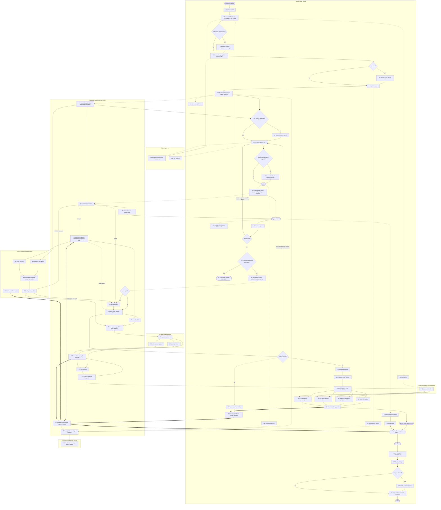

# First-frame wait: process model

This document describes the wait between a viewer's action and the first moving
frame as a set of atomic processes taken from the current code, with their
dependencies, parallelism and shared resources (torrent-tv/meta#185, plan step
3.3.4). It describes what the code does; it changes no formula. Read from
server `2645345` (0.50.32) and proxy `2ac8c25` (2.101.43).

A process here has one owner (host and thread), one start event, one end event
and one kind of work. Where the code combines several kinds of work in one call,
the call is one process and its parts are named; they are not split into
invented durations.

## 1. Events and clocks

1. `t0` — the original action. For a single-file `.torrent` (or a file the
   address names) it is the open action: `#processPlayback` takes
   `payload.startedAt` and dispatches `FILE_CHOSEN` with `originalOpen: true`
   (server `components/loading/loading.js`). For a multi-file torrent it is the
   file choice; the time spent choosing is not preparation. `waiting.js` logs
   it as `[wait-start] wait=<n> startedAt=<ms>`.
2. `t1`, `t2`, `t3`, `t4` — the browser's coarse marks in `#playVideoFile` and
   `#waitForPrebuffer`, logged together as `[evt] cold-start total= transport=
   plan= prepare= prebuffer=`. Section 6 states what each interval contains.
3. `tPlay` — the first `requestVideoFrameCallback` with `presentedFrames > 0`
   after the element's `playing` event (`components/player/player.js`,
   `[first-frame] wait=<n> elapsedMs=`), with `audioReady` read from the audio
   buffered ranges at that media time (`[first-frame-observation]`).
4. Browser times use `performance.now()` from `t0`. Proxy durations use the
   proxy's own clock. A browser time and a proxy time are never subtracted from
   each other.

## 2. Edge and resource notation

1. **Blocking** — the caller waits for this process to end before it
   continues. In the diagram (section 9) an arrow states completion order:
   the target cannot complete before the source has completed.
2. **Parallel start** — the caller starts the process and continues without
   waiting for it (`void …`, fire-and-forget).
3. **Gate** — a condition the browser reads by polling. Its release is seen at
   the next poll, so a gate adds the poll latency to the condition's own time.
4. **Shared resource** — processes that run at the same time but take service
   from one capacity (section 4). Their service is not additive.

## 3. Processes

### 3.1 Browser: action, connection, plan

| ID | Process | Starts after | Ends when | Edge | Measured now |
|---|---|---|---|---|---|
| A0 | Original action (`t0`) | viewer | `FILE_CHOSEN` dispatched | — | `[wait-start]` |
| A1 | Parse the `.torrent` in the page (`openParsedTorrentDetails`) | A0 | parsed object returned (synchronous) | blocking | no separate line |
| A2 | Connect to a proxy (`#acquireTransport` → `ProxySelector.chooseBestProxy`). Joins the connect `#connectEarly` started at page load; costs nothing when that connect has finished | A1 | `WebRtcProxy` adopted | blocking | `[ice]`, `[proxy-selector]` lines; no duration line |
| A2.1 | Ask the server which proxy (`POST /api/proxy-clients/choose`) | A2 | answer | blocking | no |
| A2.2 | Signalling WebSocket, SDP offer/answer relayed by the server, ICE checks, DTLS, SCTP, data channels open (`WebRtcProxy.connect`; limit 12 s public-only, 5 s same network, 30 s overall) | A2.1 | channel open | blocking | `[ice] … State=` lines |
| A2.3 | Liveness ping over the channel (`proxy.ping()`) | A2.2 | pong | blocking | `channelRttMs` in debug state only |
| A2.4 | Branch: public-only attempt failed → local-network permission (one viewer click) → A2.1–A2.3 again with private candidates | A2.2/A2.3 failure | second channel open | blocking | `public-only connect failed` line |
| A2.5 | Link probe (`measureLink`) | A2 | probe answers | parallel start | link samples |
| A3 | Ask for the proxy that holds this film (`#useProxyThatHoldsTheFilm`, `POST /choose` with the info hash); branch: move → close, A2 again | A2 | answer (and reconnect) | blocking | `proxy … is not the best for this film` |
| A4 | Register the source (`POST /api/sources`; cached per transport; the proxy only records it) | A3 | `sourceKey` | blocking | no |
| A5 | Early estimate (`GET /api/sources/:key/stats`, 1 s limit; single file only) | A4 | answer or abort | parallel start | `[wait-estimate]` on render |
| A6 | File list (`GET /api/sources/:key/files`, repeated every 2 s while pending); waits for P1 | A4 | statement of the files | blocking | no |
| A7 | Branch: more than one video and none addressed → playlist; the viewer's choice is a new `t0` | A6 | choice | — | `[wait-start]` |
| A8 | Warm-up registration (`#warmSourceInBackground`) | A6; again before A12 | registered | parallel start | `source … registered for viewer-owned preparation` |
| A9 | Filename capacity hint (`#preferProxyFromFilename`, `POST /api/proxy-clients/can-serve`, the server asks every proxy over its tunnel); branch: restrict the pool and close; the connect at A10 is then made within it | A6 or A7 | answer | blocking | `filename hints …` when it moves |
| A10 | `t1`: transport mark after `#acquireTransport` (normally the connection in hand); then `registerSourceOnProxy`, cached unless the proxy changed | A9 | mark | — | `cold-start transport=` |
| A11 | Source statistics poll, every 2 s while A12 runs | A10 | A12 ends | parallel start | no |
| A12 | Playback plan (`POST /api/playback-plan`, `waitForReady: true`); waits for P2–P3 | A10 | plan received (`t2`) | blocking | proxy `plan … torrent-ready= probe= total=` per attempt; browser `cold-start plan=` |
| A13 | Fingerprint, container metadata, sidecar soundtrack metadata requests | A12 | answers | parallel start | no |
| A14 | Report the opening subtitle track (`#startSubtitlesForVideo`) | A12 | report sent | parallel start; read by gate C1 | `prebuffer: … subtitle` lines |
| A15 | Codec support (`#predictCodecSupport`, MediaCapabilities) | A12 | verdict | blocking | `playback decision` debug line (end only) |
| A16 | Branch: `cannotServe` → `POST /can-serve` → `#playVideoFile` runs again from A9 on the proxies that answered | A15 | — | blocking | `proxy cannot serve this file` |
| A17 | Branch: HTTP transport → direct-play probe (`#tryPlayDirectUrl`); success leaves this model. The WebRTC transport skips it | A15 | probe result | blocking | debug line |

### 3.2 Browser: output and HLS loading

| ID | Process | Starts after | Ends when | Edge | Measured now |
|---|---|---|---|---|---|
| B1 | Open the output (`POST /api/transcode-sessions`); repeated after a "warming up" 500 with `min(3000, 500 + 250·n)` ms; 409 `no-capacity` → A16 path; waits for P6, and for P5 bytes through the route's own re-open on new bytes | A15 | session answer | blocking | `[evt] transcode-session create`; proxy `cold-start "<name>": … create-total=` |
| B2 | Net reporter (every 1.5 s) and session keep-alive started | B1 | session released | parallel start | net-report samples |
| B3 | Media playlist wait (`waitForHlsPlaylist`); the synthetic VOD playlist answers at once, otherwise retry with `min(3000, 500 + 250·n)` ms | B1 | playlist with `#EXTINF` | blocking | no |
| B4 | Restate a position changed during allocation (`reportSeek` loop) | B3 | position acknowledged | blocking (normally zero iterations) | `seek intent` |
| B5 | hls.js: master playlist (when variants exist), `MANIFEST_PARSED`, level pinned, `startLoad` | B4 | `startLoad` called | blocking | `[torrent-tv][hls] start-up: manifest requested/parsed` |
| B6 | Video init request, held by the proxy until P13 | B5 | init received | blocking for `t3` | `[net-debug] dc-load` (`waitMs`, `transferMs`) |
| B7 | Separate soundtrack: its playlist and init, held until P13 of the audio output | B5 | init received | parallel with B6; blocking for `t3` | `[net-debug] dc-load` |
| B8 | First video fragment request, held until P11 publishes it, then D1 | B5 | bytes received | parallel with B9 | `[net-debug] dc-load` |
| B9 | First audio fragment request (separate soundtrack) | B5 | bytes received | parallel with B8 | `[net-debug] dc-load` |
| B10 | SourceBuffer append (init, then fragments), per track | B6–B9 | `updateend` | blocking per buffer | not measured |
| B11 | `t3`: `readyState >= HAVE_METADATA` (`#ensureVideoReady`, no decoded frame required). Under Media Source this needs the init segment of every SourceBuffer. A progress poll runs every 1 s meanwhile | B10 (inits) | `loadedmetadata` | blocking | `cold-start prepare=` |

### 3.3 Browser: readiness gate and presentation

| ID | Process | Starts after | Ends when | Edge | Measured now |
|---|---|---|---|---|---|
| C1 | Prebuffer gate (`#waitForPrebuffer`): loop every 250 ms with the element paused; asks progress every 1.5 s, or at once after a net report when the buffer grew; releases when `playbackReadiness.version === 1 && ready === true` and the subtitle hold is clear (`t4`). A buffer standing still for 4 s restarts the loader at the buffered end | B11 | release | gate | `[evt] prebuffer waiting … reason=`, `prebuffer ready …`, `cold-start prebuffer=` |
| C2 | Net report delivered: buffered ranges per track, position, link samples | B2 / `reportNow` | proxy records the reading | input to P14 | net-report route |
| C3 | Subtitle hold (`subtitleStartHold`): a "ready" answer requested before the proxy knew the opening subtitle track is not taken | A14 | proxy states the track read | part of gate C1 | `prebuffer: this proxy does not state …` |
| C4 | Application state `OPENING → ADVANCING` on `PLAYBACK_READY` (`PAUSED` when the viewer stopped) | C1 | state published | blocking | `view=player shown state=` |
| C5 | `video.play()` → `playing`. Branch: autoplay refused → waits for a viewer gesture | C4 | `playing` | blocking | `[evt] player.play reason=state`, `player.play refused` |
| C6 | Frame callbacks until `presentedFrames > 0`; audio required at that media time | C5 | `tPlay` | blocking | `[first-frame]`, `[first-frame-observation] audioReady=` |

### 3.4 Proxy main thread

One Node.js event loop runs every route handler, the data-channel forwarding
(`transport/data-channel-handler.js`, through loopback HTTP), container reads,
the download map pass, the readiness forecast and encoder orchestration. Only
the torrent runs in a worker thread (`torrent/worker/client.js`); FFmpeg runs as
child processes. P9 and P10 are not used: that work is F1–F3 (section 3.5).

| ID | Process | Starts after | Ends when | Edge | Measured now |
|---|---|---|---|---|---|
| P1 | Torrent ready (`torrentPool.getTorrent`): add in the worker, metadata (in hand for a `.torrent`, from the swarm for a magnet), piece verification unless every file is already whole (`skipVerify`) | A6 or A12, whichever asks first | `ready` | blocking for A6, A12 | tracker lines; no ready duration line |
| P2 | Container declarations (`readDeclarations`, `declaredTracksOf`): strict reads of held bytes; missing bytes become demand; re-run on every storage change (`getReadyPlan` → `waitForPlan`) | P1 | codecs and duration known | blocking for A12 | `plan … probe=` |
| P3 | Plan completion: sidecar soundtrack headers (`buildInventory`), subtitle defaults, cache; the offer (`offeredHeights`, `cannotServe`) on the way out | P2 | plan answered | blocking for A12 | `plan … total=` |
| P4 | Download map pass (`DownloadMaps.resolvePlayback`, proxy `server.js`): on each change of demand, works out the source byte ranges of every unresolved segment of every watched output (`directSegmentInput` / `PacketIndex.inputFor`), records them in `SegmentInputTable`, publishes the priority map to the worker; yields between zones | demand change | pass ends | repeated; feeds W3 and P14 | per-minute pass totals only |
| P5 | Keyframe index (`KeyframeTables`), started during P2 (`warmKeyframeIndex`) and read from held bytes only; required only when the video is copied. When its bytes are missing, the output-open route waits for the next storage change and opens again (`waitForPlan` in `routes/api/transcode-sessions/post.js`) | P2 (warm), B1 → P6 | table answered | blocking for P6 (copy) | `keyframe index "<name>": … waited <ms>`, `cold-start … keyframes=` |
| P6 | Output open (`OutputOpening.open`): media info from the plan, file length, P5, cut grid and timeline, capacity admission (`admitsWatching`), viewer placed; the session is answered before any segment exists | B1 | output returned | blocking for B1 | `cold-start … media-info= create-total=` |
| P7 | Encoder plan (`planEncodersSoon` → microtask → `planEncodersNow` → `encodeOrchestrator.reconcile`) from the priority map per output and host capacity | P6, P4, seek | runs decided | blocking for P8 | partial: `restart for #… decided` only after a wanted segment |
| P8 | Run input (`EncodeInputs`): input ranges of the run's first segments, wait until those bytes are held (W5), memory admission, read/copy of held bytes | P7 | input admitted | blocking for F1 | not measured as one duration |
| P11 | Piece closure: FFmpeg names the closed piece on fd 3, completeness judged (`encode/piece-completeness.js`), published in `SegmentStore` | F2 / F3 | published | blocking for P12 | `cold-start <id>: first-segment ready +<ms>` (first one served) |
| P12 | Held request answered (`SegmentServing`), streamed through the data-channel handler into D1 | P11 | response sent | blocking for B6–B9 | `[net-debug] dc-load waitMs` on the browser |
| P13 | Init available: written by FFmpeg at run start, or, for outputs cut at given times (`cutsAtGivenTimes`), lifted from the first produced piece (`#initFromFirstSegment`) | F1 or P11 | init readable | blocking for B6/B7 | not measured |
| P14 | Readiness forecast on each progress request (`getSessionProgress` → `#playbackReadinessFor` → `predictPlaybackReadiness`): worker stats (W6), segment inputs from `SegmentInputTable`, rates, client ranges (C2) | progress request | answer | read by gate C1 | `readiness parts … in all <ms>`, `playback readiness {…}` on reason change, `playback held …` |
| P15 | Early estimate (`waitEstimateForFile` / `waitEstimateForSource` → `LocalObservations.firstFrameSeconds`) | A5, A6, A11, P14 | value or null | observer, blocks nothing | `[wait-estimate]` on render |

### 3.5 FFmpeg child processes (one per run; a separate soundtrack is a separate output)

| ID | Process | Starts after | Ends when | Edge | Measured now |
|---|---|---|---|---|---|
| F1 | Spawn and open the input over loopback HTTP (`/encode-input/:token/:fileIndex` or `/stream`) | P8 | first packet read | blocking | derived at run end: `encode input of run #a..#b on <key>: opened in <s>` |
| F2 | Encode or copy the first video piece up to its cut | F1 | piece closed | blocking for P11 | `… first piece named at <ms>` in the same line; per-piece speed readings |
| F3 | Same for the separate soundtrack output | its own F1 | piece closed | parallel with F2 | per-piece speed readings |

### 3.6 Torrent worker thread and swarm

| ID | Process | Starts after | Ends when | Edge | Measured now |
|---|---|---|---|---|---|
| W1 | Add and metadata (the worker half of P1) | P1 | `ready` | blocking for P1 | no |
| W2 | Trackers, DHT, peer connections, unchoke | W1 | peers serving | blocking for W4 | tracker update lines; first peer not logged |
| W3 | Piece selection from the published priority map (`SwarmSelection`) | P4 | selection applied | blocking for W4 | `download: first class …` |
| W4 | Piece download, one service per torrent | W2, W3 | piece received | shared resource R1 | rates in stats; no per-piece event |
| W5 | Verification and storage (shared memory, spill to disk); main thread told the held bytes changed | W4 | piece readable | blocking for P2, P5, P8, P4 | no per-piece event |
| W6 | File statistics and per-piece arrival forecast (`getFileStats`, `downloadForecast`) | stats request, P14 | answer | blocking for P14 | `[stats] getFileStatsMs=`, `readiness parts … arrival forecast` |

### 3.7 The viewer link

| ID | Process | Starts after | Ends when | Edge | Measured now |
|---|---|---|---|---|---|
| D1 | Transfer of a response from proxy to browser over the one SCTP association (control and media channels) | any response | last byte received | shared resource R5 | `[net-debug] dc-load transferMs` per HLS resource; link probe samples |

## 4. Shared resources

| ID | Resource | Processes that share it | Consequence |
|---|---|---|---|
| R1 | Download service of one torrent | W4 for every file and output of that torrent (picture, soundtrack, header reads, later segments) | Bytes are served once, in priority order; parallel demands queue on one service |
| R2 | Proxy main event loop | A-requests' handlers, P2–P8, P11–P15, data-channel forwarding | A long synchronous step delays every response. Measured: an `onSend`→`finish` gap of 33.875 s in field23 overlapped a 33.862 s map pass (research `wait-estimate-2026-10-19-ttv185.md`) |
| R3 | Processor cores | F2, F3 and other runs, R2, the worker | Measured per-piece speeds already include the sharing at the time they were taken |
| R4 | Encoder slots and the memory budget (`MachineBudget`, `EncodeInputs`) | P6 admission, P8 admission | A refusal or a wait for memory delays F1 |
| R5 | The viewer link | D1 for every response: segments of both tracks, init, playlists, progress answers, net reports (other direction), client logs, link probes | Transfers to one viewer are serial in time; the forecast models one link queue |
| R6 | Browser main thread | hls.js parsing and append, page code, frame callbacks | Not measured |
| R7 | Proxy disk | piece spill, segment files, original-input copies | Not measured as a separate service |

## 5. Branch points

1. Magnet instead of `.torrent`: P1 waits for the metadata from the swarm; A6
   repeats every 2 s meanwhile.
2. Connection already made by `#connectEarly`: A2 costs nothing; otherwise
   A2.1–A2.3 run, with A2.4 when the public-only attempt fails.
3. A better proxy holds the film (A3) or reports capacity for the filename
   (A9): the connection is replaced. After A3 the connect is made at once;
   after A9 it is made at A10, so it falls inside `transport`.
4. More than one video file: the wait restarts at the viewer's choice (A7).
5. `cannotServe` in the plan (A16) or `no-capacity` from B1: the pool is
   asked which proxies can serve the file, and `#playVideoFile` runs again
   from A9 on them; plan and output start from nothing on that proxy.
6. Transport: HTTP may play the file directly (A17), which leaves this model;
   the WebRTC data channel always takes the HLS path.
7. Video copied or encoded: copying needs the keyframe index (P5) before the
   output exists; encoding does not.
8. Soundtrack muxed into the picture or served separately: a separate
   soundtrack is a second output with its own P6–P13 and F3, B7, B9; the
   forecast then requires both tracks (`requiredAudio`).
9. Prepared output already on disk: P8–P11 cost nothing for the pieces that are
   published; B6–B9 are answered at once.
10. Source already whole on disk: W2–W5 cost nothing for its bytes; the
    forecast treats the source as `complete`.
11. Output cut at given times: the init appears only with the first piece
    (P13), which moves the first piece's production before `t3`.
12. The opening subtitle track: the gate also waits for the proxy to have read
    it (C3).
13. Autoplay refused: `tPlay` waits for a viewer gesture (C5).
14. Seek, soundtrack or quality change: section 8.

## 6. What the coarse intervals contain

| Interval | Single-file open | Multi-file choice |
|---|---|---|
| `transport = t1 − t0` | A1, A2 (when not finished early), A3, A4, A6 (waits for P1), A9, A2 again | A9, A2 (normally in hand) |
| `plan = t2 − t1` | A12: P1 (cached), P2 (header bytes: P4, W3–W5), P3, response over D1 | same |
| `prepare = t3 − t2` | A13–A15, B1 (P6, with P5 for a copy), B3–B5, B6/B7 waiting for P13 (P7, P8, F1, and for given-time cuts F2/F3 and P11), D1, B10 | same |
| `prebuffer = t4 − t3` | gate C1: the rest of first-piece production and delivery, the continuity forecast to the end of the film (P14, needing P4 inputs for every remaining segment of an incomplete source), net report and poll latency, C3 | same |
| `presentation = tPlay − t4` | C4, C5, C6 | same |

The name `transport` therefore covers the file list and the torrent's metadata
for a single-file open. When `#playVideoFile` runs again on another proxy
(branch 5), `#coldStart.t0` becomes the time of that run, while the overlay
and `[first-frame] elapsedMs` keep the original `t0`; `presentationMs`, logged
as `elapsedMs − totalMs`, then also contains the abandoned attempt. The
boundary between `prepare` and `prebuffer` moves with the output type (branch
11). Medians of these intervals taken over different files, transports and
output types describe different work.

## 7. What the current calculations cover

1. `LocalObservations.firstFrameSeconds` sums five medians of the intervals in
   section 6, taken from earlier waits on the same proxy configuration. It
   prices each interval as a whole; overlap and shared resources inside an
   interval are whatever they were in those earlier waits.
2. `predictPlaybackReadiness` schedules, per remaining segment in media order:
   the source bytes on the torrent's one service (R1; planned piece arrivals
   from W6 first, then the measured rate), the start of a new run and its open
   cost, per-track processing at the track's measured rate (tracks in parallel,
   each serial in itself; a segment's processing starts only when its whole
   input is held), and delivery on one link queue (R5), plus
   `appendSeconds` when supplied (`ViewerRequests` supplies none). The delay is
   the largest lateness of a production or delivery against the media already
   ahead of it, over the near window and the tail to the end of the film.
3. It returns no number (a reason instead) while an input is missing:
   `separate-audio-not-observed`, `timeline-unavailable`,
   `link-rate-unavailable`, `segment-size-unavailable`,
   `source-measurement-unavailable`, `source-input-ranges-unavailable` (P4 has
   not resolved a remaining segment of an incomplete source),
   `encode-rate-unavailable`, `download-rate-unavailable`,
   `service-not-advancing`; `media-continuity-unavailable` stops the start.
4. `firstRequiredSegmentsSeconds` is the delivery completion of the first
   segment not yet held, the latest over the required tracks. It ends at D1 of
   B8/B9. It does not contain: the rest of the continuity gate (the delay
   above), the poll and net-report latency of C1, C3, B10, C4–C6.
5. Not represented as separate terms in either calculation (the medians of
   item 1 contain them only inside whole intervals): A1–A17, B1–B5 and their
   retries, P5, P6, P7, the P4 pass time, the main-thread queue (R2), processor
   sharing between runs beyond what measured rates contain (R3), memory
   admission (R4), the init path (P13), append and decode (B10, R6), and C4–C6.

## 8. Seek, soundtrack and quality change

A seek starts with the element's `seeking` event or a control. The report is
debounced by 300 ms, then `#moveToPosition` resets the waiting model, takes the
seek hold, stops the loader, reports the position (`POST
/api/transcode-sessions/:id/seek` → `ViewerRequests.requestSeek`: the viewer is
moved, held requests are woken, `planEncodersSoon`), and restarts loading at
the position. The proxy side then repeats P4, P7, P8, F1–F3, P11, P12 for the
segments at the new position, unless they are already published. The hold
(`#holdSeekUntilReady`) asks for progress every 1.5 s, sooner when the forecast
names a shorter delay or the element reports `seeked`/`canplay`, and releases
on the same readiness answer as C1. The seek's `t0` is recorded by
`waiting.js` when the application state enters a waiting state; its alignment
with the viewer's action has not been traced in this document.

A soundtrack or quality change opens another output (`prepareAudioTrack`,
`prepareQualityVariant`) through the same P6–P13 processes and is held by the
player (`#holdForAudio`, `#cushionHeld`). These holds are not traced further
here.

## 9. Diagram

Edge meanings:

1. `X --> Y` — Y cannot complete before X completes.
2. `X -.-> Y` — X starts Y or states a demand to it and does not wait for it.
3. `X -.- Y` — X uses Y's service; no completion order is implied.
4. `X ==> Y` — X is an input of a gate that the browser reads by polling.

Diamonds are branch points. A branch to A9 is `#playVideoFile` run again on
another proxy: its plan and output start from nothing on that proxy. A loop
through W5 back to P2 or P5 is the event-driven re-read when new bytes become
held. Each node carries the ID from section 3; F1 runs once per output, so a
separate soundtrack has its own F1.

## 10. Limits of this model

1. Processes named "not measured" have no start and end event in the logs, so
   their share of a wait cannot be read from a field run today: A2.1–A2.3 as
   separate durations, A6, P1 by itself, P8, P13, B10, the first peer and each
   piece arrival (W2, W4, W5), the main-thread queue (R2) per response, and the
   browser main thread (R6).
2. P4, P2 and P5 are event-driven and repeat; the table names the pass that
   matters for the first frame, not every repetition.
3. The seek, soundtrack and quality branches (section 8) are described at
   process level only.
4. The direct-play path over HTTP (A17) and the web-seed path are outside this
   model.
5. The `HAVE_METADATA` condition of B11 is the Media Source specification's
   rule; how long hls.js takes to create its buffers and append the inits in
   this player is not measured.
6. Whether the keyframe index read (P5) states its missing bytes to the
   download map itself, or relies on the bytes P2 requested, is not traced.
7. Measurement defect found while tracing (not changed here): after a re-run
   of `#playVideoFile` on another proxy, `presentationMs` contains the
   abandoned attempt (section 6); the proxy records these stage values for the
   medians of section 7, item 1 (`routes/api/client-logs/post.js` →
   `noteFirstFrameObservation`).
8. The model states structure and order. It contains no durations and is not a
   forecast; the field magnitudes it cites come from the research notes of
   torrent-tv/meta#185.
