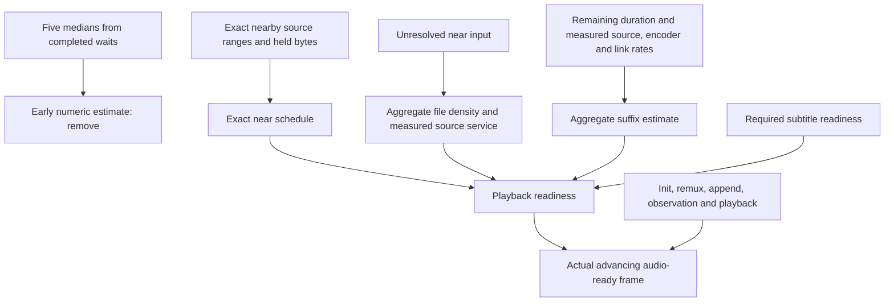

# Playback start forecast

## Product requirement and calculation scope

The goal is playback through the film without buffering interruptions. It does
not require scheduling every remaining segment before playback can start.
Precise calculation may be limited to upcoming playback, with a cheap
aggregate estimate of later work when useful. The horizon and detail must be
justified by measured playback reliability and computation cost. Resolving
exact distant source ranges or downloading the whole file is not a startup
requirement. The full-film scheduling described below records the audited
implementation, not a required architecture (owner clarification, 2026-10-25,
torrent-tv/meta#245).

## Audit scope and the calculation to retain

The atomic audit linked below records the earlier implementation and its
measurements. The current forecast follows the scope agreed in
torrent-tv/meta#245: use exact source ranges and segment timing near the viewer,
then estimate remaining source, processing and delivery work from aggregate
measurements. The goal is uninterrupted viewing; the forecast does not resolve
every future segment before playback starts.

The proxy still reports the first required segment estimate separately.
Readiness combines the exact near schedule with a duration-level suffix
estimate. Before enough source, encoder or link measurements exist, the result
states a specific noncomputable reason. Completed waits remain evaluation data,
not another ETA. The [atomic audit](https://github.com/torrent-tv/meta/blob/main/research/forecast-atomic-audit-2026-10-24-ttv185.md)
describes proxy `230cdb3` (2.107.6) and server `2a62d48` (0.66.6), before this
scope change.

## Current forecast

Processing readings retain the media produced (`workSeconds`) and active
processing time (`workingSeconds`). Their service rate is total media divided
by total active time, so splitting the same work into unequal pieces does not
change the rate. The observation's wall-clock span and descriptive rate means
remain separate quantities. Point-only legacy readings retain their previous
equal-work summary until measured work quantities are available.

Inside the configured look-ahead, the forecast uses exact segment boundaries,
mapped source ranges, held bytes, planned piece arrivals, measured encoding and
client delivery. If a nearby map entry is unresolved, it estimates the input
volume from selected-file length and duration, reduced by the held fraction.
That volume is charged at the measured torrent rate; the estimate never creates
a byte address or treats guessed bytes as present. A malformed exact map entry
remains an explicit refusal.

Past the look-ahead, the forecast does not visit each segment. For each
unfinished source file it estimates remaining bytes from file length, duration
and the fraction not already held or mapped. It estimates unfinished output
work from each track's remaining duration and measured encoding rate, and
delivery from output size per media second and measured link rate. Shared
source files and the client link are charged once. The suffix work scales with
the number of sources and tracks rather than the number of segments.

This suffix is an aggregate estimate. It predicts the effect of measured
sustained rates on the remaining duration, not the arrival time of each future
packet or frame. Exact near scheduling protects the upcoming work; the suffix
accounts for a source, encoder or link that cannot keep pace over time. New
exact ranges and measurements replace estimates on later polls.

Readiness is held by the greatest lateness from the exact near schedule or the
aggregate resource finish against the media already ahead of the viewer. Slow
service adds startup wait when prepared media cannot cover the estimated work.
Missing distant addresses alone do not make the forecast noncomputable.

The earlier audit's findings about run opening, service measurements and
overlap between input, encoding and delivery remain evaluation questions for
field measurements. They do not require scheduling every remaining segment.

Critical review: future rates can change, average byte density is an initial
mapping rather than an exact packet index, initial audio sample-work scaling
does not model every decoder's nonlinear cost, and client receive/append time
is not separately measured. These are approximation limits, not hidden weights.
Actual progress, segment sizes and link observations refine the prediction.
The client countdown uses elapsed local monotonic time; expiration cannot
authorize playback. Only the proxy's readiness and real track coverage can.

Zero service, missing media facts and a genuine timestamp gap remain explicit
noncomputable states. The UI reports their causes instead of an estimating
placeholder or a fabricated duration.

## Input capture contract — ttv-254

The proxy carries provenance beside forecast values. Capture intervals use the
owner's monotonic `performance.now()` clock and are interpreted only when the
owner epoch matches. Browser marks are serialized as
`performance.timeOrigin + performance.now()` so a browser can bound their age
through a later response on that same clock; proxy and worker marks remain
relative to `performance.now()`. A missing, malformed, superseded or cancelled
input stays unknown or invalid; calculation time never stands in for its
capture time.

| Input family | Owner and units | Capture interval and epoch | Action, generation and revision | Validity and unknown reason |
|---|---|---|---|---|
| Source | Torrent worker; byte ranges and arrival times in milliseconds on the proxy host | `sourceCapture.startedAt..completedAt` bounds file stats; `downloadForecast.capture.startedAt..completedAt` separately bounds arrival-range calculation. Rate histories retain each reading or their aggregate capture interval. All use the worker thread's `performance.timeOrigin` | The proxy adds the active wait action and viewer generation; worker revision advances for each snapshot | Valid only when the owner returns complete ordered intervals and current source facts. No source handle, failed stats, unavailable arrival forecast, old epoch or malformed interval stays unknown with a reason. |
| Link | Browser; raw delivery rate in Mbit/s, converted to byte/s for the forecast | `linkSampleStartedAtBrowser..linkSampleCompletedAtBrowser` bounds the transfer that produced the rate; the browser's `performance.timeOrigin` is `clockEpoch` | Link sample action and generation are retained when the transfer belongs to an active session; its revision advances only for a new transfer. The report separately carries its own reporter epoch, generation and increasing revision | Valid only when rate, sample interval, age and clock epoch agree. No transfer remains unknown; a newer invalid marked sample clears the prior forecast sample. |
| Encoder | Proxy encoder owner; media seconds per active second and processed media seconds | A measured speed reading carries its own monotonic capture interval; proxy process `performance.timeOrigin` is the epoch. Run progress carries its monotonic update point. A projected speed has no capture interval or epoch. | The proxy attaches `waitId`, viewer generation and the ordered measured-rate revision. A projection records its source (`stored-encode-prediction` or `current-cost-projection`) without inventing a revision. | Measured samples are valid only with complete ordered intervals in one epoch. A prediction may still seed the numeric rate trend, but its capture is `unknown` with reason `projected-encoder-speed-has-no-capture`; it contributes no age. Missing owner marks, reordered samples or mixed epochs remain unknown. |
| Browser buffer | Browser; seconds and media-time ranges | `captureStartedAtBrowser..captureCompletedAtBrowser` bounds the report's viewer and buffer reads; the browser page's `performance.timeOrigin` is the epoch | Browser reporter epoch, session id, seek generation and increasing report revision accompany the snapshot | Valid only for the active session and generation. Missing/invalid capture, an older/duplicate report, a seek-replaced generation or a cancelled output cannot supply fresh ranges. |

The progress response preserves each family's capture record and returns age
bounds for browser-owned facts on the browser clock and proxy-owned facts
through the same progress request's monotonic transport bounds. The bounds keep
the measured inbound/outbound asymmetry: no half-RTT assumption and no
cross-host clock subtraction. A fact whose epoch or capture marks cannot be
reconciled has an unknown age. These records do not enable numeric first-frame
ETA; that ETA remains unavailable.

A speed reading is the film between the ends of two published pieces (the run's
start for the first reading) over the run's own working time between the moments
the encoder named them closed; input waits and stops are not working time, and
`-progress` reports do not enter it (torrent-tv/meta#414). The run is told where
a piece ends on the output's timeline (`pieceEndSeconds`, given by `EncodeRuns`);
a piece whose end is unknown gives no reading. Each run logs its first reading
once (`encode-run #A..#B on <address>: first speed reading …`).

The encoder rate trend uses measured speed readings first. While none exists,
`predictedEncodeSpeedOf` supplies the output's stored encode prediction. At the
initial offer, `EncodeCost.notePredictionFor` uses the selected mode's startup
benchmark, the source decode model, already committed family work and machine
availability. A later encoder-mode switch can replace that value through
`EncodeCost.notePriceFor`.
`projectedEncodeSpeedOf` is the fallback: `EncodeCost.projectedSpeedOf` applies
the current output cost (measured run cost when available, otherwise the
startup encode or copy calibration), current contention and machine
availability. These values retain the numeric rate formula, but neither source
stores the interval, epoch or revision of a capture that produced the estimate.
The polling time therefore appears only in the trend calculation; it does not
become an encoder capture mark. A later measured reading replaces the projected
rate and carries its own original capture marks.

The forecast is answered on every progress poll of a waiting viewer, on the
proxy's main thread, so it avoids repeating work (torrent-tv/meta#178). A piece
already played that was never read and is not made is left out before anything
is converted: it is not scheduled, not where a track starts, places no unread
piece and lends no frame to what the page holds. The exact edges of a piece are
converted once and kept with it; the pieces an output hands over between polls
are the same objects while their edges, read ranges and torrent inputs stay the
same. The request hands the forecast the first piece and the pieces inside its
configured near window. The suffix estimate uses track and source totals; it
does not build a schedule for each later piece.

This forecast covers part of the viewer's wait. The whole wait, from the
viewer's action to the first moving frame, is described process by process,
with its dependencies and shared resources, in `first-frame-wait-model.md`.

## Continuity is decided in exact time

The forecast lives in the viewer component (`services/viewer/`), because what
it predicts is how the viewer's browser will play; the request operation
(`ViewerRequests`) is handed it by `wire-outputs.js`.

1. **The file states integers.** A piece's media is read as presentation
   intervals in the integer ticks of each track's timescale
   (`readPresentationRanges`, `services/encode/segment-formats/mp4-boxes.js`).
   Intervals are joined there only where they touch or overlap; the format
   states what the samples say and nothing about browsers.
2. **One function places a piece.** The position written into `tfdt` when a
   piece is served and the position its coverage is read at both come from
   `readTrackEdits`, which converts the movie-timescale edit into track ticks
   with one stated rounding. The reader and the writer cannot disagree.
3. **Seconds from the page are exact fractions.** A buffered range, a position
   or a cut time arrives as a JavaScript number, which is a binary fraction;
   `services/viewer/media-time.js` converts it to that fraction exactly. No unit
   is chosen. A buffered range is widened by `REPORTED_TIME_ERROR`, the bound of
   Chromium's three truncations to whole microseconds, so that it denotes every
   exact time the report can stand for.
4. **The join rule holds in every engine.** The Media Source specification
   leaves the threshold to the implementation, so a gap counts as joined only
   when Chromium, Gecko and WebKit all join it: twice the gap within the two
   ranges' longest frames since a keyframe (Gecko's fuzz), and the gap within
   2002/24000 s (WebKit's `timeFudgeFactor`). Chromium's own bound follows from
   the first. Old iOS without Media Source plays HLS in a closed player, and
   nothing is derived for it.

Seconds appear again only for rates, schedules and the answer.

## A piece is finished when its frames reach its cut

A closed non-final fragment is reusable only if the end of its last frame, on
every track, reaches its muxer's cut less `SEGMENT_CUT_TIME_DELTA_SECONDS`,
the delta the muxer is configured with. That is a fact of production, so no
browser frame allowance is used to decide completeness. For explicit cuts the
closure channel is CSV: its reference packet end has not lost the fraction of
a movie tick that MP4's empty edit loses. The first reference packet's time is
recovered from that end minus the first piece's exact sample span (the first
CSV start is zero even after a seek), and is added to the relative cut times
handed to FFmpeg. Comparisons use integer microseconds, as FFmpeg's segment
muxer does. A stored piece without this closure reading carries the upper
uncertainty of its empty edit, read from the movie and track timescales.

The last frame must still reach the cut on every track. No playable media, a
missing full frame, or a failed rename remains a publication failure. Such a
failure stops the run, records that cause and releases its claimed interval;
the existing repeated-start failure limit applies to subsequent attempts. A
refused file cannot stay claimed while the encoder finishes the whole film.

The encoding decides completeness
(`encode/piece-completeness.js`): `EncodeRuns` judges a closed file before it is
published, and judges a stored piece left by an earlier process when the
forecast asks for it, taking a short one off the disk. The segment store keeps
the bytes and the media intervals read from them and judges nothing. Interrupted
fragments are therefore never served or counted, so the production schedule
treats their media as unfinished work. The final fragment uses its actual media
end rather than the container's approximate duration.
