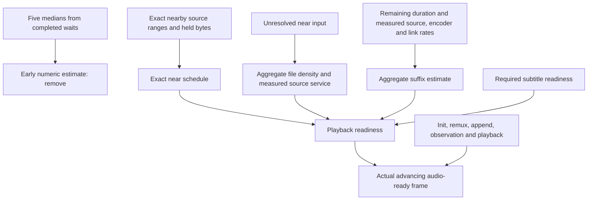

# Playback start forecast

## Product requirement and calculation scope

The goal is playback through the film without buffering interruptions. It does
not require scheduling every remaining segment before playback can start.
Precise calculation may be limited to upcoming playback, with a cheap
aggregate estimate of later work when useful. The horizon and detail must be
justified by measured playback reliability and computation cost. Resolving
exact distant source ranges or downloading the whole file is not a startup
requirement. The full-film scheduling described below records the audited
implementation, not a required architecture (owner clarification, 2026-10-25,
torrent-tv/meta#245).

## Audit scope and the calculation to retain

The atomic audit linked below records the earlier implementation and its
measurements. The current forecast follows the scope agreed in
torrent-tv/meta#245: use exact source ranges and segment timing near the viewer,
then estimate remaining source, processing and delivery work from aggregate
measurements. The goal is uninterrupted viewing; the forecast does not resolve
every future segment before playback starts.

The proxy still reports the first required segment estimate separately.
Readiness combines the exact near schedule with a duration-level suffix
estimate. Before enough source, encoder or link measurements exist, the result
states a specific noncomputable reason. Completed waits remain evaluation data,
not another ETA. The [atomic audit](https://github.com/torrent-tv/meta/blob/main/research/forecast-atomic-audit-2026-10-24-ttv185.md)
describes proxy `230cdb3` (2.107.6) and server `2a62d48` (0.66.6), before this
scope change.

## Current forecast

Inside the configured look-ahead, the forecast uses exact segment boundaries,
mapped source ranges, held bytes, planned piece arrivals, measured encoding and
client delivery. If a nearby map entry is unresolved, it estimates the input
volume from selected-file length and duration, reduced by the held fraction.
That volume is charged at the measured torrent rate; the estimate never creates
a byte address or treats guessed bytes as present. A malformed exact map entry
remains an explicit refusal.

Past the look-ahead, the forecast does not visit each segment. For each
unfinished source file it estimates remaining bytes from file length, duration
and the fraction not already held or mapped. It estimates unfinished output
work from each track's remaining duration and measured encoding rate, and
delivery from output size per media second and measured link rate. Shared
source files and the client link are charged once. The suffix work scales with
the number of sources and tracks rather than the number of segments.

This suffix is an aggregate estimate. It predicts the effect of measured
sustained rates on the remaining duration, not the arrival time of each future
packet or frame. Exact near scheduling protects the upcoming work; the suffix
accounts for a source, encoder or link that cannot keep pace over time. New
exact ranges and measurements replace estimates on later polls.

Readiness is held by the greatest lateness from the exact near schedule or the
aggregate resource finish against the media already ahead of the viewer. Slow
service adds startup wait when prepared media cannot cover the estimated work.
Missing distant addresses alone do not make the forecast noncomputable.

The earlier audit's findings about run opening, service measurements and
overlap between input, encoding and delivery remain evaluation questions for
field measurements. They do not require scheduling every remaining segment.

Critical review: future rates can change, average byte density is an initial
mapping rather than an exact packet index, initial audio sample-work scaling
does not model every decoder's nonlinear cost, and client receive/append time
is not separately measured. These are approximation limits, not hidden weights.
Actual progress, segment sizes and link observations refine the prediction.
The client countdown uses elapsed local monotonic time; expiration cannot
authorize playback. Only the proxy's readiness and real track coverage can.

Zero service, missing media facts and a genuine timestamp gap remain explicit
noncomputable states. The UI reports their causes instead of an estimating
placeholder or a fabricated duration.

The forecast is answered on every progress poll of a waiting viewer, on the
proxy's main thread, so it avoids repeating work (torrent-tv/meta#178). A piece
already played that was never read and is not made is left out before anything
is converted: it is not scheduled, not where a track starts, places no unread
piece and lends no frame to what the page holds. The exact edges of a piece are
converted once and kept with it; the pieces an output hands over between polls
are the same objects while their edges, read ranges and torrent inputs stay the
same. The request hands the forecast the first piece and the pieces inside its
configured near window. The suffix estimate uses track and source totals; it
does not build a schedule for each later piece.

This forecast covers part of the viewer's wait. The whole wait, from the
viewer's action to the first moving frame, is described process by process,
with its dependencies and shared resources, in `first-frame-wait-model.md`.

## Continuity is decided in exact time

The forecast lives in the viewer component (`services/viewer/`), because what
it predicts is how the viewer's browser will play; the request operation
(`ViewerRequests`) is handed it by `wire-outputs.js`.

1. **The file states integers.** A piece's media is read as presentation
   intervals in the integer ticks of each track's timescale
   (`readPresentationRanges`, `services/encode/segment-formats/mp4-boxes.js`).
   Intervals are joined there only where they touch or overlap; the format
   states what the samples say and nothing about browsers.
2. **One function places a piece.** The position written into `tfdt` when a
   piece is served and the position its coverage is read at both come from
   `readTrackEdits`, which converts the movie-timescale edit into track ticks
   with one stated rounding. The reader and the writer cannot disagree.
3. **Seconds from the page are exact fractions.** A buffered range, a position
   or a cut time arrives as a JavaScript number, which is a binary fraction;
   `services/viewer/media-time.js` converts it to that fraction exactly. No unit
   is chosen. A buffered range is widened by `REPORTED_TIME_ERROR`, the bound of
   Chromium's three truncations to whole microseconds, so that it denotes every
   exact time the report can stand for.
4. **The join rule holds in every engine.** The Media Source specification
   leaves the threshold to the implementation, so a gap counts as joined only
   when Chromium, Gecko and WebKit all join it: twice the gap within the two
   ranges' longest frames since a keyframe (Gecko's fuzz), and the gap within
   2002/24000 s (WebKit's `timeFudgeFactor`). Chromium's own bound follows from
   the first. Old iOS without Media Source plays HLS in a closed player, and
   nothing is derived for it.

Seconds appear again only for rates, schedules and the answer.

## A piece is finished when its frames reach its cut

A closed non-final fragment is reusable only if the end of its last frame, on
every track, reaches its muxer's cut less `SEGMENT_CUT_TIME_DELTA_SECONDS`,
the delta the muxer is configured with. That is a fact of production, so no
browser frame allowance is used to decide completeness. For explicit cuts the
closure channel is CSV: its reference packet end has not lost the fraction of
a movie tick that MP4's empty edit loses. The first reference packet's time is
recovered from that end minus the first piece's exact sample span (the first
CSV start is zero even after a seek), and is added to the relative cut times
handed to FFmpeg. Comparisons use integer microseconds, as FFmpeg's segment
muxer does. A stored piece without this closure reading carries the upper
uncertainty of its empty edit, read from the movie and track timescales.

The last frame must still reach the cut on every track. No playable media, a
missing full frame, or a failed rename remains a publication failure. Such a
failure stops the run, records that cause and releases its claimed interval;
the existing repeated-start failure limit applies to subsequent attempts. A
refused file cannot stay claimed while the encoder finishes the whole film.

The encoding decides completeness
(`encode/piece-completeness.js`): `EncodeRuns` judges a closed file before it is
published, and judges a stored piece left by an earlier process when the
forecast asks for it, taking a short one off the disk. The segment store keeps
the bytes and the media intervals read from them and judges nothing. Interrupted
fragments are therefore never served or counted, so the production schedule
treats their media as unfinished work. The final fragment uses its actual media
end rather than the container's approximate duration.
